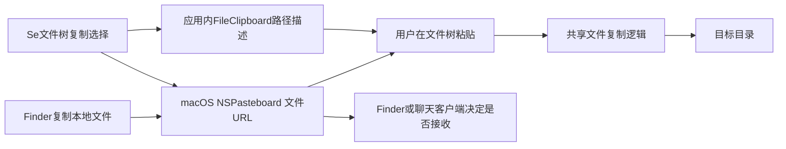

## 结论

**可以实现，而且当前 Se 的 macOS 桌面版已经有真实文件剪贴板的核心接线，并不是只有“复制路径”。** 本轮应优先验收现有 Finder 双向复制、跨项目切换和聊天客户端兼容性，再补可靠性及其他平台，而不是从零新增一套功能。

研究范围是用户 2026-10-28 17:31 +08:00 提出的三个场景：系统复制本地文件后粘贴进文件树、项目 A 文件树复制后粘贴到项目 B、文件树复制后粘贴到访达/飞书/微信。**仅研究，没有读写实际系统剪贴板、操作聊天应用、上传文件、改变产品代码或主进程。** 下文“已实现”指源码与接线存在，不等于此次实机兼容验收已通过。

### 当前能力矩阵

| 场景 | macOS Tauri 本地项目 | Windows/Linux 桌面 | 浏览器/手机与远程 host |
| --- | --- | --- | --- |
| Finder/系统文件管理器复制文件 → 文件树粘贴 | 已实现原生文件 URL 读取及文件复制，待实机验收 | 缺原生文件列表剪贴板适配 | 未发现文件树 ClipboardEvent/FileList 上传接线，不能读取任意本地路径 |
| 同一树/多根树之间复制粘贴 | 已有应用内路径描述和复制服务 | 同一应用内剪贴板存活时有基础复制能力 | 同 host 也受现有文件操作授权限制，不是普遍开放 |
| 项目 A → 切换项目 B → 粘贴 | 代码可通过系统剪贴板延续；应用内剪贴板会被清空，需要专门回归和失败反馈 | 切项目后应用内状态清空，又没有原生文件剪贴板兜底 | 不应简单保留裸路径，必须绑定来源 host/项目和授权 |
| 文件树复制 → Finder 粘贴 | 已写入标准原生文件 URL，平台机制匹配；本轮未实测 | 未实现相应原生格式 | 浏览器不保证能写通用原生文件列表，应该提供下载 |
| 文件树复制 → 飞书/微信形成附件 | 已有标准文件 URL 输出，但具体客户端接受行为未验证 | 未实现原生文件列表桥接 | 不能把网页 ClipboardItem 或复制下载链接等同原生文件附件 |
| SSH/远程文件 → 本机外部应用 | 已知远程视图有单文件下载，不等于剪贴板互通 | 同样需要先获得本地文件 | 需授权传输至客户端，不能把服务器路径直接写成本机 file URL |

### 现有数据流

- 文件树 `copySelected` 同时记录应用内选择并调用 `writePasteboardFilePaths`。
- Rust 使用 `NSURL::fileURLWithPath` 和 `NSPasteboard.writeObjects`，不是把路径拼成普通文本。
- 粘贴时读取系统文件 URL 与 `changeCount`。当其他应用更新剪贴板且有文件条目时，优先使用新的系统文件选择，而不是旧的应用内复制项。
- 右键打开文件菜单时会检查系统剪贴板来决定是否启用“粘贴”，没有为这项能力引入背景内容轮询。
- “复制路径”是另一条 `clipboardApi.writeText` 命令。用户需要真实文件互通时应使用文件树“复制”/Cmd+C，而不是“复制路径”。
- 剪切当前只保存在应用内，未导出为 Finder/聊天客户端的删除源文件协议。研究建议继续先保证 copy，不将 cut/move 与附件复制混在一起。

## 证据

### 当前仓库实际接线

| 文件 | 事实 |
| --- | --- |
| `src/renderer/lib/file-pasteboard.ts:11–39` | 只有 `isMac && isTauriContext()` 启用；系统写入返回 changeCount，失败返回 null |
| `src-tauri/src/file_pasteboard.rs:31–65` | 写多项 NSURL 文件 URL；读文件 URL，并将 Finder file-reference URL 解析为实际路径 |
| `src-tauri/src/file_pasteboard.rs:76–114` | 三个 Tauri 文件剪贴板命令；非 macOS 分支写入报不支持、读取为空 |
| `src/renderer/stores/file-explorer-store.ts:756–807` | 应用内 copy 与原生镜像、剪切 stamp、系统优先级、目标目录及 copyEntries 调用 |
| `src/renderer/stores/file-explorer-store.ts:372–439` | `setRootPath` 和 `setRoots` 清空应用内 clipboard，解释跨项目对系统剪贴板的依赖 |
| `src/renderer/components/file-explorer/FileExplorer.tsx:433–449` | 用户右键动作时读取系统文件列表，更新菜单可用性 |
| `src/renderer/components/file-explorer/FileExplorer.tsx:854–860` | “复制路径”走纯文本，不能与真实文件复制混同 |
| `src-tauri/src/fs_copy.rs:15–93` | 目录目标检查、自包含复制拒绝、同名后缀、递归目录及文件复制 |
| `src-tauri/src/fs_copy.rs:96–108` | 符号链接按链接复制，不跟随复制其目标树 |
| `src-tauri/src/web/fs_api.rs:873–900` | `/fs/copy-into` 调共享复制服务，但受 `check_local_only` 限制，不能直接为远程上传放开 |
| `src/renderer/components/ssh/RemoteFileExplorer.tsx:98–132` | 已有单文件下载流程，不等于远程剪贴板 |

相关原生桥接由既有提交 `0d6ec445` 引入。父会话确认 `file_pasteboard.rs`、`file-pasteboard.ts`、`fs_copy.rs` 与 `v0.15.24` 的相关内容无差异，不能将其说成本轮新增功能。未核验用户当前运行二进制的完整部署对应关系，因此不宣称当前安装版本已经通过这些场景的行为验收。

已有测试源码包括：

- `src/renderer/stores/file-explorer-store.test.ts:807–928`：复制镜像至系统剪贴板、外部复制后优先使用新条目、复制/剪切/拖入路径等 mocked 回归。
- `src-tauri/src/file_pasteboard.rs:118–151`：使用私有 pasteboard 的原生读写测试，不是用户 general pasteboard。
- `src-tauri/src/fs_copy.rs:137–264`：普通同名、目录、符号链接、自己复制到自己内部、非法目标等测试。
- 本次未运行上述测试，未找到真实 Finder/飞书/微信及跨项目切换的完整端到端兼容证明。

### 平台文档

1. [Apple：Pasteboard 写入](https://developer.apple.com/library/archive/documentation/Cocoa/Conceptual/PasteboardGuide106/Articles/pbCopying.html) 与 [读取](https://developer.apple.com/library/archive/documentation/Cocoa/Conceptual/PasteboardGuide106/Articles/pbReading.html)：NSURL 文件对象、多个条目及只读取文件 URL 的能力。
2. [Apple：NSFilenamesPboardType](https://developer.apple.com/documentation/appkit/nsfilenamespboardtype)：旧文件名数组接口已弃用，应使用现代文件 URL 方式。引用不等于字节快照，不能将旧接口限制套用到现代多对象写入。
3. [Tauri clipboard-manager JS](https://v2.tauri.app/reference/javascript/clipboard-manager) 与 [Rust API](https://docs.rs/tauri-plugin-clipboard-manager/latest/tauri_plugin_clipboard_manager/struct.Clipboard.html)：官方插件未公开文件列表读写，Se 的自定义 AppKit 桥接有必要；图片写入不是复制任意文件附件。
4. [Microsoft Shell Clipboard Formats](https://learn.microsoft.com/en-us/windows/win32/shell/clipboard)：现有文件用 CF_HDROP，虚拟内容用 FILEDESCRIPTOR/FILECONTENTS，两者不是同一实现。
5. [IANA text/uri-list](https://www.iana.org/assignments/media-types/text/uri-list) 与 [GTK FileList](https://docs.gtk.org/gdk4/struct.FileList.html)：Linux 可提供文件 URI/文件列表，但不同文件管理器、X11/Wayland 与 cut/copy 约定仍需兼容验证。
6. [MDN DataTransfer.files](https://developer.mozilla.org/en-US/docs/Web/API/DataTransfer/files)：浏览器在用户 paste 事件中可取得实际暴露的 File，不保证每次 OS 文件复制都有可用 File 或完整目录树。
7. [W3C Clipboard API](https://www.w3.org/TR/clipboard-apis/) 与 [Chrome web custom formats](https://developer.chrome.com/blog/web-custom-formats-for-the-async-clipboard-api)：任意 MIME/Blob 或 web 自定义格式并不保证被原生应用识别为文件列表；不能把普通路径文本偷偷转成可访问本地文件。规范草案不是浏览器已部署能力的完整承诺。
8. [RFC 8089](https://www.rfc-editor.org/rfc/rfc8089.txt)：`file:///...` 按解释它的本机文件系统理解，远程 host 路径不能冒充客户端本地文件。

### 应优先补齐的可靠性问题

**P0，同机 macOS 现有能力验收与反馈：**

- 多文件、文件夹、中文/空格路径、复制后源被移动/删除、系统权限拒绝及系统剪贴板被其他应用更新。
- 项目 A 复制后切换 B 的正常路径，以及原生写入失败时的清晰反馈。应用内复制描述应与树 UI 重建解耦，但必须附带来源 host/项目/实例，不能仅删除清空语句后长期信任裸路径。
- Finder 双向成功不等于飞书/微信也成功。逐个客户端和版本验证是否形成真正附件，区分普通文件、图片内容、聊天消息、链接、未下载附件、目录和多选。

**P0，复制安全性补强：** 当前源码通过“检查目标名称是否存在→追加 copy 后缀”避免通常的同名覆盖，但随后使用 `std::fs::copy`，并非原子排他创建。因此不能把注释中的“永不覆盖”推广成并发竞争下的保证。递归复制失败也未见完整事务回滚，可能留下部分输出。该判断是源码层面的待加固风险，本轮没有复现数据覆盖或改动文件。后续应在隔离测试中补原子目标占用、并发同名、取消、部分失败、权限与磁盘空间用例。

**P1，Windows/Linux：** 保留统一 renderer facade，增加原生文件列表读写适配，分别验证文件管理器和聊天客户端；不把路径文本或图片数据当文件附件。

**P1/P2，浏览器和远程：**

- 输入是“浏览器实际给出的 File → 授权上传到目标 host/项目”，不是让服务器复制用户本机绝对路径。
- 输出优先提供明确下载。有原生桌面客户端时，远程字节先下载到受控本地暂存区，完成后再在用户明确动作下写本地文件 URL。
- staging 需要大小/配额、进度、取消和生命周期设计。外部应用可能延迟读取，不能在切换项目、IPC 返回或剪贴板 changeCount 改变时立即删除文件。
- 不为支持手机/远端粘贴而直接去掉旧 `/fs/copy-into` 的 LocalOperator 限制。需要项目范围授权的上传/下载协议，明确源/目标机器与外发确认。

## 未决

- 飞书/微信对标准 macOS 文件 URL 的实际接受程度、目录/多文件/格式限制没有足够官方通用契约，本次也未实测。不能承诺全部互通，也不能因没有找到文档而断言不支持。
- 新版系统剪贴板隐私提示、React→Rust 异步调用是否被识别为用户粘贴、文件沙箱权限仍需在目标系统验证。
- 复制文件 URL 通常是保存引用，不是锁定复制时的字节；是否要求快照语义须单独定义。
- 浏览器/手机/SSH 的不同文件树视图还需按具体入口补验收，尤其不能把服务端剪贴板当作用户设备剪贴板。
- 推荐先验证同机 macOS 已有三条用户路径，再决定小范围修复和其他平台增量。后续实机测试应使用非敏感临时样本，不发送聊天消息、不覆盖系统剪贴板原内容而不告知用户。
- 当前用户要求为“先调研”，本报告不是实现、权限调整、自动上传或安装发布的授权。
