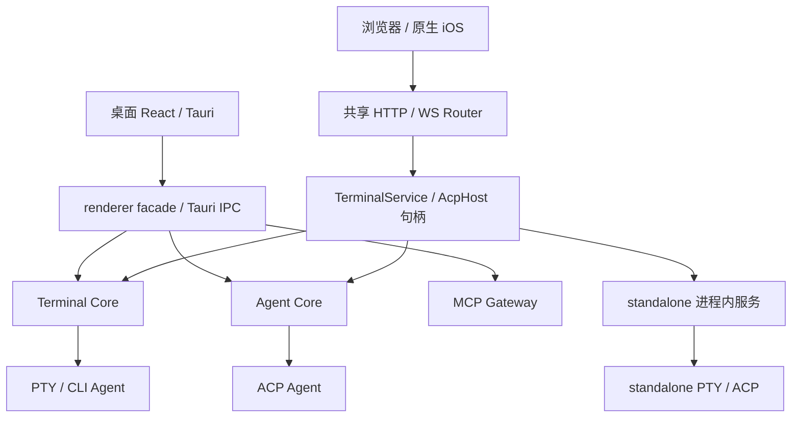

## 结论

**有值得借鉴的内容，但不建议把 herdr 当作 Se 的替代底座。最有价值的是“让 Agent 状态可信、可等待、可编程”的控制契约，而不是再做一次多终端或 daemon。**

Se Manager 已是多端项目工作台，herdr 则更聚焦 CLI Agent 的终端运行时。建议保留 Se 的 Conversation、Core 分离、Tauri/web 门面和原生 iOS 架构，吸收 herdr 的状态机、身份固定的 wait、事件丢失恢复、schema 完整性与性能守卫。

### 两个会改变优先级的事实

1. **我们已经参考过 herdr。** `src/renderer/lib/agents/agent-terminal-state.ts:15-19` 说明检测字符串与 herdr 的公开 manifests 交叉核对后重新表达，未复制其实现。后续应借鉴状态稳定性和维护方法，而非重复引入同一份匹配词。
2. **我们已有 Core 分离设计，Unix 桌面路径已有独立 session。** `src-tauri/src/core/launcher.rs:92-115` 将 Unix Core 脱离 GUI session，支持后续 GUI adopt。`lib.rs:2819-2833` 的 WebView 崩溃恢复仅在 macOS 编译。非 Unix detach 实现为 no-op，不能仅据这两处就证明 Windows/Linux 的所有退出、升级、adopt 行为。因此不应建议从零改 daemon，也不能宣称跨平台存活已实测通过。

### 本次理解的当前项目

| 层次 | 已有结构与能力 | 关键边界 |
|---|---|---|
| 产品聚合 | Conversation 是 Se 自有身份，ACP session 是可替换绑定。backend 为 agent/terminal，执行目标为 workspace/project_root/worktree | 项目归因、工作目录、执行目标、PTY 所有权不能混为一谈 |
| 桌面 UI | Tauri 2 + React 18 + TypeScript，终端、会话、编辑器、文件、Git、内嵌浏览器和布局 | TauriApp 与 App 共用 portable 路由，根部挂载仍需保持一致 |
| 运行时 | Rust，共享服务句柄，桌面侧 Terminal Core、Agent Core、MCP Gateway 分离 | GUI、Core、PTY 是不同生命周期，平台存活行为仍需分别验证 |
| 远程 | desktop shared-live 与 standalone se-server 复用 Router，浏览器/iOS 通过 HTTP/WS 接入 | standalone 用 in-process 服务，退出时 drain/终止所持资源，不等同桌面独立 Core |
| Agent | ACP 结构化对话，以及原生 CLI/PTY 两条执行路径。已有计划、权限、恢复和状态提示 | CLI 状态中的屏幕证据依赖 renderer 的 xterm，不是完整宿主权威状态 |
| 扩展能力 | Skills Hub、MCP、memory index、定时任务、worktree、工作区快照 | 已有接线，不应因没有与 herdr 相同菜单就判定缺失 |
| 移动端 | 原生 SwiftUI companion，独立 Swift 网络与数据模型，非 WebView | 新协议要同时验证 Rust、TS、Swift，不止两个 React root |
| 工程保障 | 前端类型/单测与语义守卫、Rust 检查、跨端台账、迁移 journal/recovery | 台账和源码契约不等于全部平台端到端行为都已通过 |



句柄的两类后端是部署选择，不是每次请求同时调用两套服务。图表示逻辑装配，不是跨平台进程存活的实测证明。

### 借鉴优先级

S/M/L 只表示相对改造范围，不是排期承诺。P0 表示“若决定投入，这批最值得先做”，不是已确认的线上紧急缺陷。

| 优先级 | 候选机制 | 分类 | 收益 / 工作量 | 实际增量 |
|---|---|---|---|---|
| P0 | 宿主权威 Agent 状态 + pending-idle 防抖 | 改造借鉴 | 高 / M-L | 未打开终端、renderer 重启、多端观察的状态一致性 |
| P0 | identity + 可选新状态序号门槛的 wait / prompt+wait | 改造借鉴 | 高 / M | 从“看见 idle”到可靠等待，并区分当前命中与下一次变化 |
| P0 | Agent 订阅 cursor / events_lost / snapshot | 改造借鉴 | 高 / M | 将现有 PTY seq 恢复经验推广到 Agent 控制面 |
| P1 | typed schema → operation catalog / CLI 帮助 / 能力声明 | 借鉴方法 | 中高 / M | 减少 Rust/TS/Swift/文档漂移，明确可发现控制面 |
| P1 | 热路径架构守卫 + 多终端规模性能基线 | 借鉴方法 | 中高 / S-M | 防止识别和 UI 成本随 Agent 数量失控 |
| P1 | worktree canonical operation key + 完成/失败统一回收 | 对照增强 | 中 / M | 补并发和竞态验证，不重做 Git worktree |
| P1-P2 | 多主机目录、统一 Agent 列表、独立重连 | 选择性借鉴 | 视场景 / L | 从连接远程到管理多台执行宿主 |
| P2 | 恢复等级契约、可选磁盘历史 | 选择性借鉴 | 中 / M-L | 区分活体重连、历史回放、新进程 resume |

### 1. 状态检测：从规则集合升级为宿主状态机

**我们已有：** OSC title 优先、屏幕 blocker 次之、unknown 与 idle 区分。600ms 采样按输出变化门控，并有两次尾随扫描。不是没有检测，也不是无差别轮询每个终端。

**可增加：** herdr 对 working → 没有明确空闲信号的 idle 先进入 pending confirmation，对明确 blocker、Agent 替换和进程退出走不同路径。值得借鉴的是过程状态机，不是直接套用其 100ms/700ms 等常数。

建议共享 Rust 服务提供带运行实例身份、状态序号、证据来源和时间戳的状态投影。ACP 优先使用结构化事件，CLI 使用可用的进程/title/hook/屏幕证据。没有屏幕证据时保持 unknown，不能把没输出当完成。

迁移屏幕识别到宿主需要可靠的终端屏幕状态，不能只截取原始 ANSI 字节流，也不应因此直接引入整个 herdr/Ghostty 栈。

**最小实验：** 未打开过终端页时出现权限提示、输出暂歇后继续工作、进程退出、同终端启动第二个 Agent。桌面/web/iOS 对同一运行实例应观察到一致状态，旧实例事件不能覆盖新实例。

### 2. 控制面：可靠 wait 比再增加状态灯更有价值

herdr wait 固定解析后的 terminal occupant。`after_state_change_seq` 是**可选**门槛：提供 baseline 时要求 `state_change_seq` 严格更大，未提供时保留当前条件已满足即可返回的语义。prompt 可携带 wait，避免先发送再订阅的竞态。

Se 可以在现有共享 Rust 服务之上定义稳定的 list/get/observe/prompt/wait 语义。HTTP、Tauri、未来 CLI/MCP 只是 transport 或投影，不另建一套进程管理器。特别要区分等待下一次停下和当前已满足就返回。

**最小实验：** 发送前旧状态已是 idle、发送后 Agent 立刻返回、等待期间 Agent 被替换、prompt 未消费、超时/退出。应返回可区分结果，不能将阻塞、退出或 idle 一律当任务成功，更不能自动同意权限请求。

### 3. 订阅：事件通知变化，snapshot 恢复真相

herdr retained event history 落后时显式返回 `events_lost`，提示重新订阅并使用 `session.snapshot` 对齐。

Se 的 PTY 已有 claim、seq、水位和 replay，不应再造终端恢复机制。实际增量是为 Agent 状态和跨端列表建立 cursor、运行代次、历史缺口与 snapshot reconcile 契约。

**最小实验：** 断线超过历史窗口后必须明确识别缺口并读取权威快照。两个客户端之一很慢时，健康客户端不应一起被拖住。

### 4. schema 与回归方法

herdr operation catalog 测试把 wire method、序列化名称、UI 影响、client-shell 能力目录逐项对应。可借鉴成 Se 的协议完整性守卫，再逐步导出 schema/客户端类型和可发现能力，不必第一步重写全部现有类型。

Swift `ConversationExecutionTarget` 当前是手写可选字段模型，TS 是显式 union。这是共享 JSON 样例、兼容解码测试或代码生成的具体切入口，不代表 Swift 子集本身就是 bug。

另建议借鉴禁止渲染热路径昂贵查询的架构守卫，以及 hidden/visible、多 Agent 的候选版本对基线实验。有此类脚本不等于 herdr 性能已被本次实测证明更好。

### 5. worktree：补操作契约，不重做已有能力

我们已有 project/worktree/terminal 关联及创建 worktree 后切换 launchCwd 的流程。herdr 的参考增量是 canonical checkout key 防同路径并发、open 前重验 repo/checkout 身份，以及 worker 启动失败也进入统一 completion 清理。

将这些作为本地 worktree 服务的审查清单。不要直接照搬禁止 linked worktree 作为来源等限制，因为 Se 的产品规则可能不同。

**最小实验：** 同一路径同时创建和删除、检索后目录被替换、worker 无法启动。不应永久 pending、错误归属或误删仍有活跃终端的目录。

### 6. 生命周期、多机和背压的取舍

- Se 已有 Core 分离方向，需评估的是 standalone 是否要求升级入口服务不停止任务，而非先判其生命周期边界是 bug。Windows/Linux 存活与 adopt 仍需专项验证。
- 机器或 PTY 宿主重启后，原进程不会凭快照复活。herdr README 已明确说明。Se 也应分别呈现仍活着并重连、仅恢复显示历史、新进程恢复 Agent 对话。
- herdr 有多机器目录和聚合 Agent 视图的产品方向。Se 已有 SSH/共享远程，不等于已有多宿主统一控制面。可作为重度多机用户的演进方向，不必立即修改 ExecutionTarget union。
- herdr 将可靠控制与可丢弃渲染分 lane，渲染队列容量为 1。**不能将其直接套在 Se 原始 PTY 字节流上。** 丢 ANSI 增量会破坏终端状态，必须保序、背压或经明确缺口和可恢复快照重同步。可合并的是可替代的完整状态/渲染更新，不是任意输出块。

### 暂不借鉴

1. **不整体移植 TUI、Ratatui 或 Ghostty VT 替换 xterm.js。** 终端模拟、TUI 合成和浏览器渲染不是同一层。Ghostty binding 带 Zig 0.16.0 构建链，需单独兼容性和性能论证。
2. **不重做 daemon、多终端、worktree、Skills/MCP。** 当前已有相关机制，应补契约和可靠性。
3. **不优先复制插件市场。** 进程外插件不等于沙箱，先稳定扩展 API、信任与授权边界。
4. **不把本地 socket 的同用户信任移到公网。** Se 的 bearer/origin、IngressProvenance 和本机专属变更策略不能被新控制面旁路。
5. **不默认记录全部终端历史或环境。** 输出可能含凭据，磁盘历史只能作为有显式选择、保留和删除策略的能力单独评估。
6. **不把潜在风险写成已确认漏洞。** 未知 route class 的放行分支值得补 route 覆盖检查，但未遍历全部 Router 与后续校验，不能宣布已有未授权路由。

### 推荐实施顺序（尚未采纳）

- 第一批：状态证据/身份契约、状态机与回归样例。复用 OSC 采集、ACP 事件和输出门控，先做最小垂直切片。
- 第二批：wait、订阅缺口恢复、typed operation catalog。先读能力，再受控开放变更能力，补鉴权和跨端行为测试。
- 第三批：worktree 并发、性能门禁，按场景做多机视图与 standalone 生命周期一致性。

每批都应评估 Tauri、desktop shared-live、se-server、浏览器/手机及原生 iOS。不是先在 renderer store 做完，再补远程。

## 证据

### 固定快照与方法

- 检查日期：2026-10-23，用户时区 `+08:00`。
- 本地：`qinsehm1128/termul-new`，HEAD `8662be45`，`package.json:4` 为 `0.15.21`。研究开始时工作区干净。
- 上游：HEAD `5bd900d88c80d95f5b145397e45bbeea398b8165`，清单 `0.9.5`，提交时间为 `2026-10-22 05:28:59+08:00`。
- [最新稳定发布](https://github.com/herdrdev/herdr/releases/tag/v0.9.5) 与 [API 元数据](https://api.github.com/repos/herdrdev/herdr/releases/latest) 已核实：v0.9.5，`2026-10-15 00:07:28+08:00`。研究的是上述 master 提交，不声称与 tag 相同。
- 五维静态调查：本地运行时、产品模型、工程边界，上游控制机制、主机设计。关键结论在主会话重新读源码交叉验证，并做独立 reviewer 复核。
- 整体理解指主要能力域、组合根和关键边界，不是逐行审计全仓库、全平台实机验证或完整安全审计。
- [参考条目](../../reference-inbox/herdr-agent-worktree/index.md) 保存来源与候选机制，仍为 inbox/not adopted。历史上已参考检测词，与本次尚未采纳的新机制不同。

### 本地源码索引

| 证据 | 事实 |
|---|---|
| `README.md:31-50`、`package.json:53-94` | 产品域及桌面/web/测试构建入口 |
| `src/renderer/main.tsx:66-77`、`src/renderer/app/portable-router.tsx:35-76` | 双 root 与共用路由 |
| `src/shared/types/conversation.types.ts:43-52,68-94,96-115` | 执行目标、可替换绑定、PTY 非拥有引用、backend |
| `src/renderer/types/project.ts:103-185` | 会话/项目/worktree 关联、resume 元数据、运行态与 claim 边界 |
| `src-tauri/src/core/app_host.rs:43-54`、`core/launcher.rs:92-115` | 三角色 Core、Unix session 脱离、非 Unix no-op |
| `src-tauri/src/lib.rs:2819-2833` | macOS WebView reload 接线与 Core 存活设计 |
| `src-tauri/src/remote/host.rs:579-613`、`web/mod.rs:300-362` | 共享 Router、不同生命周期装配 |
| `src-tauri/crates/se-pty/src/manager.rs:1463` | 现有 seq/replay 基础 |
| `src/renderer/lib/agents/agent-terminal-state.ts:1-19,42-53,74-81` | 已参考 herdr、证据依赖及优先级 |
| `src/renderer/hooks/use-agent-terminal-state.ts:25-36,51-72,79-124` | 600ms、输出门控、settle pass、renderer 更新 |
| `src/renderer/features/agent-session/agents/AgentLauncher.tsx:1118-1218` | 已有 worktree 创建与 launchCwd 切换 |
| `ios/SeRemote/SeRemote/Projects/ConversationModels.swift:3-12,59-64` | Swift 自有解码模型 |
| `src-tauri/src/web/operation_policy.rs:13-25,50-63` | 本机专属 mutation 策略 |
| `.github/workflows/pr-validation.yml:117`、`src/renderer/lib/__tests__/parity-checklist.test.ts:20-22` | CI、静态契约台账入口，不等同全端 E2E |

### 上游不可变源码链接

| 证据 | 借鉴点 |
|---|---|
| [README:29-38](https://github.com/herdrdev/herdr/blob/5bd900d88c80d95f5b145397e45bbeea398b8165/README.md#L29-L38) | daemon、多机、控制定位，重启不保原进程 |
| [agent_detection:39-76](https://github.com/herdrdev/herdr/blob/5bd900d88c80d95f5b145397e45bbeea398b8165/src/pane/agent_detection.rs#L39-L76) | pending idle、生命周期旁路 |
| [wait:537-559](https://github.com/herdrdev/herdr/blob/5bd900d88c80d95f5b145397e45bbeea398b8165/src/api/wait.rs#L537-L559) | 身份匹配，可选新状态序号门槛 |
| [subscriptions:282-339](https://github.com/herdrdev/herdr/blob/5bd900d88c80d95f5b145397e45bbeea398b8165/src/api/subscriptions.rs#L282-L339) | 历史消费、snapshot 补偿、events_lost |
| [operations:108-147](https://github.com/herdrdev/herdr/blob/5bd900d88c80d95f5b145397e45bbeea398b8165/src/api/schema/operations.rs#L108-L147) | schema 与能力目录完整性测试 |
| [worktrees deferred:100-167](https://github.com/herdrdev/herdr/blob/5bd900d88c80d95f5b145397e45bbeea398b8165/src/app/api/worktrees/deferred.rs#L100-L167) | canonical key 与并发登记 |
| [client_transport:120-127](https://github.com/herdrdev/herdr/blob/5bd900d88c80d95f5b145397e45bbeea398b8165/src/server/client_transport.rs#L120-L127) | 控制/渲染分离，不等于可丢原始 PTY 字节 |
| [persist/io:45-66](https://github.com/herdrdev/herdr/blob/5bd900d88c80d95f5b145397e45bbeea398b8165/src/persist/io.rs#L45-L66) | 临时写、file sync_all、replace、父目录同步 |
| [UI 热路径守卫](https://github.com/herdrdev/herdr/blob/5bd900d88c80d95f5b145397e45bbeea398b8165/scripts/test_ui_hot_path_architecture.py#L9-L37) | 禁止 render/layout 全屏格式化、进程树查询 |
| [justfile:91-145](https://github.com/herdrdev/herdr/blob/5bd900d88c80d95f5b145397e45bbeea398b8165/justfile#L91-L145) | 规模、API公平性、发布性能、文档契约 |
| [release_perf_smoke:51-85](https://github.com/herdrdev/herdr/blob/5bd900d88c80d95f5b145397e45bbeea398b8165/scripts/release_perf_smoke.sh#L51-L85) | hidden50/visible30、双向轮次对照、回归阈值 |
| [Ghostty build:72-115](https://github.com/herdrdev/herdr/blob/5bd900d88c80d95f5b145397e45bbeea398b8165/crates/ghostty-vt/build.rs#L72-L115) | Zig 构建链，不是 xterm.js 的轻量替换 |

### 实际执行的验证

```sh
bun run test src/renderer/lib/agents/agent-terminal-state.test.ts src/renderer/hooks/use-agent-terminal-state.test.ts src/renderer/lib/__tests__/parity-checklist.test.ts src/renderer/lib/__tests__/conversation-parity-golden.test.ts
```

`2026-10-23 11:13:15+08:00` 开始，Vitest 4.1.9，**4 文件、218 项通过**，3.44 秒，退出码 0。Agent 规则 32、采样计划 10、conversation parity golden 23、parity checklist 153。

parity 台账对 System、Keyboard、QuickTerminal 的三个推荐专门测试文件发出非阻断警告。通过不等于完整跨端 E2E、整仓测试或安全性证明。

独立 reviewer 总体通过，无 high/critical，指出平台证据范围及 wait 可选门槛两处 medium 表述问题。本版已补充 Unix/macOS 条件编译范围与无 baseline 的当前状态命中语义。reviewer 未独立执行产品测试。

### 许可证与变更范围

- Se 根 `LICENSE` 为 MIT，herdr 根 [LICENSE:89-128](https://github.com/herdrdev/herdr/blob/5bd900d88c80d95f5b145397e45bbeea398b8165/LICENSE#L89-L128) 为 Apache-2.0。
- Apache-2.0 允许复用，但复制代码需保留适用许可、版权/归属、修改说明，并处理适用 NOTICE，不能将复制部分简单改成 MIT。vendor 第三方许可需分别检查。本段不是法律意见。
- 本次仅写研究文档与参考条目，未复制上游产品代码，未修改产品实现，建议均未标为已采纳。

## 未决

1. 宿主侧 CLI 屏幕状态成本尚未原型验证，不能承诺搬一个 TS 函数就让 iOS 获得相同识别能力。
2. ACP/PTY/会话各自已有身份与序号，应先明确复用范围，不预先再造全局序号体系。
3. 未穷举所有 CLI/MCP/HTTP 操作。建议是补稳定编排语义和可发现性，不是断言当前无自动化 API。
4. worktree 后端是否已有等价串行化需对照检查，多机视图使用频率和 standalone 独立 Core 必要性需场景驱动。
5. 未运行完整本地测试、Rust 全量构建、desktop/web/iOS 交互验证、herdr 构建或性能基准。上游测试被阅读不等于执行，不给双方速度/可靠性作实测排名。
6. Windows/Linux 的退出存活、升级交接与 adopt，SSH 断线后的远端进程存活，所有路由鉴权覆盖需后续专项验证。
7. 中途退出/恢复造成 teammate graph 汇总捕获报 incarnation changed。个体结果已单独获取，关键结论用实际文件复核，未将失败的 graph 汇总当作成功验证。
