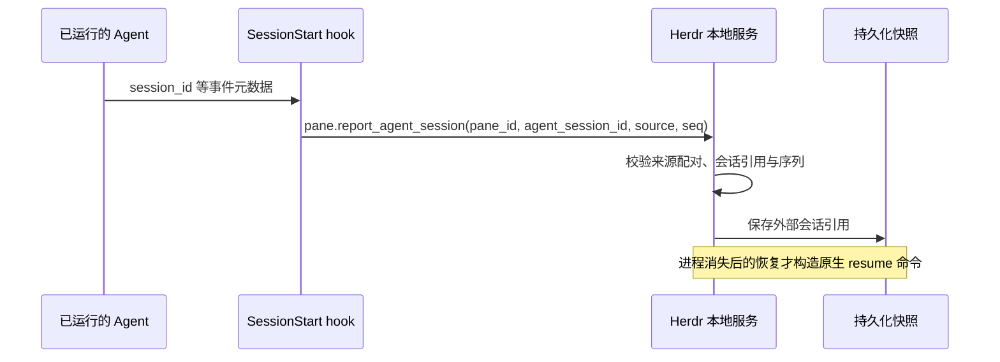

## 结论

**Herdr 对精确 Agent 会话 ID 采用主动上报，而不是每隔一段时间启动 Agent CLI 查询。这是 Se 当前 qin-code 15 秒探针值得借鉴的设计。** 但 Herdr 仍会轮询进程和屏幕来识别 Agent 及忙闲状态，不能称其完全无轮询。

本次固定上游 `herdrdev/herdr@5608de0608918aba2f9d501e7793b984a0ca9cfa`，观察日期 2026-10-26，时区 +08:00。该提交时间换算为 2026-10-24 05:54:08 +08:00，Cargo 版本 0.9.5，许可证 Apache-2.0。本次是静态源码调查，没有执行 Herdr、hooks、构建或测试，没有更改 Se 产品代码、Agent 配置或运行中的应用。

### 三种能力必须分开

| 能力 | Herdr 的实现 | 是否重复启动 Agent CLI |
| --- | --- | --- |
| 谁在终端里运行 | 前台进程组、argv、PID 和进程启动标记。macOS 使用系统 API，Linux 使用 procfs | 不通过启动 Agent 检测 |
| working / idle / blocked | PTY 屏幕、OSC title/progress、输出活动，以及部分 Agent 的生命周期 hooks | 不通过启动 Agent 检测，但仍有采样循环 |
| 崩溃后 `--resume` 所需的精确会话 ID | Claude/Codex 集成 hook 从 SessionStart payload 取得 `session_id`，通过本地 socket 上报并持久化 | 没有周期性启动 Agent 的 ID 探针；hook 事件本身会执行辅助脚本 |

进程 PID、Herdr pane ID、外部 Agent conversation/session ID 是三个不同标识。知道进程叫 `claude` 或当前状态是 idle，不代表知道应当恢复哪个会话。

### Claude/Codex 的关键路径

- Claude 脚本要求 `HERDR_ENV`、socket 路径及 pane ID，过滤非 SessionStart、Cursor 和子 Agent 上报，从输入读取 `session_id`。
- Codex 脚本同样上报会话 ID，并要求有效 transcript path、拒绝继承的 `CODEX_THREAD_ID` 与当前 ID 不匹配的情况。对缺失 hook event name 有兼容分支，不能夸大为严格要求每次都有该字段。
- hook 使用 shell/Python 辅助程序向 Unix socket 发送消息，连接超时 0.5 秒。因此是“按事件运行辅助脚本”，不是“零子进程”。
- Herdr 通过 `AgentSessionRef` 保存 ID，Pi/OMP 还允许路径型引用。恢复 Claude/Codex 时生成 `claude --resume <id>` / `codex resume <id>`。
- 检查到明确进程退出时会清理适用的持久化引用。仍存活时的客户端重连、原生会话 resume、历史终端画面回放不是同一操作。原生 resume 分支抑制重复画面回放，并对相同外部会话做去重。

### 轮询没有消失，昂贵工作被拆开了

Herdr 的已识别 Agent 进程稳态复查间隔是 5 秒，缺少前台进程组时是 30 秒，初始获取有 500ms/2s 的阶段性探测。面板检测 tick 为已识别 300ms、未识别 500ms、待释放 50ms，屏幕扫描另外受内容序列和状态条件约束。这些是源码调度常数，不是本次实测性能结果。

Claude/Codex 并不属于 Herdr 的完整生命周期状态 hook authority 列表。它们的精确 ID 可以由 hook 提供，而忙闲/阻塞主要仍靠屏幕与 OSC。不能用 SessionStart hook 直接宣称全部运行状态已事件化。

### 对 Se 的实际意义

Se 现有两条不同链路：

1. `use-agent-terminal-state.ts` 的 600ms 状态 tick，已有输出变化门控和尾随扫描，使用 OSC / xterm 或选配的 Ghostty host screen。
2. `use-agent-session-tracker.ts` 的 15 秒精确会话跟踪，调用 Rust 进程/打开文件扫描，并在识别到 qin-code 客户端时执行 `qin-code debug clients:map`。这一条才是用户观察到反复启动 CLI 的来源。

Se 对 Claude 当前读 `sessions/<PID>.json`，对 Codex 当前看已打开 rollout 文件，对 Pi 进行目录/时间推断，**这些不是 Herdr 的检测实现**。Herdr 的区别是让知道精确 ID 的 Agent 自己报告它。

**上游没有内置 qin-code 识别、manifest、hook 或原生恢复映射。** 24 项 Agent 清单没有 qin-code，父会话在 `src/` 中检索 `qin-code|qin_code|qincode` 为零匹配。本次没有证明自定义集成也无法支持它，结论仅限内置能力。因此不能把 Herdr 当作现成的 qin-code 无探针适配器。

### 建议与取舍，尚未实现

| 方向 | 取舍 | 原因 |
| --- | --- | --- |
| qin-code 主动上报会话创建、切换、恢复、清空后的最新 ID | 优先借鉴，适配实现 | 会话变化的生产者提供权威信息，不依赖 PID/argv 是否变化 |
| 先核实 qin-code 现有共享服务能否直接提供只读客户端映射/订阅 | 优先调查 | 若有稳定接口，Se 可复用服务而不为每次查询启动 CLI；本次未核实该接口 |
| 把 Se 的 `ps`/`lsof` 改为原生进程读取 | 后续性能优化 | 可减少系统子进程，但仅做这一项仍不能消除 `qin-code debug clients:map` |
| 仅按 PID/argv 不变永久缓存会话 ID | 不采用 | `/clear` 和会话切换可能原地发生，PID 与启动参数都不变 |
| 直接移植 Herdr 全部 hook 安装器与配置写入流程 | 不采用 | 不解决 qin-code 内置适配缺失，还会引入 Agent 配置修改和辅助运行时依赖 |
| 只把 15 秒改成更大常数 | 临时降成本，不是根治 | 仍启动 CLI，且增加恢复身份的陈旧窗口 |

若实施，应把权威会话映射放在适用的共享 Rust/宿主服务，而不是只有 renderer 内存状态。报告需绑定终端/客户端实例与进程启动代次，区分显式退出、临时断连和真正无会话，拒绝旧代次/旧序列覆盖新状态。来源字符串白名单本身不是身份认证，跨 transport 时不能直接复用本地 socket 的信任假设。

桌面 Tauri、desktop shared-live、standalone se-server、浏览器/手机均应评估。当前 15 秒钩子仅在 Tauri 启用，不应把这个历史限制当作新协议只能桌面可用的理由。具体接入方式须先核实 qin-code 的现有能力，再定方案。

## 证据

### 上游不可变链接

| 源码 | 已核实事实 |
| --- | --- |
| [Claude hook 20–99](https://github.com/herdrdev/herdr/blob/5608de0608918aba2f9d501e7793b984a0ca9cfa/src/integration/assets/claude/herdr-agent-state.sh#L20-L99) | 环境门控、SessionStart、session_id、pane ID、socket 上报 |
| [Codex hook 51–97](https://github.com/herdrdev/herdr/blob/5608de0608918aba2f9d501e7793b984a0ca9cfa/src/integration/assets/codex/herdr-agent-state.sh#L51-L97) | transcript 与继承 thread ID 校验、相同报告方法 |
| [macOS foreground group 523–555](https://github.com/herdrdev/herdr/blob/5608de0608918aba2f9d501e7793b984a0ca9cfa/src/platform/macos.rs#L523-L555) | 原生 proc_pidinfo/tcgetpgrp，不启动 Agent |
| [进程复查常数 413–420](https://github.com/herdrdev/herdr/blob/5608de0608918aba2f9d501e7793b984a0ca9cfa/src/pane.rs#L413-L420) | 稳态、无前台组和获取阶段分开调度 |
| [Agent 清单 71–96](https://github.com/herdrdev/herdr/blob/5608de0608918aba2f9d501e7793b984a0ca9cfa/src/detect/mod.rs#L71-L96) | 24 项内置 Agent 中没有 qin-code |
| [会话引用 116–160](https://github.com/herdrdev/herdr/blob/5608de0608918aba2f9d501e7793b984a0ca9cfa/src/agent_resume.rs#L116-L160) | 来源配对、ID/路径、Codex 启动参数回退及 source 语义 |
| [恢复命令 199–214](https://github.com/herdrdev/herdr/blob/5608de0608918aba2f9d501e7793b984a0ca9cfa/src/agent_resume.rs#L199-L214) | 从引用构造原生 resume argv |
| [来源与 ID 校验 321–353](https://github.com/herdrdev/herdr/blob/5608de0608918aba2f9d501e7793b984a0ca9cfa/src/agent_resume.rs#L321-L353) | 去重键、来源配对、控制字符等校验 |
| [退出处理 551–569](https://github.com/herdrdev/herdr/blob/5608de0608918aba2f9d501e7793b984a0ca9cfa/src/terminal/state.rs#L551-L569) | 适用引用与报告恢复命令的清理 |
| [restore 820–862](https://github.com/herdrdev/herdr/blob/5608de0608918aba2f9d501e7793b984a0ca9cfa/src/persist/restore.rs#L820-L862) | resume、去重与历史画面回放分支 |

### Se 当前证据

- `src/renderer/hooks/use-agent-session-tracker.ts:20–65`：15 秒固定 tick、仅防重入、desktop gate，无可见性暂停/退避。
- `src-tauri/src/cli_session/live.rs:81–103,107–115,234–246`：进程扫描及候选 PID 打开文件查询，仅 QinCode 命中时额外查客户端表。
- `src-tauri/src/cli_session/live.rs:373–424`：Claude/Codex/Pi 的本地被动识别分支。
- `src-tauri/src/cli_session/live.rs:433–492`：argv 陈旧问题、按客户端表匹配、每轮执行 qin-code 探针。
- `src/renderer/lib/agents/live-agent-sessions.ts:64–90`：外部 ID 变为恢复 argv 并写入 terminal.agentSession。
- `src/renderer/hooks/use-agent-terminal-state.ts:29–75,88–93,104–125,190–207`：独立的 600ms 状态循环、输出门控、OSC 事件和宿主屏幕读取。
- `src/renderer/lib/agents/agent-terminal-state.ts:15–19`：Se 已参考 Herdr 的公开检测词，不代表已采用其会话上报机制。

已复用[既有 Herdr 参考条目](../../reference-inbox/herdr-agent-worktree/index.md)，未改写其历史或将其标为 adopted。该条目记录旧的 2026-10-23 快照，本专项记录新的固定提交，两者不应混用行号。

调查克隆保留在 `/Users/qs/.qin-code/scratch/scout-herdr-20261026-205458-58463/herdr` 供后续核对。父会话验证 HEAD 精确一致且工作区无修改。未删除此前克隆，未执行任何上游脚本、hook、构建、测试或安装。

## 未决

- 尚未检查 qin-code 的现有只读服务协议/订阅能力，不能承诺 Se 单方即可实现事件上报。
- 没有在用户机器安装或测试 Claude/Codex 的 Herdr hooks。实际 CLI 版本的事件覆盖、缺失 hook、配置冲突和兼容性仍需隔离验证。
- 内置 hook 缺失不等于完全没有恢复回退，源码至少存在 Codex `resume <id>` 启动参数和单独 reported-resume 分支。因此不作“无 hook 必定不能恢复”的过强断言。
- 没有实测 Herdr 相对 Se 的耗时、CPU 或恢复成功率。源码证明调用方式不同，不等于性能基准完成。
- 建议的最小验收仅在隔离测试中进行：同 PID 切换会话、旧代次延迟消息、短暂服务不可达、明确退出、多个同目录客户端及丢失进程后的正确恢复。不得为验证而停止用户当前主程序/活 PTY。
- 当前只是研究建议，未采纳、未实现、未发布新版本。
