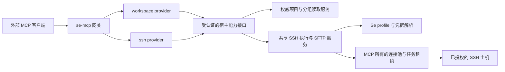

## 结论

### 范围与状态

用户需求：查询 Se 当前分组与项目，并参考 https://github.com/classfang/ssh-mcp-server 将已配置 SSH 能力供外部 MCP 客户端复用，整理新增工具列表。本轮只分析，未实施工具、未连接真实远端、未读取凭据。以下为建议方案，不代表用户批准实施。

**可行。建议沿用 se-mcp 单一入口，增加 workspace 与 ssh 两个内置 provider。共建议新增 16 个业务工具：workspace 3 个、ssh 13 个。保留现有 session-memory/project-scope 的 6 个工具。** 不再创建独立 SSH 配置库，不要求模型提交密码或私钥，不接管用户交互终端。

### 复用的精确定义

1. 第一目标：复用 Se 已保存的 SSH profile、宿主内凭据解析、主机密钥验证和连接/SFTP实现。用户在 Se 配置一次，外部按稳定 profileId 调用。
2. 推荐连接所有权：由共享宿主服务管理 MCP 专用、可复用的连接池，首次调用按需建立，并发首次连接去重。profile 变更/授权撤销使租约失效。并非每个工具都重新握手。
3. 借用现有 libssh2 活跃连接是可选优化，需要租约、并发和生命周期设计，不能让 MCP 超时或断开影响用户终端/文件传输。
4. 不接管本地 PTY 内系统 ssh 的交互式 shell。参考项目也只复用自身进程创建的连接。
5. “外部”先指同宿主其他 MCP 客户端。保留 loopback + Bearer。若要异机连接，另评估受认证远程接入，不直接开放端口。

### 建议新增工具清单

表中名称是 **Direct 模式最终名**。provider 内局部名去掉 `workspace_` 或 `ssh_` 前缀，由既有网关加一次前缀。例如 Grouped 中 `ssh_tool_call({toolName:"execute",arguments:{...}})` 对应 Direct 的 `ssh_execute`。这些名称为提议，未注册。

| 阶段 | 最终名 | 主要输入 | 输出与语义 | 权限性质 |
|---|---|---|---|---|
| A | workspace_group_list | query?, includeEmpty?, cursor?, limit? | id/name/排序位置、可见项目数量与ID、未分组集合摘要 | 只读目录 |
| A | workspace_project_list | groupId?, ungrouped?, query?, includeArchived?, cursor?, limit? | 注册项目 id/name/path（获授权时）/groupIds/归档状态；包括无记忆索引项目 | 只读目录 |
| A | workspace_project_get | projectId | 单项目路径、分组与归档等已存在元数据 | 只读目录 |
| A | ssh_profile_list | query?, tags?, cursor?, limit? | 获准使用的 profileId/name/host/port/username/authMethod、能力/连接状态摘要 | 只读元数据 |
| A | ssh_profile_get | profileId | 脱敏配置、可用能力与凭据是否已配置；不返回凭据或私钥内容 | 只读元数据 |
| A | ssh_test_connection | profileId, timeoutMs? | 连接/认证/主机信任状态、耗时、稳定错误码 | 主动联网，可能更新信任记录，不标纯只读 |
| B | ssh_execute | profileId, command, cwd?, timeoutMs?, maxOutputBytes? | stdout/stderr/exitCode/durationMs/truncated/timedOut；非零退出不等于传输失败 | 远端代码执行，高权限 |
| B | ssh_list_files | profileId, remotePath, cursor?, limit? | 名称/类型/大小/时间/权限，非递归默认 | 远端读 |
| B | ssh_read_file | profileId, remotePath, offset?, maxBytes? | 有硬上限的文本分页、nextOffset/eof，二进制提示使用下载 | 远端读，内容仍可能敏感 |
| B | ssh_write_file | profileId, remotePath, content, overwrite?, expectedHash? | 写入字节/结果版本；默认禁止无条件覆盖，追加可后扩展 | 远端写，覆盖需额外授权 |
| B | ssh_upload | profileId, localPath, remotePath, overwrite? | 有界文件上传；长传输返回 operationId | 宿主文件读取+远端写，存在外传风险 |
| B | ssh_download | profileId, remotePath, localPath, overwrite? | 临时落盘后原子替换，长传输返回 operationId | 远端读+宿主文件写，非纯只读 |
| C | ssh_job_start | profileId, command, cwd?, runtimeLimit? | 立即返回 jobId/状态；有明确的远端执行与存活策略 | 高权限、持久远端副作用 |
| C | ssh_job_status | jobId, offset?, maxBytes? | 状态、分流/有界输出、nextOffset、退出码或未知原因 | 任务所有者范围内读 |
| C | ssh_job_list | profileId?, state?, cursor?, limit? | 当前调用者有权查看的作业/传输列表 | 任务所有者范围内读 |
| C | ssh_job_cancel | jobId | 取消结果与远端终止是否确认；不得以断开通道冒充已杀进程 | 终止操作，按任务授权 |

- 总数：A=6、B=6、C=4，共16。加现有6个，内置业务工具将是22个，而不是顶层包装入口数。
- 初期建议先完成 A+B 的12个工具，但权限与宿主基础设施是前置条件。C的4个作业工具独立验收。
- B阶段传输若尚未具备作业查询/取消基础设施，只允许严格有界的单文件同步传输，**不要返回无法查询/取消的operationId**。异步传输随C共享作业生命周期，统一使用jobId或明确定义映射。
- 首期不支持递归目录传输。后续加文件数、总字节、深度、单次预算、符号链接和部分失败语义后再开放。
- 不新增 connect/disconnect 给模型。工具按需连接，避免模型误断用户连接。profile创建/修改/删除、凭据读写、主机信任审批、跳板机、端口转发不在本批范围。
- 不新增 project-to-SSH 自动关联工具。目前双方没有关联字段，不能通过项目名、标签或路径猜测服务器。
- 分组是扁平结构，不承诺树形。用groupIds表达成员关系，不预设每项目只能在一个分组。
- 状态信息可并入各查询公共meta，不为每个诊断点增加工具：hostId/hostMode、source、revision/observedAt、freshness、capabilities。这些meta需要新增实现，不能宣称当前已有。

### 推荐架构与四端边界

- 桌面网关是独立进程，必须新增窄权限宿主桥，不能直接引用 Tauri 的 SSHManager。宿主桥持有凭据，不把它们发给 MCP 网关。
- 推荐共享 Rust 服务和 trait：profile repository、credential resolver、project catalog、SSH executor、job registry。桌面/standalone 各自注入实现，Tauri/web/MCP 共用服务与授权，不复制业务逻辑或配置。
- shared-live 与 standalone/browser 当前 SSH 操作不齐全。实施时提供等价宿主API与renderer facade、测试两根应用。不能只给桌面加工具、等以后手工补齐。
- OS keychain 无法在其他宿主凭空复用。standalone 只能使用该宿主配置的agent/key/凭据后端，返回认证未配置或明确不可用，不静默读取桌面密钥。
- 桌面宿主离线而网关仍在时，SSH 返回 HOST_UNAVAILABLE，不偷偷改走第二套身份/配置。项目若采用只读快照缓存，必须标明过期与来源，不把未同步当空集合。
- standalone项目源现有格式无groups。若本批目标是四端完整分组查询，需扩展现有注册表格式及迁移；仅作为过渡状态时，返回groupsSupported:false而非误导性的空分组成功结果。

### 权限与安全前置条件

1. 当前Bearer用于网关准入，ToolPermission只按server/tool过滤，不区分调用者、目标连接和路径。不能仅注册ssh provider到AllowAllTools就开放执行。需要宿主签发caller grant或明确的全局授权策略，后端校验profileId/operation/path/job ownership，不能相信调用参数里的callerId。
2. SSH 默认关闭写/执行/外传权限。按目标授权read/execute/upload/download/write/cancel。危险操作确认绑定确切目标与参数、有效期，防止调用者自行填confirmed:true。
3. 任意shell命令本质是目标账号权限。正则黑名单不是沙箱，cwd不是安全边界，SFTP路径限制也不限制execute。需要隔离账号/远端系统权限或明确的高权限授权，不能承诺“开放shell但不能读取远端秘密”。
4. 保留Se主机密钥检查。未知主机首次信任的自动化规则需明确，MCP不能替人批准密钥变化。授权测试连接前提示可能写known_hosts。
5. 使用专用脱敏DTO，不直接序列化SSHProfile。绝不提供宿主password/passphrase/privateKey/token读取工具。结果可能含远端敏感内容，需输出权限和日志脱敏，不能声称凭据一概不会出现在任意远端输出中。
6. 上传/下载的localPath是**Se宿主路径**，不是外部MCP客户端机器路径。必须检查本地与远端授权根、真实路径/符号链接、覆盖、配额与竞态。远端realpath加路径前缀检查也不是任意shell执行的隔离边界。
7. exec同时有界读取stdout/stderr，处理背压、超时、取消、非零退出和UTF-8边界。超时不自动重试有副作用命令。关闭SSH通道不保证远端进程已结束，应返回terminationConfirmed/unknown。
8. 后台任务与传输需要所有权、日志上限、期限、取消、重连后识别、PID复用防护。先声明支持的远端平台，不假装POSIX进程组方案适用于Windows。
9. 不复用当前可能阻塞异步锁的SFTP command包装，抽共享服务并采用有界阻塞工作队列。共享Session线程/串行化细节应核对ssh2 crate实际保证，不能仅凭clone断言线程不安全。
10. 新能力及失败路径须有持久边界日志，但不记录密钥、原始命令全文、文件内容或完整敏感输出。若修改Tauri/web/event/renderer状态或凭据处理，同步plugin capability catalog及相关provider，执行catalog检查。

### 价值与投入

| 范围 | 价值 | 相对投入 | 主要难点 |
|---|---|---|---|
| workspace目录3工具 | 高 | 低到中 | 权威数据接线、桌面跨进程、standalone分组缺口 |
| SSH列表/详情/测试 | 高 | 中 | 脱敏DTO、凭据宿主化、主机信任 |
| exec/SFTP6工具 | 很高 | 中到高 | 授权、exec可靠性、路径/覆盖、跨端服务 |
| job生命周期4工具 | 高 | 高 | 远端存活、取消确认、输出配额与恢复 |

建议不是另起Node服务照搬参考实现，而是借鉴契约，增强现有Rust底座。单纯转发已安装ssh-mcp-server虽能快速调用，但它维护自己的配置与连接，不能满足Se统一管理的目标。

## 证据

### Se本地源码

- `src-tauri/src/mcp_core/builtins.rs:100-115`：现有注册session-memory/project-scope；`:807-838` 的memory_projects来自记忆索引而非完整项目目录。
- `src-tauri/src/mcp_core/domain.rs:86-96`：ToolPermission只接server_id/tool_name；AllowAllTools返回true。`config.rs:179-211`：工具级allow/deny，无连接/路径/caller维度。
- `src-tauri/src/mcp_core/http.rs:85-96,101-117`：只允许loopback绑定与Bearer校验。
- `src-tauri/src/mcp_core/service.rs:412-433`、`process.rs:298-377`：独立进程初始化内建服务；`server_main.rs:44-107`：standalone网关构建。
- `src-tauri/src/ssh/mod.rs:19-55`：SSHManager及断开/关闭生命周期；`lib.rs:3628-3629`：桌面托管实例。
- `src-tauri/src/ssh/profile_manager.rs:16-17,35-54,210-264`：元数据store、list/get/get_with_credentials；`ssh/credential_store.rs:76-101`：OS keychain接口。
- `src-tauri/src/ssh/connection.rs:87-154,208-234,270-328,458-505`：按调用新建连接、认证及主机密钥验证；`:767-812`：clone_session与现有exec，后者仅stdout字符串，无完整执行结果/超时。
- `src/renderer/hooks/use-ssh-connection.ts:200-278`：交互终端在本地PTY运行系统ssh，与libssh2通道不同。
- `src-tauri/src/ssh/sftp.rs:67-306`：列目录、上传、下载、整文件读写；`commands.rs:4357-4484,4589-4645`：包装层不同阻塞模式。
- `src/shared/types/ssh.types.ts:31-32`及`ssh/profile_manager.rs:43`：jumpHost字段未实现完整连接行为。`ssh/port_forward.rs:68-79`仅local转发。
- `src/renderer/lib/ssh-api.ts:22-32,80-86,102-139`：web保存脱敏profile，SSH操作返回WEB_UNSUPPORTED。不能宣称SSH四端已齐。
- `src/renderer/hooks/use-projects-persistence.ts:905-916`：桌面持久化projects/groups；`src-tauri/src/commands.rs:5029-5051`：向宿主镜像同步。
- `src-tauri/src/web/project_registry.rs:39-84,186-217,530-549`：项目分组摘要、成员裁剪、standalone seed。
- `src-tauri/src/acp/project_registry.rs:88-103`：schemaVersion3注册表无groups。`src/renderer/types/project.ts:32-68`：扁平分组，项目无SSH外键。

### 参考项目与已安装工具

外部来源：用户提供 https://github.com/classfang/ssh-mcp-server 。核对日2026-11-07（+08:00）。固定提交 `ff97574651f6e1efe938797ba29f526c499c36a3`，package版本1.11.0，ISC许可证。未复制代码，未安装运行上游。

- [工具定义目录](https://github.com/classfang/ssh-mcp-server/tree/ff97574651f6e1efe938797ba29f526c499c36a3/src/tools)：execute-command、upload、download、read-file、write-file、list-servers、job-start、job-status、job-list、job-kill，共10个。
- 当前会话安装版的schema也列出同名10个工具，但**未核实安装包版本与上游提交一致**。只读取工具schema，未调用真实SSH工具。
- [连接管理:351-416](https://github.com/classfang/ssh-mcp-server/blob/ff97574651f6e1efe938797ba29f526c499c36a3/src/services/ssh-connection-manager.ts#L351-L416)：进程内连接缓存与首次连接去重。
- [客户端配置:1706起](https://github.com/classfang/ssh-mcp-server/blob/ff97574651f6e1efe938797ba29f526c499c36a3/src/services/ssh-connection-manager.ts#L1706)：未设置hostVerifier；[ssh2 v1.17.0文档](https://github.com/mscdex/ssh2/blob/v1.17.0/README.md#L953-L955)说明缺省自动接受，不能照搬到Se。
- [路径检查:567-703](https://github.com/classfang/ssh-mcp-server/blob/ff97574651f6e1efe938797ba29f526c499c36a3/src/services/ssh-connection-manager.ts#L567-L703)：远端路径默认宽松，词法边界不等于强沙箱。
- [job脚本](https://github.com/classfang/ssh-mcp-server/blob/ff97574651f6e1efe938797ba29f526c499c36a3/src/utils/remote-jobs.ts)：远端持久任务与信号处理，可借鉴生命周期，不照搬日志/权限默认值。
- [许可证](https://github.com/classfang/ssh-mcp-server/blob/ff97574651f6e1efe938797ba29f526c499c36a3/LICENSE)：ISC，复制时保留版权与许可声明，依赖合规需另核实。

借鉴：目标标识、配置与tool schema分离、按需连接去重、exec/SFTP/job分层、输出分页、稳定错误。改造：Se凭据与host-key体系、结构化结果、caller授权。拒绝照搬：无hostVerifier、可选HTTP鉴权、默认首台目标、远端路径默认全开、整连接关闭当任务取消。

### 验证范围与未来验收

本轮完成源码与外部固定提交阅读、当前安装SSH MCP schema核对。未跑构建/测试、未执行SSH命令、未传输文件、未测试实际主机密钥或并发行为。参考归档工具reference在本会话不可用，来源与版本存于本分析文档，不手工伪造reference-inbox元数据。

实施时最小验收：无记忆项目可见；空分组/未分组/归档/分页/宿主未同步可区分；workspace列表过滤后计数不泄露越权项目；无profile/caller授权拒绝；不泄露凭据；密钥变化拒绝；exec stdout/stderr/非零/超时/超限；路径穿越与符号链接/覆盖失败；传输部分失败与临时文件清理；任务所有权/取消未知/断线恢复；MCP重启不杀用户PTY；桌面、shared-live、standalone、browser与三种MCP呈现模式契约一致；插件目录unclassified:0。

## 未决

- 本文是待评审建议，无产品实现与上线承诺。实施前需确认新增16工具是否全部纳入首批，还是先A+B。
- 宿主桥协议、caller grant分发/撤销、桌面离线策略与连接池所有权需要设计定稿。
- standalone分组格式迁移与SSH credential backend需明确。不能用空数组或未配置冒充成功支持。
- 当前项目没有SSH关联模型。本批不自动推断；若用户要“项目默认主机”，另加显式关联契约。
- 初期远端OS支持范围、作业存活保证、覆盖确认粒度与输出/日志硬配额尚未选定。
- 未对参考仓库进行动态安全验证，未做全部依赖许可证审计。
