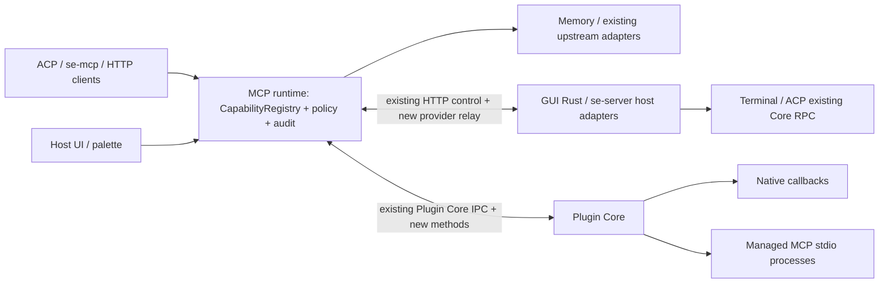

# 建立 Se Manager 统一能力注册表与声明式插件工作台

## 目标

### Objective

按本文 C1 开始冻结契约，再交付一套同时服务 Se MCP、原生插件和工作台命令的能力平台。用户安装一个插件，能看到其要求的能力、提供的工具与视图；启用后，工具进入统一 MCP gateway，视图进入 Primary Side Bar、Secondary Side Bar 或 Panel，主题、菜单和快捷键使用宿主统一机制；禁用后所有运行资源撤销，用户布局和配置保留。

采用 **VS Code 的贡献点、视图容器、上下文键与布局交互模型**，不是加载 VS Code 扩展、嵌入整个 VS Code Workbench 或增加 Node 扩展宿主。可信原生 C-ABI 插件仍只运行在 Plugin Core；网页仍是 opaque-origin sandbox iframe；宿主 ABI vtable 不变。

### Evidence：已核实事实与边界

所有相对路径以 `/Users/qs/project/me/termul` 为根。此次只读文件和文档，没有操作 git、启动桌面应用或执行测试。已有两份 accepted 插件计划是约束；workbench-layout-plan 是待修订草案，不是已实现事实。知识搜索只有 staged 候选，未用作事实；当前工具绑定的 qin-code 项目模型不适用于 termul。

| 证据 | 已核实内容 |
|---|---|
| `.qin-code/docs/plans/plugin-host-capabilities-plan.md:17–37`；`plugin-web-ui-plan.md:17–33` | 保留服务、回调内调用、ticket/lease、ABI v1、静态网页、wake 例外和受管进程；secrets 延后。 |
| `src-tauri/src/lib.rs:3757–4120`；`commands.rs:1486–1496` | invoke_handler 跨多个域；terminal_write 直接调用 terminal.runtime().write，不能按普通 UI 操作自动开放。 |
| `src-tauri/src/mcp_core/builtins.rs:33–38,45–71,100–125,158–205` | 当前六个 memory/project 工具、BuiltInCapability、BuiltInRegistry；已有工具前缀与 policy 过滤。不是全面的宿主能力表。 |
| `mcp_core/config.rs:58–68,94–104,119–144,179–219` | stdio/http/sse upstream；allowTools/denyTools，deny 优先；NameCollisionPolicy 当前只有 PrefixServerId。此处及下文省略的 Rust 路径前缀为 `src-tauri/src/`。 |
| `mcp_core/service.rs:328–336,374–488`；`server_main.rs:44–107` | 桌面 gateway 是独立 `--mcp-core` 进程；standalone gateway 在 se-server 内。现有 control 无宿主能力路由。 |
| `mcp_core/http.rs:151–195,323–338`；`crates/se-mcp-bridge/src/bridge.rs:44–86` | Direct/Grouped/Entry 三种投影；当前 bridge 按消息转发，未实现工具变更通知。crates 路径前缀为 `src-tauri/`。 |
| `crates/se-plugin-host/src/broker.rs:309–408`；`runtime.rs:49–58,253–262` | reserved host 调用先释放 broker 锁；禁止同步回调重入；默认 native callback 2 秒；HostDelivery 已存在。 |
| `crates/se-plugin-host/src/{storage.rs:18–22,host_context.rs:11–39,host_feedback.rs:8–12,managed_process.rs:802–804,1009–1017}` | 已有有界票据/来源租约/反馈；普通 process stdin=null、stdout 被日志读取，不是现成 MCP transport。 |
| `crates/se-plugin-protocol/src/manifest.rs:19–50,81–191,199–217`；`src/shared/types/plugin.types.ts:53–85` | 现有 manifest 严格字段校验，views 是 sidebar/panel 数组；when 仅五布尔键 AND；已有 commands/configuration/menus/keybindings/statusItems/processes。 |
| `src/renderer/layouts/WorkspaceLayout.tsx:2817–3018`；`components/CommandPalette.tsx:129–160` | 左右面板仍固定挂载；插件命令已有代次与声明校验。renderer 路径下文简称 `R/`。 |
| `R/lib/themes/custom-themes.ts:33–81,158–218`；`types.ts:31–47`；`apply-color-theme.ts:174–241` | 已有自定义主题校验、内置主题优先、语义色和统一 terminal theme 入口；尚无插件主题来源和显式 ANSI 覆盖字段。 |
| `credentials.rs:85–101`；`acp/project_registry.rs:9–21`；`R/hooks/use-projects-persistence.ts:23–40,88–105` | 凭据为 JSON；桌面项目数据来自 renderer，standalone 使用独立文件注册表，不能假造一个 project_* Rust CRUD 服务。 |

### 能力清单与初始开放集合

R=read，W=mutate，S=sensitive；S 优先于读写属性，另存 destructive 标记。下表是**本方案的保守分类和明确开放集合**，不是声称现有每个命令体都已完成安全审计。未列入开放集合的 invoke 命令不自动导出。每个 operation 的具体 DTO 在 C1 按现有类型固化，C3 复用服务实现，不向调用者暴露任意 invoke。

| 域 / file:line | R / W / S 分类 | 本期注册的宿主 operation（统一 `se.` 前缀） |
|---|---|---|
| 项目/工作区：`acp/project_registry.rs:9–21`，`web/project_registry.rs:150`，`lib.rs:4026,4116–4119` | R 摘要/manifest；W 激活/修改 manifest；S 环境秘密、任意路径 | `projects.list/get/activate`、`workspace.manifest.get/write`；写仅限已登记 project，activate 要有前台窗口；不导出 secret env。 |
| 终端/PTY：`lib.rs:3803–3828`，`commands.rs:1486` | R 生命周期/cwd/退出码；W 默认 shell 创建/尺寸；S 屏幕原文、原始输入、跨所属终端终止 | `terminals.list/get/create/resize/closeOwned`；`terminals.screen.read/writeInput/terminate` 为 S、逐次确认，read 仅表示无写副作用。 |
| ACP/会话：`lib.rs:3938–3972,4076–4104` | R catalog/会话摘要；W 新会话/提示/取消；S permission response、自动批准设置 | `agents.catalog`、`sessions.list/get/create/sendPrompt/cancel`；session 正文受项目授权；不导出 respond_permission 或关闭审批。 |
| SSH/SFTP：`lib.rs:3879–3900` | R 去秘密 profile/目录；W 连接/文件变更；S 密码、私钥、askpass、任意远程命令 | `ssh.profiles.list/connections.list/connect/disconnect`、`sftp.list/read/write/mkdir/rename/delete`；绑定 connection 与已授权远程根目录，破坏性变更确认；不返回密钥。 |
| Git/worktree：`lib.rs:3853–3869,3908–3933` | R status/diff/log；W stage/commit；S push、discard、删除 worktree | `git.status/diff/log/stage/unstage/commit/push/discard`、`worktrees.list/create/remove`；push/discard/remove 为 S。 |
| Quick terminal：`lib.rs:4083–4090`；`quick_terminal_commands.rs:31–73` | R list；W create/rename/close；S 删除仍有活动进程的会话 | `quickTerminals.list/create/rename/close`；不把关闭标签伪装为杀 PTY。 |
| Skills：`lib.rs:3976–3988` | R status/preview；W install/refresh/cancel；S 安装来源或 hook 执行 | `skills.status/preview/refresh/install/cancel`；install 归 S，不自动运行未批准 hook。 |
| 定时任务：`lib.rs:3989–4002` | R list/get/runs/audit；W draft/update/pause；S activate/runNow/delete | `tasks.list/get/runs/audit/draftCreate/draftUpdate/pause/activate/runNow/delete`；执行与删除为 S，复用现有调度服务。 |
| 记忆/历史：`lib.rs:4006–4012,4064–4073`；`mcp_core/builtins.rs:33–38` | R 项目范围检索/会话；W rebuild；S 跨项目原始档案 | 六个既有工具映射为 `memory.search/sessionList/sessionGet/sessionMessages/projects`、`projects.boundary`，另加 `memory.build/status`；保留 ProjectFence。 |
| MCP 配置：`lib.rs:4030–4048`；`mcp_core/config.rs:228–238` | R 去秘密 status/tools；W enablement/policy；S 原始 env/header、启动命令、认证 | `mcp.servers.list/tools.list/status`；管理写入只经本地管理 UI，不提供通用 mcp_put_config capability。 |
| 通知/进度/存储：`crates/se-plugin-host/src/host_feedback.rs:8–12`、`storage.rs:18–22` | R 自有状态；W 自有通知/KV；S 读取其他插件空间 | `feedback.notify/progress`、`storage.get/set/delete`；namespace 从 caller 派生，不能传另一个 pluginId；现有 host API 保持兼容。 |
| 设置/主题/布局：`R/hooks/use-app-settings.ts:37–43`，`R/lib/themes/apply-color-theme.ts:211–241` | R 安全设置；W theme/layout；S 修改安全、全局执行参数 | `settings.appearance.get/set`、`workbench.layout.get/reset`；只接受 themeId、terminalColorTheme；禁止任意 setting key。 |
| 插件管理：`lib.rs:3779–3800` | R 已安装摘要；S 安装原生代码、授予权限、enable/reload/uninstall | `plugins.list`；生命周期和授权仅本地管理 UI，不授予插件自我提权能力。 |
| 凭据/OAuth/AI keys：`lib.rs:3934–3937,4049–4057`，`credentials.rs:85` | 全部 S；读取 token 即泄密 | 不注册 secret 获取/写入、askpass 或 OAuth token 操作；可在安全摘要里显示 configured/authenticated 布尔值。 |
| 文件搜索/浏览器/remote/system：`lib.rs:3758–3778,3831–3852,3870–3878,4013–4025,4058–4063` | R 有界搜索；W 页面导航；S 剪贴板、远程管理、迁移、退出/升级 | `files.search/read` 仅已授权项目根；其余本期不导出。禁止通用 filesystem、shell、HTTP proxy capability。 |

### Requirements

| ID | Requirement / source | Planned outcome | Acceptance evidence |
|---|---|---|---|
| R1 | “大部分能力”、统一对外 MCP | 上表所有开放项进入一份 typed registry；MCP、host API、可选 palette 投影一致 | C1/C2 catalog fixture、C3 adapter 表覆盖测试，禁止 raw invoke 测试 |
| R2 | 插件自己编写 MCP、注入统一能力 | 受管 stdio 与 native callback 两条 provider 路线；插件 operation 可被其他插件调用 | M1/M2 生命周期、跨插件、ACP 和 bridge 集成测试 |
| R3 | “界面直接用 VS Code 方案” | 容器、视图、when、菜单、命令、快捷键、配置、主题、图标、状态项统一注册 | L1–L6；内置/插件同操作 fixture 与 DOM 断言 |
| R4 | 统一布局、样式和主题 | 逻辑主副侧栏/Panel、Move View/Reset View Locations、语义主题与 ANSI | L3–L6 布局持久化、PTY 不重建、主题实时更新测试 |
| R5 | 既有约束与授权、审计、协商 | ABI 不变、回调 ticket、显式授权、无 secrets、旧 Core 降级、非桌面边界 | C1/C2/C4/M1 安全负例、旧 manifest/core fixture、parity 测试 |

### 强制验收场景 H1

**假设 Se 没有内置“整理历史会话”产品功能。**第三方原生插件 `example.history-organizer` 必须仅靠公开接口完成：向项目右键菜单贡献“整理历史会话”；读取该项目的历史会话与正文，整理/增量同步并显示进度、结果和取消；把同一个插件操作发布为 Se 统一 gateway 中的 MCP 工具。测试不能通过调用内置菜单 handler 或保留内置按钮来冒充插件实现。

本场景把原先抽象的“开放大部分能力”落实为可证明的纵向链路：`project.context → 插件 command → se.host.capabilities → 项目历史服务 → progress → 插件结果`，以及 `MCP tools/call → 同一个插件 operation → 同一条能力链`。

### 补入 Evidence

| 入口 | 已核实事实 |
|---|---|
| `src/renderer/locales/zh-CN/projects.json:332`；`src/renderer/components/ProjectSidebar.tsx:729–757` | 文案为“整理历史会话”；现有内置项目菜单有运行/进度/取消状态。仅作为参考，不作为第三方插件依赖。 |
| `ProjectSidebar.tsx:615–618,621–677,681–687` | 订阅 `MEMORY_INDEX_PROGRESS_EVENT`；先 status 判断首次或需重建，再 build；展示 sessions/messages/bytes/duration；cancel 走同一 API。 |
| `src-tauri/src/memory_index/commands.rs:52–79,136–200,251–307` | 已有 150ms 节流进度、memoryBuild/memoryCancel/memorySessions/memorySession IPC；build 可能超过两分钟。 |
| `src-tauri/src/memory_index/service.rs:196–242,246–263,300–333,414–421`；`store.rs:161–185` | 有项目范围 status/list/get，但读取路径使用会 migrate 的 Store::open；不能直接宣称新包装是无副作用 read。 |
| `memory_index/service.rs:1145–1200`；`src/renderer/lib/__tests__/parity-checklist.test.ts:1462–1475` | 已有只允许明确入口索引的 guard；必须保留“不在 startup/list/read 隐式整理”的约束。 |

### 补入 Requirements 表

| ID | Requirement / source | Planned outcome | Acceptance evidence |
|---|---|---|---|
| R6/H1 | 用户指定：没有内置整理功能时，插件贡献项目菜单、读取和整理历史、报告进度、发布同一 MCP 操作 | `example.history-organizer` 经公开能力完成整个流程，不调用内置 handler；归一化数据来自项目历史索引，不仅是实时 AgentSessionContext | M2 的 Rust/renderer 联合纵切验收首次通过；L5 重跑完整工作台回归；跨项目、无权限、禁用、超时负例必测 |

## 非目标

### Scope

1. 不实现 VSIX/Node/JS 后端，不允许主窗口 DOM/CSS/React 注入；不改变 native/process 完全受信任这一事实。授权只约束**宿主提供的入口**，不声称限制原生代码自行访问系统或网络。
2. 不提供 secrets、OAuth token、SSH 私钥或安全设置绕过；不做自动抓取 invoke_handler 后全部导出。已有外部 upstream 的凭据解析不受影响，但不能借能力 API 读取这些值。
3. 不替换中央 PaneRenderer/终端 pane tree，不实现浮动窗口、任意嵌套 docking、布局云同步、完整 VS Code API/主题文件二进制兼容；walkthroughs 本期明确延后。
4. 不把 standalone/browser 变成 native 插件宿主：共享 Rust 能力适用时同步开放；原生插件安装/授权、iframe 及其 UI contribution 保持 desktop-only，非桌面明确返回 unsupported。共享工作台布局在两 renderer root 可用，手机保留 MobileChatShell。
5. 本交付是规划；父会话负责保存本文和批准后调度。实施也不得擅自运行用户桌面实例、修改 git 或把 qin-code 仓库安装脚本套用于 termul。

本场景与现有 reference 语义一致：同步本机已存在的项目 agent/conversation 历史到派生索引、读取归一化会话并产生整理摘要；可以把插件自己的摘要写入其 project KV。**不修改或删除原始 vendor transcript，不上传远端，不提供任意对话正文写入或通用文件写接口。**因此新增 mutate 能力是“刷新/重建派生历史索引”，不是“任意改写用户历史”。

若以后需要改写对话标题、分组或源消息，应另增有明确字段、来源所有权和 CAS 的 operation；本场景不假装现有索引服务已经具备这些能力。

## 任务

### Design A：一份操作注册表，三个投影

**权威位置固定在 Rust MCP runtime**：新增 `src-tauri/src/mcp_core/capabilities/`。桌面为 `--mcp-core` 进程持有一个 `Arc<CapabilityRegistry>`；standalone 为 se-server 内的 McpCore 持有同一实现。Plugin Core 和 renderer 只持 revision 标记的快照/代理，不保有另一套权威操作定义或权限表。

`CapabilityDescriptor` 固定字段：`id,title,version,inputSchema,outputSchema,class,scopes,destructive,requiresConfirmation,availability,provider,surfaces`；class 为 `read|mutate|sensitive`，scopes 为 `profile|project|terminal|session|sshConnection|pluginSelf|window`。Rust DTO、schema 与 handler 在 `OperationSpec<I,O>` 一处配对；`register(spec, handler)` 拒绝重复身份，所有调用统一经过 `invoke(ctx: CallContext, call: CapabilityCall) -> CapabilityResult`。静态 handler 的参数/结果用 serde 类型；动态 MCP schema 经有界 JSON Schema 校验器验证，禁止远程 `$ref`、无限递归和取网。

输入固定为 `{requestId,id,version,scope,input,timeoutMs}`；输出固定为 `{requestId,registryRevision,result:{ok,value}|{ok:false,error:{code,message,retryable}}}`。`CallContext` 由已认证连接生成 caller、project grants、generation、deadline、traceId 和调用链，禁止信任 JSON 自报 pluginId。list 为 cursor 分页且权限过滤，返回 descriptor、revision、nextCursor；每页最多 100 项且不超过 192 KiB。

六个 memory/project 工具保留现有外部名称作为 alias，但 schema、分类、scope 和调用统一落入 operation spec；BuiltInRegistry 改为 registry 的 provider/projection adapter，不能继续另写一份 tools() schema。普通外部 upstream 也登记其工具 descriptor，仍复用现有 transport 与 policy；MCP annotations 只是描述，不能自动获得 read 权限。Facade 和 Grouped/Entry 从同一 registry 派生；palette 只显示明确 `surfaces.commandPalette=true` 且有无参或受控参数表单的 operation，不自动把任意工具变成按钮。

### Design B：进程路由与无重入调用



现有 MCP Core 没有通往 GUI 的能力通道，下面是**新增桥接**，不是现存功能：

1. Plugin Core 增加 `plugins.capabilities.snapshot/take/complete/invoke` 与 `plugins.mcp.snapshot/call` RPC。MCP runtime 用现有 `CoreEndpoint`、`connect_core`、request/response framing 连接 Plugin Core；不增加 ABI，也不新造 CoreRole。snapshot 返回已提交代次的描述符；take 是有界长轮询，complete 回送结果。断线撤销该来源，重连先全量 snapshot 再接受增量。
2. `se.host.capabilities@1` 提供 `list/call/cancel`。它只在 native callback 内受理；list 读取已过滤缓存，call 同步返回 `{accepted:true,ticketId,requestId}`，真正 IPC/磁盘工作异步进行。完成由已有 HostDelivery 投递 `se.host.capabilities.completed`，原回调结束前不投递，不持 runtime/broker 锁等待 GUI。wake 仍是唯一允许回调外发起的 host 调用。
3. GUI Rust adapter 复用已有 gateway HTTP control client，新增内部 `/control/capabilities/providers/{attach,take,complete,heartbeat,detach}`；MCP runtime 发任务，宿主异步取出调用已有 Rust service/Terminal/ACP RPC。provider owner token 与普通 MCP bearer 分离，不放到 `connection_info` 或发给 agent；bootstrap 文件 owner-only，绑定 profile/ownerBootId/connection。普通 MCP token 不能注册 provider、回复别人的 ticket 或写 grants。
4. GUI 断开后，memory、独立 upstream 和仍运行的 Plugin Core provider 继续可用；依赖 GUI 的 operation 标记 unavailable，调用返回 `CAPABILITY_HOST_UNAVAILABLE`，不悄悄启动桌面。standalone adapter 在进程内执行，采用同一权限链；没有 GUI 的 appearance/layout 操作明确 unsupported。桌面项目摘要读取现有 renderer-fed ProjectRegistry；没有有效来源时不可用，不另造项目文件或直接改 renderer 持久化。
5. 首轮限额：单调用 JSON 输入/输出各 128 KiB、总 envelope ≤256 KiB；每 caller 8 个 pending、全局 64；30 次/秒、burst 60；默认 5 秒、硬上限 30 秒；take 长轮询 1 秒、heartbeat 5 秒、lease TTL 15 秒。native provider callback 仍遵守现有 2 秒上限；慢任务返回现有业务 jobId，不阻塞 native 回调。调用链最多 8 层，跨 IPC 保留链与根授权，A→B→A 返回 `CAPABILITY_REENTRANT`。

timeout/cancel 在执行前保证无副作用；执行后只尽力取消，不宣称回滚。mutate 不自动重试；同一 caller/generation/requestId 在 5 分钟有界缓存内去重（最多 1,024 项）；重启后结果不明返回 `CAPABILITY_OUTCOME_UNKNOWN`，不作 exactly-once 承诺。旧 generation completion、越 scope、坏输出 schema 分别拒绝为 stale/denied/invalid-output。

### Design C：授权、审计与版本

新增 manifest `capabilities.requires:[{id,version,scopes,reason}]`，只能精确 operation id，无通配符；仍需 `services.requires` 声明 `se.host.capabilities@1`。安装阶段先静态读取/校验包 manifest，显示 R/W/S 分组、scope、原因及来源；必须同意后才执行 native load/create。legacy 裸库无法在加载前可信读取 manifest，保持“先信任原生代码”的警告，但所有新能力初始拒绝，声明展示并授权后才 enable。不能把读取裸库 manifest 宣称为无代码执行。

授权是 `manifest requirement ∩ 用户 grant ∩ provider live ∩ scope ∩ 调用面 policy`；deny 永远优先。首次安装没有自动写入 grant；升级增加权限或扩大 schema/class/scope 时先暂停激活，展示 diff；撤销立即阻止新调用。grants 绑定 pluginId、包 hash、operation version 与批准 scope；原生程序自行访问系统不在此安全边界内。

R/W 可按安装时的明确选择持久批准；S 需要本地管理 UI 针对调用摘要逐次批准，令牌绑定 operation、input digest、scope、caller、有效期 30 秒且单次消费。headless/remote 没有本地审批者即 `CAPABILITY_CONFIRMATION_REQUIRED`，不自动放行。secrets、安全绕过等排除项即使用户给了 grant 也不存在可调用 operation。

MCP 新宿主能力默认不公开，按 operation 在 MCP 管理页显式开启；已有六工具和普通 upstream 保持原 enablement/policy。外部 agent 不能继承“宿主 UI 全权限”：ACP 注入 session/project-bound credential，se-mcp 使用用户为该 client 配置的 grants；旧共享 bearer 只保持既有工具权限，对新增宿主/插件工具默认拒绝。跨插件调用保留原始 caller 和中间链，只可缩小、不可扩大授权。

每次尝试写审计：时间、trace/requestId、caller/provider、operation/version、目标 scope 的匿名标识、策略 revision、批准来源、耗时、结果码；**不记录参数、输出、屏幕、路径、prompt 或 secret**。新文件 `<profile>/capabilities/audit/`，7 天/20 MiB 有界轮转；先记 admission，再执行；admission 写失败返回 `CAPABILITY_AUDIT_UNAVAILABLE`。完成日志失败显示 degraded 并阻止后续新调用，不能把已发生的操作报告成未发生。

manifest 扩展使用 `schemaVersion:2`，新宿主读取 v1/v2 并规范化，**其他 RPC envelope 与 ABI 仍为 v1**。新增可选 hello 能力 `plugins.capability-registry.v1`、`plugins.mcp.v1`、`plugins.workbench.v1`；未协商则相关界面/调用返回 PLUGIN_NOT_SUPPORTED，四项基础能力连接不因此失败。v2 包不能发给旧 Core 尝试加载；不丢字段降级。operation 独立整数 major version；破坏输入/输出/class/scope 改变须升版或重审批，不就地篡改已批准契约。

### Design D：插件 MCP 和插件 operation

v2 的新增贡献示例（省略既有必填字段；所有新字段由 C1 冻结）：

```json
{
  "schemaVersion": 2,
  "capabilities": {"requires": [{"id":"se.projects.list","version":1,"scopes":["profile"],"reason":"选择项目"}]},
  "contributes": {
    "capabilities": [{"id":"summarize","title":"项目摘要","version":1,"class":"read","scopes":["project"],"inputSchema":{"type":"object","additionalProperties":false},"outputSchema":{"type":"object"}}],
    "mcpServers": [
      {"id":"native","kind":"native","operations":["summarize"]},
      {"id":"index","kind":"stdio","processId":"indexer","tools":[{"name":"search","upstreamName":"search","class":"read","scopes":["project"]}]}
    ]
  }
}
```

native operation 完整 ID 为 `plugin.<pluginId>.<localId>`；native MCP 只引用同一条 operation，不复制 schema。非 MCP 的 native capability 也可被已授权插件经 `se.host.capabilities.call` 调用。Core 经现有 on_service_call 调用 `se.host.capabilities.invoke`；被 mcpServers 引用的 native tool 经 `se.host.mcp.invoke`，输入同为 `{callId,operationId,input,scope,deadlineMs}`，统一校验输出。

新增保留 `se.host.mcp@1` 的 `publish/withdraw/status`：只允许发布 manifest 已声明 descriptor 的子集，发布发生在 generation 提交后；不允许 runtime 注册任意 service/name 或改批准 schema。插件不能 provide `se.host.*`。native invoke 回调返回 operation 结果；长处理走业务 jobId/受管进程，不放宽 callback 超时。

stdio 的 processId 必须引用本插件 contributes.processes，单 processId 只能绑定一个 MCP server。ProcessManager 增加 `ioMode:log|mcp` 内部模式：mcp 模式 stdin/stdout 独占给协议引擎，stderr 才进日志；不会被另一个 MCP runtime 再 spawn 一份。保留包路径校验、进程组、孤儿回收、退避上限和禁用清理；不引入 Node 后端运行时，也不对可信进程自行调用服务设网络沙箱。

先 initialize/tools/list 成功，再把 manifest allowlist 中的 upstreamName 导入 registry；title/schema 取服务器，class/scope 取声明和用户批准，未知工具不自动公开。没有 outputSchema 的 upstream 使用 MCP CallToolResult envelope schema，不能伪造业务 schema。动态工具集变化重新校验；同名 schema hash 改变先停止准入并要求重新审批。

公开名称固定 `plugin.<id>.<tool>`；tool/localId 限 `[A-Za-z0-9_-]{1,64}`，不含点，使用显式路由映射而非 split 猜测 pluginId。每插件跨所有 MCP server 的 alias 唯一，完整工具名 ≤256 字符；不同插件 ID 允许有点，但不得覆盖已有完整 ID。MCP 兼容名称编码若遇到更严客户端限制，只能在客户端适配层提供稳定 alias 并返回 canonicalId，不改变 registry 身份。

普通 upstream 保持 PrefixServerId；`plugin.` 和 `se.` 是 registry 保留前缀，发生完整名称冲突整批拒绝，不覆盖、不加随机后缀。启用/禁用 server、tool policy 存在原 MCP control-plane 文档新增 `pluginServers:[{pluginId,serverId,enabled,policy}]`，只存用户覆盖，不复制 command/env/schema；安装包仍是声明源。

生命周期：enable→提交代次→启动/握手→登记；disable/quarantine/disconnect→先撤 registry admission→取消 ticket→关闭协议→停止进程组；upgrade 先撤旧代次再发布新代次，旧响应不能复活。MCP UI 的 server toggle 不改变 plugin desiredEnabled；关闭 server 停止其 MCP process 或 native 路由，其他插件功能继续运行。已卸载插件的 policy/布局保留为休眠偏好，可手动清除。

MCP HTTP 开启支持通知的会话 transport，registry revision 变化合并发送 `notifications/tools/list_changed`；Entry 的固定四工具仍保持不变，但 server/tool list 返回最新 revision。se-mcp bridge 保留会话 ID、接收服务端事件并串行写 stdout；不得重放已发送 mutate。旧 stateless 客户端继续可以按请求使用，但需重新 tools/list；对不响应通知的 ACP agent，管理 UI 显示“需刷新工具/重建会话”，不强杀正在执行的回合。

### Design E：VS Code 贡献模型与统一样式

**内置和插件都注册到同一个 WorkbenchRegistry**，归一化描述符包含 `{id,owner,title,containerId,defaultLocation,when,actions,renderKind}`。内置 renderer factory 由宿主代码绑定；插件只允许 uiTree/web。贡献、运行 availability、用户 layout overrides 分层保存，禁用不删除用户位置。

| VS Code 贡献点 | Se v2 manifest / 行为 |
|---|---|
| viewsContainers | `{activitybar:[{id,title,icon}],secondarySidebar:[...],panel:[...]}`；activitybar 默认 Primary Side Bar，secondarySidebar 为 Se 明确扩展；一个 Activity Bar 随 Primary Side Bar 位置移动，Secondary/Panel 用各自容器选择器。 |
| views | `{[containerId]:[{id,name,type:"uiTree"|"web",entry?,allow?,when?,visibility:"visible"|"collapsed"|"hidden"}]}`；visibility 仅首次默认。v1 sidebar/panel 转适配描述符，旧安装默认保留中央路由兼容。 |
| commands / menus | commands 为 `{command,title,category?,icon?,enablement?,capabilityId?}`；menus 为 `{[location]:[{command,when?,group?,order?}]}`，location 增加 `view/title`、`view/item/context`、`editor/title`、`commandPalette`，保留四个旧上下文位置。editor/title 是 Se 活动 pane，不是任意 React 注入点。 |
| keybindings / configuration | `{command,key,mac?,linux?,win?,when?}`；支持一段或两段 chord；configuration 保留当前 string/number/boolean 校验和 config revision，新增 scope=`plugin|project`，不开放任意 app settings。 |
| themes / icons / statusBar | themes=`[{id,label,path,uiTheme:"vs"|"vs-dark"}]`；icons=`[{id,path?,token?}]`；statusBar=`[{id,text,alignment:"left"|"right",priority,command?,when?,scope}]`，继续使用 host.status 更新和 TTL/lease。walkthroughs 本期不接受，返回明确 unsupported。 |

v1 commands/views/menus/statusItems 保持可解析；v2 使用上述形状，statusItems 仅作为 v1 alias，不能同时声明两个来源。每插件保留 ≤8 views、≤2 status items、≤4 processes；新增 ≤4 containers、≤64 capability operations、≤4 MCP servers、≤128 MCP tool aliases、≤8 themes、≤32 icons，总 manifest 仍 ≤256 KiB。

when/enablement 使用共享有界 parser，不用 eval。首版语法为布尔值、`!`、`&&`、`||`、`==`、`!=`、括号和字符串字面量；≤512 字符/64 AST 节点/深度 8，其他 VS Code 语法明确报错。键包括原五键以及 `view`、`viewItem`、`activeViewlet`、`activeEditor`、`resourceScheme`、`workbench.panel.visible`、`config.<pluginId>.<key>`；未知键为 false。`when` 控制展示，`enablement` 控制操作；都不是授权依据。宿主执行时重查 generation、target 及权限，不能信任 renderer 的布尔结果。

内置树行提供宿主认可的 viewItem contextValue；插件 uiTree list item 新增 contextValue 和 itemId，web 内容内部不自动成为宿主菜单目标，只可通过受控 bridge 请求显示本视图声明的菜单。不能借该入口伪造另一个项目/终端。所有插件动作仍走 plugins.contribution.execute；capabilityId 命令再进入 registry，不绕授权。

快捷键冲突顺序：明确用户覆盖 > 内置默认 > 插件默认；插件冲突默认不绑定并展示原因，保留 ctrl→cmd 和旧自定义。chord 仅在当前 when 成立时捕获，1 秒超时后取消；除明确授权的终端上下文绑定外不吞终端按键。状态项稳定 ID 不含 generation，动态文本变更不重置布局。

主题不开放 CSS 字符串：包内主题 JSON 先走 validateCustomColorTheme，扩展 `terminalAnsi` 为 black/red/green/yellow/blue/magenta/cyan/white 及对应 bright* 16 个可选十六进制颜色；未提供项复用 ansi16FromPalette。`colors` 只接受宿主登记的语义 token，初版允许 background/foreground/primary/accent/border/sidebarBackground/sidebarForeground；映射到现有 CSS variables，禁止 URL、选择器和任意变量名。格式是 Se 的受控主题数据，不承诺任意 VS Code JSON 即插即用。

插件 theme ID 为 `plugin:<id>:theme:<themeId>`，内置与用户主题不能被覆盖；插件 disable/uninstall 时立即回退用户最后可用主题，并保留 preferredThemeId 供恢复。所有现存/新建终端统一走 getActiveTerminalTheme；切换不重建 PTY/iframe，iframe 只收 token 数据。图标仅宿主 token 或包内有界图片，SVG 必须净化并作为 img 资源加载，拒绝 script/foreignObject/外链；不内联注入主 DOM。

### Design F：替换原布局草案的 L1–L5，新增 L6

| 原草案部分 | 本计划的确定变化 |
|---|---|
| L1 数据模型 | `DockLocation=primary|secondary|panel`，primarySide=left|right；layout schemaVersion=2；editor 仅留 legacy 插件 route bridge。删除把 title/header/rail 任意互搬的通用 ChromeSlot 设计，使用注册菜单、状态位置与容器顺序。 |
| L2 适配与注册 | 内置 project/conversation、SSH、CLI sessions、local/SSH explorer 全部成为真实 view；Git/history/MCP 等完整页面仍是 command/editor 页面，不硬塞侧栏。插件使用 viewsContainers/views 的规范化结果。 |
| L3 外壳 | Primary/Secondary Side Bar + 底部 Panel；主侧 Activity Bar 与逻辑主侧同行，副侧和 Panel 选择容器；项目和 SSH 可分开移动；中央 pane tree 不改。 |
| L4 操作 | 明确 View: Move View、Move View Container、Reset View Locations、Toggle Primary/Secondary Side Bar、Toggle Panel；同一 reducer 服务标题菜单、drag、键盘与设置；when 与用户隐藏分别处理。 |
| L5 迁移/恢复 | 延续旧键一次迁移、失败备份、窗口尺寸隔离、不可隐藏的设置/插件入口与 PTY 保活；Reset View Locations 仅重置位置/显隐/折叠，Reset Workbench Layout 才额外重置尺寸。 |
| 新 L6 | 插件主题、ANSI、icons、menus/actions、commands/keybindings/configuration/statusBar；内置 chrome 同样从贡献注册表获取，不保留插件专用硬编码分支。 |

持久化使用 `settings/workbench-layout`，保存 version/revision/primarySide/container placement/view placement/status placement；尺寸单独用 branded `workbench-layout-window/main`，browser 用 sessionStorage。默认 primary=240、secondary=256、panel=240；范围分别 180–420、220–560、120–600。保留原 migration 的 activity-rail/settings/app/context-bar 与尺寸键读取；未知未来版本或读错误不得当不存在，恢复前写 backup，失败终止覆盖。位置跨会话保留但多客户端不假称 CAS，继续明确 last-successful-write 策略。

用户具体 placement 永远高于 manifest default；缺席插件保留休眠 override。拖动只来自容器/view handle，6px 激活，pointerup 一次提交；Escape/失效 generation/blur 零提交。提供 Move View 菜单和键盘替代。iframe 跨父容器可能重载，移动前确认；不承诺 React key 能防止重新加载。所有内置终端保持原 mount/key，只触发现有 resize 合并。

### Execution Plan：单一依赖路线与独占文件

批准后默认使用 `general-executor`，不存在时回退 `general`。下列 13 包是可独立验收的交付包；每包内部按 30–60 分钟测试/实现切片执行，不另建 workflow task 文件。估算为人日（8 小时），含测试、不含人工排队；总计约 32–46 人日（含 H1 增补：C3 +1–2、M2 +1）。所有新增路径均标“新”。同一文件始终只有下述一个 owner；其他包只读或提交接口需求，禁止平行修改接线文件。cargo 构建串行。

验证缩写：`CT` 展开为 `cargo test --manifest-path src-tauri/Cargo.toml --target-dir /Users/qs/project/me/termul/src-tauri/target`；`VT` 展开为 `bunx vitest run`。命令从仓库根执行。tests 的新名称是本计划要求新增的验收，不是已通过证据。每包 Read first 都包括其全部修改文件，以及下列指定模式文件。

#### C1 — 冻结操作与贡献契约（2–3 日）
- **ID / Outcome：** C1；Rust/TS 一致的 v1/v2 manifest、capability/provider DTO、错误码、协商与共享 fixture。
- **Files / symbols：** `src-tauri/crates/se-plugin-protocol/**`、`src/shared/types/plugin*.ts`、新 `src/shared/types/capability.types.ts`、`src/shared/plugin-fixtures/**`；本包独占必要 Cargo.toml/Cargo.lock 依赖变更。
- **Read first：** manifest.rs、host.rs、rpc.rs、request_validation.rs、web.rs、已有 contracts.json；本计划 Design A–F。
- **Changes：** 固化 CapabilityDescriptor/CallContext/CapabilityCall；v2 贡献结构、精确 requires、所有上述限额与 optional hello flags；JSON Schema 校验选用仓库依赖评审后锁定版本，不改变 ABI crate；不让全局 SCHEMA_VERSION=1 被 manifest v2 一并替换。
- **Dependencies / parallelism：** 无；完成后 M1、C2、L1 可并行。其他包不可自行补共享字段。
- **Acceptance criteria：** v1 fixtures 全部仍有效；unknown fields、重复 ID、外部 schema refs、超限、保留名、未声明 native op 被拒；新 manifest 在旧能力集合下不加载。
- **Verification：** `CT -p se-plugin-protocol`；`VT src/shared/types/plugin.types.test.ts src/shared/types/capability.types.test.ts`（后者新）；风险为 schema 演进误伤旧插件。

#### C2 — MCP runtime 单一注册表、授权与投影（4–6 日）
- **ID / Outcome：** C2；一个 live registry 同时驱动 list/call、builtins/facade/gateway、policy/audit 和通知。
- **Files / symbols：** `src-tauri/src/mcp_core/**`，含新 `capabilities/{mod,catalog,registry,policy,audit,provider_relay}.rs`；其他包不修改该目录。
- **Read first：** builtins.rs、domain.rs、config.rs、facade.rs、service.rs、process.rs、http.rs、既有 memory ProjectFence；C1 DTO。
- **Changes：** 实现 register/invoke/list、provider relay 与普通 MCP bearer 权限隔离、leased dynamic providers、canonical alias 映射、pluginServers 覆盖和 session list_changed；静态六工具转 registry spec，所有 transport 调用也经统一准入与审计。
- **Dependencies / parallelism：** C1；可与 M1、L* leaf 组件并行；使用 fake provider，不等 GUI。
- **Acceptance criteria：** `capability_registry_single_source`、`provider_token_cannot_be_mcp_bearer`、`audit_failure_blocks_admission`、`legacy_aliases_preserve_policy`、`list_and_call_use_same_grants`、`revision_emits_list_changed` 测试通过；未知权限默认拒绝。
- **Verification：** `CT -p se-manager --lib mcp_core`；风险是旧 gateway 名称/enablement 回归，必须比较旧 fixture 工具集。

#### M1 — Plugin Core 原生能力与受管 MCP provider（4–6 日）
- **ID / Outcome：** M1；callback-safe capability tickets、native tools、stdio 协议生命周期成为同一 generation 的资源。
- **Files / symbols：** `src-tauri/crates/se-plugin-host/src/**`、其 tests、`src-tauri/src/core/plugin.rs`、`src-tauri/src/plugin_commands.rs`、`src-tauri/crates/se-terminal-core/src/ipc.rs`；新 host `capabilities.rs`、`mcp.rs`。
- **Read first：** broker/abi_worker/runtime/host_services/storage/managed_process、core/plugin 的 owner 与可选能力协商；C1 契约。
- **Changes：** 实现 Design B 的四个 capabilities RPC、两个 MCP RPC、se.host.capabilities 与 se.host.mcp；native dispatch 保持 2 秒；process ioMode 独占 stdin/stdout，发布/撤销/孤儿回收与 generation 绑定；只在授权后 native load。
- **Dependencies / parallelism：** C1；与 C2 并行用 fake registry；最终与 C2 配对后才开启新能力位。
- **Acceptance criteria：** `capability_completion_waits_for_callback_return`、`cross_plugin_cycle_rejected`、`stdio_stdout_has_one_reader`、`disable_withdraws_before_process_stop`、`upgrade_rejects_old_completion`、`old_core_still_connects` 通过。
- **Verification：** `CT -p se-plugin-host --lib`；`CT -p se-manager --lib plugin`；`CT -p se-terminal-core --lib ipc::tests`；风险是 native 重入和 stdio 双消费。

#### C3 — 宿主能力适配与跨运行模式路由（4–6 日）
- **ID / Outcome：** C3；能力清单的全部本期开放项连接真实服务，含 scoped ACP credentials 和 headless unavailable 行为。
- **Files / symbols：** 新 `src-tauri/src/capability_host/**`；`src-tauri/src/{lib.rs,commands.rs,server_main.rs,remote/host.rs,web/mod.rs,web/router.rs,acp/mcp_router.rs,acp/manager.rs}`；新 `web/capabilities_api.rs`。
- **Read first：** invoke_handler；TerminalServiceHandle/AcpCoreClient；quick_terminal_commands.rs:31–56；memory_index/commands.rs:22–43；web ProjectRegistry 与 projects_api；各域既有 service API。
- **Changes：** 用带依赖的 host provider dispatch 替代构造 Tauri State；接入全部列出的 operation、分页/路径 fence/去秘密 DTO；新增 Tauri `capabilities_list/call` 和对应 authenticated web API；GUI provider attach/heartbeat/take；ACP session 发放 project-bound grants；standalone 使用同一 adapter，无 GUI 项明确 unsupported。
- **Dependencies / parallelism：** C2、M1；可与 L2–L4 并行。项目与设置变更只经其现有权威路径，禁止旁写持久化文件。
- **Acceptance criteria：** `capability_adapter_catalog_is_complete` 比对清单；每个 operation 至少一条成功与越权测试；PTY 输入、SSH、SFTP、tasks S 操作缺批准无副作用；GUI 消失后 memory/plugin tools 可用、UI operation 不可用。
- **Verification：** `CT -p se-manager --lib capability`；`CT -p se-manager --features standalone-server --lib capability`；风险是桌面/standalone 项目来源不同。

#### C4 — 安装授权、管理页与审计 UI（2–3 日）
- **ID / Outcome：** C4；安装前可见权限、升级 diff、可撤权、可查脱敏审计，拒绝状态有明确原因。
- **Files / symbols：** `R/pages/PluginsPage.tsx` 及测试、`R/features/plugins/manager/**`、`R/lib/plugin-api.ts` 及测试；新 `R/lib/capability-api.ts`、`R/features/capabilities/**`；`R/locales/{en,zh-CN}/plugins.json`。
- **Read first：** PluginsPage 现有确认流程、PluginDetails/Services/Processes、plugin-api、M1 的静态 inspect/admission、C3 transport。
- **Changes：** 加 permissions/audit 页签、按 R/W/S/scope 展示、grant/revoke/逐次确认；安装包先 inspect 再 grant/enable；legacy 库明确提前执行代码的信任提示；web facade 不能执行本地授权。
- **Dependencies / parallelism：** C3；与 M3、L* 并行，互不改 locale/页面。
- **Acceptance criteria：** [UI-observable] 未确认时无 native activation 调用；升级多一个 scope 必须再确认；撤权后下一次调用显示 denied；审计列表不包含输入 secret 哨兵。
- **Verification：** `VT src/renderer/pages/PluginsPage.test.tsx src/renderer/features/plugins/manager src/renderer/features/capabilities`；风险是“已安装”被误当“已授权”。

#### M2 — se-mcp/ACP 发现刷新与端到端证据（2–3 日）
- **ID / Outcome：** M2；外部客户端能发现/调用插件工具，变更后不会使用失效代次。
- **Files / symbols：** `src-tauri/crates/se-mcp-bridge/**`、`src-tauri/crates/se-plugin-example/**`；新 `src-tauri/tests/plugin_platform.rs`、`scripts/test-plugin-platform.sh`；不修改 C2/M1 的实现文件。
- **Read first：** bridge.rs、现有 plugin_e2e、mcp fixture、ACP mcp_router 契约；C2 notification/session 契约。
- **Changes：** bridge 保留 session/event reader、单 stdout writer、断线重新 initialize/re-list；示例贡献一个 native summarize、一个 stdio search、一个调用其他插件 operation 的命令；测试仅临时 profile/fake service，不启动桌面。
- **Dependencies / parallelism：** C3；可与 C4/M3/L* 并行；发现实现缺陷交回 owner 修复，不跨 scope 编辑。
- **Acceptance criteria：** ACP HTTP client 与 se-mcp client 均见 `plugin.example-platform.summarize/search`；disable 后 list 消失且旧调用失败；新增工具收到 list_changed；旧 stateless client 主动 re-list 可恢复；mutate 断线不重放。
- **Verification：** `CT -p se-mcp-bridge`；`CT -p se-manager --test plugin_platform --features mcp-test-fixture`；风险是客户端缓存行为不同。

#### M3 — MCP 管理页的插件来源与 policy（1–2 日）
- **ID / Outcome：** M3；可在统一 MCP 页面控制插件 server/tool 开关并理解权限阻断。
- **Files / symbols：** `R/components/settings/Mcp*.tsx` 及对应测试、`R/stores/mcp-store.ts` 及测试、`R/lib/mcp-control-api.ts`（若无则新建）与 `mcp-gateway-api.ts`、所需 `src/shared/types/mcp*.ts`；MCP locale 文件归本包。
- **Read first：** McpControlPanel/McpServersSettings/McpGatewayPanel、config allow/deny、C2 registry status DTO；先使用现有 control facade，不能新建第二份配置存储。
- **Changes：** 显示 host/plugin/upstream 来源、owner/generation、工具 class/scope、有效 policy、进程状态；写 pluginServers revision，禁止编辑派生 command/schema；支持 reconnect/re-list 提示。
- **Dependencies / parallelism：** C2、M1；与 C3、C4 并行，可先用 fake provider。
- **Acceptance criteria：** [UI-observable] server toggle 不关闭整个插件；deny tool 后 Direct/Grouped/Entry 都不可调用；刷新不丢用户 override；无 secret 值出现在 JSON 编辑器。
- **Verification：** `VT src/renderer/components/settings/McpControlPanel.test.tsx src/renderer/components/settings/McpServersSettings.test.tsx`；新增 `McpPluginServers.test.tsx` 同目录测试；风险是派生配置误回写为普通 upstream。

#### L1 — VS Code 布局状态、迁移与操作（2–3 日）
- **ID / Outcome：** L1；所有位置变更有唯一 reducer 和持久化入口。
- **Files / symbols：** 新 `src/shared/types/workbench-layout.types.ts`、`R/stores/workbench-layout-store.ts`、`R/hooks/use-workbench-layout.ts` 及测试；现有 navigation-store、context-bar-store、use-navigation-layout、use-app-settings 的委托层。
- **Read first：** workbench-layout-plan 的旧键/尺寸证据；现有 persistenceApi、navigation.types、use-persisted-panel-size。
- **Changes：** 实现 normalizeLayout/reduceLayout/dispatch/resetViewLocations/resetLayout/retrySave；Design F 的 v2 数据、旧键迁移、backup/dirty、休眠 plugin override；旧 hooks 不再覆盖新状态。
- **Dependencies / parallelism：** C1；与 C2/M1 并行，不等 native 服务。
- **Acceptance criteria：** migration fixture 保留 rail 顺序/折叠/尺寸；unknown future schema 零覆盖；save 失败 dirty=true；同一 view 只在一个容器；恢复位置不清 theme/PTY/plugin enablement。
- **Verification：** `VT src/renderer/stores/workbench-layout-store.test.ts src/renderer/hooks/use-workbench-layout.test.ts`（新）；风险是旧 hydration 晚到覆盖。

#### L2 — 内置与插件同源贡献注册（2–3 日）
- **ID / Outcome：** L2；WorkbenchRegistry 统一身份、availability、上下文键、动作与 route reveal。
- **Files / symbols：** 新 `R/features/workbench/registry/**`；`R/features/plugins/PluginViewPage.tsx`、`PluginViewPanel.tsx` 及测试；不修改 iframe sandbox。
- **Read first：** C1 v1/v2 归一化 DTO、plugins-store、host-ui-store、contribution-context、PluginViewPage/Panel 与 CommandPalette generation 校验。
- **Changes：** registerBuiltin/registerPlugin/reconcileGeneration；builtin IDs 使用 `builtin:<name>`，插件 view 用 `plugin:<id>:view:<viewId>`；注册 project/conversation、SSH、CLI、file/SSH explorer；同一视图 route reveal 不复制第二实例；输出标题/menu/status 插槽供 L5 接线。
- **Dependencies / parallelism：** L1；与 L3 以外 backend 包并行；L6 可在其后并行开发。
- **Acceptance criteria：** 同一 fixture 内 built-in/plugin Move View 使用同一 reducer；disable 只撤注册不删 placement；旧 route reveal 已停靠视图；when=false 与 hidden 区分；unknown key=false。
- **Verification：** `VT src/renderer/features/workbench/registry src/renderer/features/plugins/PluginViewPage.test.tsx src/renderer/features/plugins/PluginViewPanel.test.tsx`；风险是布局身份误含 generation。

#### L3 — 三工作区外壳与内置视图切片（2–3 日）
- **ID / Outcome：** L3；可独立渲染主/副侧栏和 Panel，项目与 SSH 能分开停靠。
- **Files / symbols：** 新 `R/features/workbench/shell/**`；`R/components/ActivityRail.tsx`、`ProjectSidebar.tsx`、`components/ssh/SSHPanel.tsx` 及其测试。
- **Read first：** WorkspaceLayout 固定挂载、ProjectSidebar 内嵌 SSH、CliSessionPanel/FileExplorer/SSHFileExplorer、L2 registry 插槽与现有 resize hook。
- **Changes：** 提取 SSH view；WorkbenchShell 接受中央 children 与注册 view factories，primarySide 控制物理方向；Panel 在中央下方；ActivityRail 只管理 primary containers/永久管理入口，其他 chrome 通过菜单，不构造任意 ChromeSlot。
- **Dependencies / parallelism：** L2；可与 L4、L6 并行，最终由 L5 接线到 WorkspaceLayout。
- **Acceptance criteria：** [UI-observable] component harness 里项目位于 primary、SSH 移到 secondary、CLI 移到 Panel；切换主侧方向后逻辑位置不变；中央 children key/mountCount 不变。
- **Verification：** `VT src/renderer/features/workbench/shell src/renderer/components/ActivityRail.test.tsx`；风险是提取 SSH 意外触发重连。

#### L4 — Move View、拖放、键盘与恢复控件（2–3 日）
- **ID / Outcome：** L4；指针与无鼠标用户执行相同布局操作。
- **Files / symbols：** 新 `R/features/workbench/layout-controls/**` 与 `R/components/settings/WorkbenchLayoutSettings.tsx` 及测试。
- **Read first：** L1 reducer、L2 registry、ActivityRail 既有 pointer/键盘模式、PluginWebView 跨容器生命周期。
- **Changes：** 容器/view handle、合法 drop zones、Move View/Move Container/Reset View Locations 菜单、设置页；6px 激活、一次 commit、取消零写入、iframe shield 与跨父容器重载确认、aria-live/focus 恢复。
- **Dependencies / parallelism：** L2；与 L3/L6 并行，不修改其组件，提供可组合 slots。
- **Acceptance criteria：** [UI-observable] 键盘与 pointer 得到同一 LayoutState；Escape/blur/被撤销 view 不持久化；设置/插件管理不可隐藏；iframe 移动取消不改位置。
- **Verification：** `VT src/renderer/features/workbench/layout-controls src/renderer/components/settings/WorkbenchLayoutSettings.test.tsx`；风险是 iframe 吞 pointer 或终端按键被拦截。

#### L6 — 主题、菜单、命令、配置和状态贡献（3–4 日）
- **ID / Outcome：** L6；声明式贡献成为统一宿主 chrome 与主题输入。
- **Files / symbols：** 新 `R/features/workbench/contributions/**`；`R/lib/themes/**`；`R/components/CommandPalette.tsx` 及测试；`R/features/plugins/{PluginMenuItems,PluginStatusItems,PluginSettingsForm}.tsx` 及测试；keyboard-shortcuts-store、use-keyboard-shortcuts、contribution-context；不修改 C1 共享 schema。
- **Read first：** C1 DTO、L2 registry、主题 validator/ANSI/getActiveTerminalTheme、现有插件菜单 target 校验、快捷键冲突持久化、web bridge 的 token 推送。
- **Changes：** 实现 Design E 全部接受的贡献点；纯数据 colors/terminalAnsi；package image 读取通过已有受限资产通道；when grammar 与 Rust 共用 fixture；palette capability 命令使用 C4 capability-api；保留旧快捷键覆盖和 status TTL。
- **Dependencies / parallelism：** L2、C4；与 L3/L4/M2 并行；提供 initializer/slots，由 L5 唯一接线。
- **Acceptance criteria：** [UI-observable] view/title 与 editor/title 出现同一声明命令；when=false 隐藏、enablement=false 禁用；主题切换现存/新终端 ANSI 一致且 iframe 不重载；禁用主题插件立即回退；恶意 SVG/CSS 值被拒。
- **Verification：** `VT src/renderer/features/workbench/contributions src/renderer/lib/themes src/renderer/components/CommandPalette.test.tsx src/renderer/features/plugins/PluginMenuItems.test.tsx src/renderer/features/plugins/PluginStatusItems.test.tsx`；风险是第二主题来源和快捷键优先级回归。

#### L5 — 总接线、迁移回归与跨界面验收（2–3 日）
- **ID / Outcome：** L5；桌面工作台完整可用，双 renderer root 与 browser/phone 的边界一致。
- **Files / symbols：** `R/layouts/WorkspaceLayout.tsx`、`R/app/PortableAppEffects.tsx`、`R/pages/AppPreferences.tsx`、`R/components/{TitleBar,StatusBar}.tsx`、`R/components/workspace/WorkspaceTabBar.tsx`、`R/locales/{en,zh-CN}/shell.json`；新 `R/__tests__/plugin-platform.integration.test.tsx` 与相关既有 parity 测试。
- **Read first：** L1–L4/L6 公共 initializer/slot 接口、TauriApp/App 的 PortableAppEffects 挂载、原工作台布局草案验收、现有 PTY 生命周期测试。
- **Changes：** 一次接线 WorkbenchShell/registry/actions/settings/theme initializer；保留两个 roots 共用 effects；内置 chrome 从 registry 读取；提供中英文字串及旧 route/toggle 委托；非桌面贡献显示 unsupported，不调用 Tauri。
- **Dependencies / parallelism：** L3、L4、L6、M2、M3；最终集成串行，所有 owner 修复自己文件。
- **Acceptance criteria：** [UI-observable] 项目/SSH 分居两侧、插件工具可开关、插件主题与标题动作可见；重载布局相同；恢复不终止 PTY；browser 工作台可用但 native 插件入口零副作用；手机仍显示原 shell 和恢复入口。
- **Verification：** `VT src/renderer/__tests__/plugin-platform.integration.test.tsx src/renderer/__tests__/renderer-root-parity.test.tsx src/renderer/lib/__tests__/parity-checklist.test.ts`；`bun run typecheck`；风险是 giant WorkspaceLayout 接线造成重挂载。

执行 DAG：`C1 → {C2 ∥ M1 ∥ L1}`；`{C2,M1} → C3 → {C4 ∥ M2}`；`{C2,M1} → M3`；`L1 → L2 → {L3 ∥ L4}`；`{L2,C4} → L6`；`{L3,L4,L6,M2,M3} → L5`。L5 是最后交付包，L6 提前完成以避免最终接线后再跨 owner 改文件。

### Design G：历史读取、整理任务与插件同源操作

新增下列五个精确 registry ID，version 均为 1，scope 均包含绑定的 `project`，job 查询另校验 caller/owner。`projectId` 经宿主 ProjectRegistry 解析到 canonical root；调用者不能提交 `projectRoot`、原始文件路径或 index_unscoped。列表与正文默认排除 unscoped/stale，会话句柄对外使用 opaque conversationId，不透传带本地路径的底层 sessionKey。

| Operation | 分类 | 输入 / 输出契约 | 实现及限制 |
|---|---|---|---|
| `se.conversation.list` | read | `{projectId,cursor?,limit?}` → `{items:[{conversationId,agent,title?,startedAt?,messageCount}],nextCursor?,indexState}` | 默认50、上限100；只读已登记项目历史索引；缺索引返回 `indexState:"missing"`，旧版本返回 `INDEX_REBUILD_REQUIRED`，不自动 build。 |
| `se.conversation.read` | read | `{projectId,conversationId,cursor?,limit?}` → `{messages:[{ordinal,role,text,timestamp?}],nextCursor?,truncated}` | 默认50、上限100，响应≤128KiB；校验项目归属、当前索引版本和来源状态；他项目句柄按 not-found 处理；不提供密码库。 |
| `se.conversation.organize` | mutate | `{projectId,mode:"incremental"|"rebuild",requestId}` → `{jobId,state:"queued"}` | 显式授权后创建后台任务，复用 MemoryIndexService::build/IngestOptions；固定 index_unscoped=false。只有 rebuild/增量任务可写派生索引，不能写源 transcript。 |
| `se.conversation.job.get` | read | `{projectId,jobId}` → `{state,sequence,progress?,report?,errorCode?}` | 状态为 queued/running/completed/cancelled/failed；progress 含 filesSeen/filesTotal/sessionsIndexed；report 含 sessionsIndexed/sessionsSkippedUnchanged/sessionsResumed/messagesIndexed/bytesRead/durationMs/cancelled。 |
| `se.conversation.job.cancel` | mutate | `{projectId,jobId}` → `{cancelRequested:boolean}` | 协作取消本 caller 持有的任务；不得取消别的插件、用户菜单或另一 project 的构建。不能把已完成的取消请求报告成回滚成功。 |

`se.conversation.list/read` 与原计划 `se.memory.sessionList/sessionGet` 的交集用同一个 typed operation/provider 实现与 alias 映射；不得维护两份 schema/授权。历史 `read` 表示“不改状态”，不是“不含隐私”：权限页明确提示会话正文可能包含用户曾输入的敏感内容。

C3 新增 `MemoryStore::open_read_only(database_path:&Path, project_key:&str)`：使用已有 read_meta 的 SQLite read-only 打开模式，**在同一只读连接中**验证 schema version 和 project_key，绝不调用 migrate；新 registry 历史读取必须走此路径。不能用“先 status，再调用原 open”的竞态检查替代。缺失/过期索引由显式 organize 修复；读 API 不触发扫描、写盘或全量重建。

#### 长任务与进度

1. `se.conversation.organize` 只是有界 admission；普通能力调用仍在5秒默认/30秒上限内完成，后台 job 最长30分钟。每 project 同时一个构建；每插件最多8个、全局64个作业记录；任务摘要保留24小时并受数量限制。不以提高 native callback 超时解决长任务。
2. `se.host.capabilities` 新增宿主投递方法 `jobProgress`，输入 `{jobId,projectId,sequence,state,progress?,report?,errorCode?}`；只发给任务所属 plugin generation，在回调间投递；最多每150ms一次，终态必达或由 job.get 恢复。队列合并中间进度，不积压每个文件事件。
3. 插件用 `se.host.feedback.progress.upsert` 显示进度，完成后显示会话/消息/读取MB/耗时；需要定时查询时，后台线程只能调用 wake.request，再在 wake callback 内调用 job.get。禁止回调外调用 list/read/job.get。
4. disable/upgrade 关闭新 admission、撤回插件临时 UI、拒绝旧 completion，并对**该插件拥有的 job**申请取消；已经写入的派生索引不回滚。原始 transcript 哈希必须保持不变。
5. 原始 caller、scope grants 和 traceId 随异步 job/continuation 保留；不能在 host-delivery 时丢失外部 MCP 身份，转而借插件全部权限执行。MCP 对复合工具的授权提示同时列出下述依赖能力；仅授权工具名称而未批准其历史读取/整理依赖时返回 denied。

#### Manifest 与准确菜单/MCP名称

插件 ID 固定为 `example.history-organizer`。v2 声明的核心内容如下，沿用 C1 的 v2 结构，不新增菜单位置：

```json
{
  "capabilities": {
    "requires": [
      {"id":"se.conversation.list","version":1,"scopes":["project"],"reason":"列出选定项目的历史会话"},
      {"id":"se.conversation.read","version":1,"scopes":["project"],"reason":"读取会话正文用于整理"},
      {"id":"se.conversation.organize","version":1,"scopes":["project"],"reason":"增量同步或重建项目历史索引"},
      {"id":"se.conversation.job.get","version":1,"scopes":["project"],"reason":"显示整理进度与结果"},
      {"id":"se.conversation.job.cancel","version":1,"scopes":["project"],"reason":"取消本插件发起的整理"}
    ]
  },
  "contributes": {
    "commands": [{"command":"history.organize","title":"整理历史会话","capabilityId":"plugin.example.history-organizer.organize"}],
    "menus": {"project.context":[{"command":"history.organize","when":"project.exists","group":"history","order":10}]},
    "mcpServers": [{"id":"history","kind":"native","operations":["organize","organize_status","organize_cancel"]}]
  }
}
```

还须按原计划声明对应 native `contributes.capabilities`：`organize` 为 mutate，输入 `{projectId,mode}`，立即输出 `{jobId,state:"queued"}`；`organize_status` 为 read，输入 `{projectId,jobId}`，输出进度/最终汇总；`organize_cancel` 为 mutate，同输入、输出 cancelRequested。三项的 schema 只定义一次，由菜单/host/MCP 引用；`services.requires` 还要声明 `se.host.capabilities@1`、`se.host.mcp@1`、`se.host.feedback@1`，使用后台唤醒时声明 wake。

**主 MCP 工具准确名称：`plugin.example.history-organizer.organize`。**状态和取消工具分别为 `plugin.example.history-organizer.organize_status`、`plugin.example.history-organizer.organize_cancel`。主工具不因为来源为 MCP 而改成宿主 built-in；gateway 只投影已启用插件贡献。tool class=mutate、readOnlyHint=false；默认结果仅返回汇总，不在工具结果里倾倒全部历史正文。

菜单点击以右键目标 projectId 为准，不使用“当前活动项目”替换。插件菜单 command 和 native MCP callback 都进入插件自己的同一 workflow：list/read 已有索引 → 明确提交 organize → 按 jobProgress 推进 → 完成后再 list/read 获取同步后的结果 → 汇总/反馈。首次没有索引时，先取得用户明确的 mutate 授权执行 organize，再读取结果；不得把 list 自动变成隐式同步。

#### 安装和 MCP 启用时的权限文案

> “历史整理插件”请求：读取你选择项目的历史会话列表和正文；增量同步或重建该项目的历史索引；查询或取消本插件发起的整理，并显示进度。会话正文可能包含你曾输入的敏感信息。不会通过这些宿主接口读取其他项目或密钥库，也不会修改原始会话文件。此插件为可信原生代码，宿主 API 授权不是操作系统沙箱。
>
> 请选择允许的项目：`[项目 A] [项目 B]`。`[允许所选项目] [拒绝]`。

MCP 另展示：

> 允许客户端“{clientName}”调用 `plugin.example.history-organizer.organize`，并通过该插件读取及整理所选项目的历史吗？依赖权限：conversation.list/read/organize/job.get/job.cancel。默认仅返回汇总；客户端不会自动获得其他项目权限。`[允许所选项目] [拒绝]`。

不使用“允许访问所有项目”默认值；原生插件可能自行外连的信任说明不能被“不会上传”文案抵消。这里只承诺宿主能力及官方示例不会执行远端上传。

### 对原 Execution Plan 的精确修改

| 包 | 新增结果、独占文件和验收；原依赖继续有效 |
|---|---|
| C1 | 加入上述五项 operation 的 DTO/schema、jobProgress、opaque conversationId、job owner/continuation context 与 native workflow fixture。Read first 补 memory_index/service 的 IndexedSession/MemorySessionDetail/IngestReport。共享 fixture 包含不存在索引、旧索引、他项目句柄和超大正文。 |
| C3 | 独占范围追加 `src-tauri/src/memory_index/{service,store}.rs`，新 `capability_host/conversation.rs` 与 `capability_host/conversation_jobs.rs`；实现只读打开、分页、job admission/status/cancel、进度归属。精确扩展 service.rs 的显式 build caller allowlist 到新 job dispatcher，不能放宽为整个 capability_host 目录。新增测试 `conversation_read_never_migrates_index`、`conversation_job_is_owner_scoped`、`conversation_read_never_starts_build`；原始 transcript 哈希不变。 |
| M1 | 将 jobProgress 纳入有界 HostDelivery；验证长整理不阻塞 native worker、同一插件的其他命令可继续响应；disable 只取消所属 job。新增 `history_job_progress_waits_for_callback_return` 和 `history_job_old_generation_is_rejected`。不增加包/改变文件 owner。 |
| C4 | 安装 permissions UI 和 MCP 复合工具权限摘要采用上面准确文案；历史正文标“包含会话内容”，不以 read 图标掩盖数据敏感性。撤掉 read grant 后插件不能继续读取，也不能用已缓存的 scope 发新请求。 |
| M2 | 示例从抽象 summarize/search 增加此强制 native workflow；独占范围追加新 `src/renderer/features/plugins/history-organizer.integration.test.tsx`，复用原 `src-tauri/tests/plugin_platform.rs` 和 `scripts/test-plugin-platform.sh`。**M2 首次让该场景的菜单/能力/MCP 全链路通过，不等待 L6 新菜单模型，因为 project.context 既有入口已可用。**执行顺序微调为 C4→M2，确保真实授权流程已交付；M2 可使用 v1菜单→v2归一化适配，不依赖未交付 L6。 |
| L5 | 最终工作台回归重跑同一场景，确认迁移后的项目右键菜单仍是插件贡献、目标不漂移、进度/取消可达；既有 parity-checklist 的“无隐式 build”断言保持，若重命名文案只改说明，不删除限制。 |

M2 的新的真实依赖为 **C3、C4、M1、C2**；其中后三项大多由原依赖传递满足。原 DAG 的 `C3→{C4∥M2}` 改为 `C3→C4→M2`；其他边不变。C3 估算增加1–2人日，M2增加1人日，总估算从30–43调整为32–46人日；仍是13包，不新增跨 owner 写入。

## 验收

### Validation

所有以下检查是**批准后执行**，此次计划阶段均未运行。首先在当前未修改基线运行同一命令，记录已存在失败；不得把失败忽略为“环境问题”而无日志。

| 检查 | 命令 / 可观察输出 | 覆盖 |
|---|---|---|
| Rust 契约与生命周期 | 各包 CT；最终 `CT -p se-plugin-protocol -p se-plugin-host -p se-mcp-bridge`，`CT -p se-manager --lib mcp_core`，`CT -p se-manager --test plugin_platform --features mcp-test-fixture` | R1/R2/R5；schema、权限、过期代次、崩溃撤销、stdout 独占、通知 |
| 前端契约/工作台/主题 | 各包 VT；最终 `bunx vitest run` 与 `bun run typecheck` | R3/R4/R5；旧 manifest、内置与插件同模型、菜单/键盘、迁移、ANSI、双 roots |
| 跨进程临时 profile 集成 | `bash scripts/test-plugin-platform.sh`（M2 新增；只测试进程/fixture，不启动桌面）输出 `registry_consistent=true`、`disabled_tools_absent=true`、`old_generation_rejected=true`、`secret_sentinels_absent=true` | R1/R2/R5；原生工具→MCP、插件→宿主、插件→插件 |
| 安全负例 | 外部 bearer 调 provider attach=拒绝；缺 grant/错 project/旧 ticket/审计磁盘失败=拒绝；se.host.secrets=unsupported；S 无本地批准=拒绝；当前旧 MCP 六工具 alias fixture 不变 | R1/R2/R5；不依赖单纯“工具看得见”证明授权 |
| UI 可观察回归 | L5 component integration 断言 Primary/Secondary/Panel DOM、PTY mountCount、theme token、迁移重载结果；不运行真实桌面，不以 screenshot 代替断言 | R3/R4；真实原生 webview/runtime 观察须另获许可后补充，不在本次规划或自动验收偷偷启动 |

### Risks and Recovery

1. **原生信任边界不可沙箱化。** 安装页明确告知 native/process 能绕过宿主 API；审计只覆盖经 registry 的调用。不把 iframe 隔离或 requires 当作操作系统权限控制。
2. **跨进程失联与半完成写入。** generation/owner lease 撤销、有限超时、显式 outcome-unknown；不自动重放写操作。Registry 崩溃重启从已批准声明和现有 config 重建，拒绝把旧 ticket 回复并入新 boot。
3. **MCP/permission 兼容迁移。** 新能力 feature flags 初始关闭；保留旧工具 alias/config 和 v1 插件 fixture。回退先停新插件贡献并恢复 MCP 配置备份，不卸载用户插件数据；旧 Core 不加载 v2 包。
4. **布局/主题破坏活跃终端。** 中央 pane key 不变，geometry 只走现有 resize；旧布局备份成功后才迁移；主题失败回退内置；跨容器 iframe 明示重载，不承诺保存内存状态。
5. **范围与工期。** 操作数量多且 Tauri State 耦合，C1 adapter 表必须逐项连到 C3 测试；不得用“多数已完成”跳过清单。若验证发现某一开放项无法在既有权威服务安全执行，暂停该包并报告具体缺口，不自动扩大安全边界或静默删需求。

### Open Decisions

None。用户已确定 native/独立 Core/iframe/后端不限访问/不做 Node/secrets 延后；本计划将其余工程选择固定为 MCP runtime 单一权威、显式授权与 S 逐次确认、VS Code 贡献模型但不承诺 VSIX 兼容、walkthroughs 延后、palette 有选择投影。因此不再要求用户重复选择已确定的架构。

父会话下一步：将本文保存为 `.qin-code/docs/plans/plugin-platform-plan.md`，展示完整 draft 供确认；确认前不启动 C1。

### 首次通过阶段

**M2 完成时 H1 必须首次通过，L5 只是统一工作台后的回归。**不能把 C3 的宿主 API 测试或“菜单显示了”单独标为 H1 完成。

### End-to-end fixture 与断言

1. 临时 profile 放入项目 A/B 的历史 fixture，A 的一份索引是已知旧 schema，B 含唯一哨兵正文。安装 `example.history-organizer`，仅授予 A。测试显式不注册内置历史整理命令；内置 `handleOrganizeHistory`/memoryIndexApi.build spy 不得被调用。对 A 右键后必须看到插件署名的“整理历史会话”，贡献位置来自 `project.context`。
2. 缺 grant 时点击→denied、无索引写入；只给 list/read 时读取旧索引→INDEX_REBUILD_REQUIRED、旧数据库 hash 不变；给 organize 后再次点击→异步 jobId。native callback 在既有2秒内返回；fake job 时钟推进超过30秒仍可查询进度，其他插件命令可调用。进度至少经历 running→completed，并显示会话/消息/MB/耗时。
3. 插件经过公开 list/read 整理 A；build 只写派生索引，A/B 原始 transcript hash 不变；B 不出现在列表、读句柄按 not-found；无权限时不自动 build；progress、审计和主 MCP 工具结果不得出现 B 哨兵或原始完整会话正文。
4. 通过 se-mcp 和 ACP HTTP fixture 发现并调用 `plugin.example.history-organizer.organize`；校验调用同一插件 workflow/registry operation，不另走 built-in handler；状态工具返回同 job 的进度/报告；取消为协作取消。MCP caller 没有 A 或所需依赖授权时无写入，异步回调不能洗掉其权限上下文。
5. 禁用插件→菜单和三工具消失、所属 job 请求取消、旧 generation 回调拒绝；其他 caller 的构建继续。重新启用只恢复已批准声明，不自动开始整理。全流程不启动桌面应用，也不读取用户真实历史。

### 命令与预期证据

沿用原 CT/VT 展开规则：

- `CT -p se-manager --lib conversation`：只读不迁移、项目隔离、job owner/cancel/无隐式扫描全部通过。
- `CT -p se-plugin-host --lib history_job`：回调边界、限额、旧代次与长任务均通过。
- `CT -p se-manager --test plugin_platform --features mcp-test-fixture`：加入 `history_organizer_without_builtin_feature`，真实 native示例+临时profile+MCP fixture 纵切通过。
- `VT src/renderer/features/plugins/history-organizer.integration.test.tsx src/renderer/lib/__tests__/parity-checklist.test.ts`：菜单来源/目标/授权/进度与无隐式 build 守卫通过。
- `bash scripts/test-plugin-platform.sh` 追加机器可读输出：`history_without_builtin=true`、`history_same_operation_via_menu_and_mcp=true`、`history_reads_do_not_migrate=true`、`history_original_transcripts_unchanged=true`。

这些均为待实现验收，本次仅完成源码取证与计划增补，没有运行测试。
