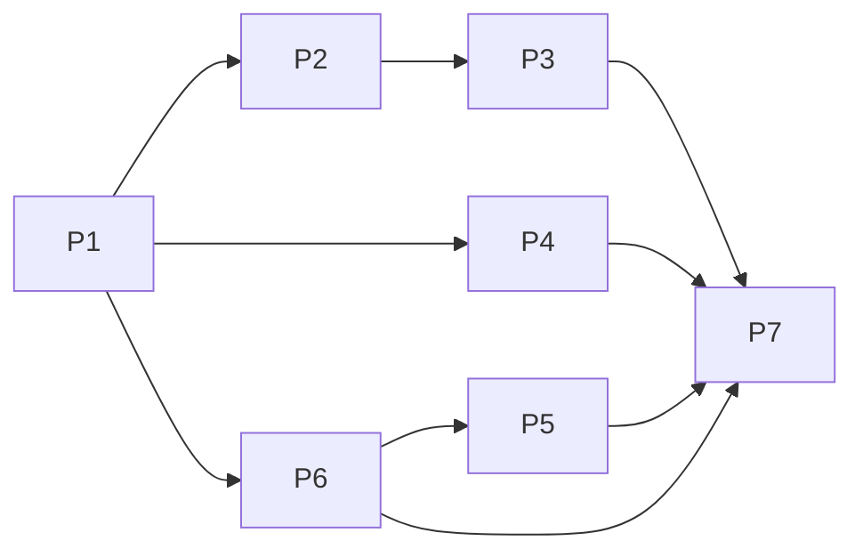

## 目标
在 termul 中交付一个可实际使用的 C-ABI 原生插件系统：用户进入“插件”页面，从本地动态库文件安装插件，启用、停用、重新加载/升级及卸载；插件可以声明命令、设置和面板，在现有主题下呈现声明式 UI，并接收操作、返回更新后的 UI 树。

插件代码只在新增的常驻 **Plugin Core** 进程执行。GUI、Terminal Core、ACP Core 不加载插件动态库。正常 Rust 插件 panic 被 SDK 捕获；原生 abort、段错误或不可取消的超时只影响 Plugin Core，由现有监督机制恢复，不终止 GUI 或终端。

交付判断以真实 cdylib 端到端测试、进程隔离测试、渲染器测试及开发应用手工验收为准，而非仅通过编译。本文件是实施计划，尚未执行这些验收。

## 依据
### 已核实的依据

| 依据 | 事实与约束 |
|---|---|
| `.qin-code/docs/proposals/cordis-cabi-plugin-system-proposal.md:55–104, 143–169, 184–205` | 用户指定为批准方案：独立 Plugin Core、编译期 CAbiPlugin 适配器、Broker、版本化副本、永不 dlclose。文档 frontmatter 仍为 `status: draft`，以本次用户明确授权为准，不擅改文档状态。 |
| `AGENTS.md:18–26` | runtime-neutral 契约放 `src/shared`；需要评估 desktop/shared-live/se-server/browser；平台专属功能必须显式 gate 并测试 unsupported；两种 renderer 根应一致。 |
| `src-tauri/crates/se-ipc/src/lib.rs:19–38, 48–72, 168–233` | CoreRole 现有 Gui/TerminalCore/AcpCore，kebab-case 序列化；按 profile 建 socket/pipe；已有 Hello/Ack/Request/Response/Event，协议版本 1、8 MiB 帧上限。 |
| `src-tauri/src/main.rs:11–20`；`src-tauri/src/core/process.rs:11–21` | 主程序在 GUI 初始化前识别 Core flag；Terminal 单独分流，其余目前进入 ACP runner。新增 PluginCore 必须显式分支，不能落进该 `_` 分支。 |
| `src-tauri/src/core/launcher.rs:92–115, 294–321, 709–914, 844–852, 926–945` | 已有脱离 GUI 会话、发现/接管、身份比对、繁忙时延后替换、启动就绪检查及角色参数/host-app 映射。 |
| `src-tauri/src/core/app_host.rs:43–54, 179–235` | macOS 使用 profile 内独立 LSUIElement host app 启动 Core。 |
| `src-tauri/crates/se-terminal-core/src/terminal.rs:528–619, 651–663, 1620–1652, 2040–2090`；`src-tauri/src/core/acp.rs:671–803, 2231–2471` | 已有方法分发、请求 ID/oneshot、事件转发、重连模式；不存在 `src-tauri/src/core/client.rs`，不要新建一个“对齐现有 client.rs”的虚构改造。 |
| `src-tauri/src/commands.rs:110–138, 148–179`；`src-tauri/src/lib.rs:2291–2301, 2389–2400, 2465–2592, 3599` | 可复用 `IpcResult<T>`、客户端代理、事件镜像及 generate_handler；监督器每 3 秒探测，连续 3 次失败后重启/重连。现有两类 Core 没有 idle-exit。 |
| `src-tauri/src/lib.rs:1696–1743, 1771–1912, 2158–2181` | 运行时身份、状态和必须 reconciliation 的 Core 均为封闭集合，需加入 PluginCore。 |
| `src-tauri/src/lib.rs:2899–2913`；`src/renderer/lib/tauri-persistence-api.ts:4–6, 50–85`；`src/renderer/stores/app-settings-store.ts:14–30` | profile 来自 `app_data_dir()`；renderer 现有通用数据用 tauri-plugin-store 的 `termul-data.json`，zustand 是缓存，不应成为常驻 Core 配置的写入权威。 |
| `src-tauri/crates/se-foundation/src/durable_fs.rs:1–7, 36–71, 582–598` | 已有跨平台同目录原子替换、落盘与目录同步辅助函数，及明确的 old/new complete 状态。 |
| `src/renderer/app/portable-router.tsx:32–85`；`src/renderer/{TauriApp,App}.tsx:4–5` | 两种 renderer 共用 portable route 表，不需要维护第二份插件路由。 |
| `src/renderer/pages/McpPage.tsx:11–59`；`components/CommandPalette.tsx:69–83, 120`；`components/settings/SettingsLayout.tsx:8–38` | 已有功能页面、桌面 gate、命令面板与设置布局模式。 |
| `src/renderer/components/ui/button.tsx:7–34`；`input.tsx:5–16`；`switch.tsx:6–25`；`select.tsx:7–31` | 可以复用主题化 Button/Input/Switch/Select；不接受插件自带 CSS、JS 或任意 DOM 属性。 |
| `src/renderer/features/quick-terminal/tauri-quick-terminal-api.ts:12–41`；`src/renderer/lib/invoke-decoded-ipc-result.ts:42–51`；`src/renderer/i18n/resources.ts:1–76` | 可采用独立 API 工厂、解码 IpcResult 和 host event 订阅模式；翻译资源显式注册。 |
| `scripts/release/component-build-inputs.json:11–23, 25–88`；`src/shared/types/updater.types.ts:3–18, 89–97` | 组件输入、身份脚本与 TS parser 都枚举四个组件；直接发布第五个 `components` 键会被旧 parser 拒绝，必须设计兼容表示。 |
| `src-tauri/Cargo.toml:6–19, 76–89`；`package.json:64, 71–74, 88–90`；`vitest.config.ts:11–26` | Rust MSRV 1.89；workspace 自动包含 `crates/*`；前端用 bun/Vitest/tsc；测试环境 jsdom，`@shared`/`@` 别名已存在。 |
| 本地 cordis `Cargo.toml:17–25`；`crates/cordis-core/src/plugin.rs:114–162, 326–357` | 本地锁定源码为 cordis-core 0.6.1、MIT、MSRV 1.88；Plugin 有关联类型和返回 impl Future，不能当作动态 trait object；`PreparedPlugin::from_input` 封装具体类型且不会替调用者执行 prepare。 |
| 本地 cordis `service.rs:134–137, 774–817`；`effect.rs:421–463` | Service 具有静态 NAME 并绑定 TypeId；provide 自动登记撤回；effect_sync 不能执行可能阻塞的 FFI，异步 effect 才用于等待清理。 |

本地 cordis 路径为 `/Users/qs/.qin-code/scratch/dshbox-cordis-cd540033`。未复制、未读取用于复制的 redoop/cordis-rust 或 bigfish1913/pi-rust 实现。

### 假设与未执行项

- 目标为 `/Users/qs/project/me/termul` 当前工作区及其基线，用户报告分支为 `main`；执行者在开始时核对工作区，不切换或整合他人分支。
- 当前会话的项目知识/模型工具指向 qin-code 仓库，不作为 termul 事实来源；目标 `.qin-code/knowledge` 未找到插件/CoreRole/cordis 相关知识。没有把 staged knowledge 当事实。
- crates.io 包下载、实际 Rust 编译、动态装载、签名策略、Windows/Linux 执行均未验证；以下是待执行的验收，不是已有通过记录。

## 执行前补充核实（2026-11-03 16:04，root 会话）

- 磁盘：数据卷可用 393 GiB；共享 target `/Users/qs/project/me/termul/src-tauri/target` 当前 2.8 GiB，`CARGO_TARGET_DIR` 未设置。
- `cordis-core =0.6.1`、`cordis-loader =0.6.1` 在本机 rustc 1.95.0 下 `cargo check` 通过（使用上述共享 target）。
- 已安装 `/Applications/Se Manager.app` 的签名：`CodeDirectory flags=0x0(none)`，自签名，`TeamIdentifier=not set`，即未启用 Hardened Runtime，当前配置下不强制库验证。若日后启用 Hardened Runtime 或公证，需要重新评估第三方动态库加载。

## 非目标

本节同时列出范围内与范围外内容；「范围外及兼容边界」即非目标。
### 范围内

- 本地原生动态库安装、清单、启停、热重载/升级、卸载；持久注册表、配置、故障隔离、Broker、生命周期撤回。
- 声明式 UI 面板与命令，配置 schema 表单、即时配置通知；en/zh-CN；真实示例插件与自动化验收。
- PluginCore 的进程发现/接管/监督/重连、运行时状态、更新 reconciliation、组件身份及其封闭枚举测试。

### 范围外及兼容边界

- 不做 TS/JS/WASM 插件、Node、iframe、插件 HTML/CSS、插件市场、网络安装、自动文件监听升级、终端控制能力或远程插件管理。
- v1 是**本机桌面能力**。shared-live/browser/phone/se-server 不暴露加载原生代码的 API；共用路由显示明确的 unsupported 状态，测试保证不调用 Tauri stub 或 HTTP。不得默默省略这些表面的评估。
- 本地安装输入是一个当前 OS/架构的 `.dylib`、`.so` 或 `.dll` 文件，不是插件目录或压缩包；v1 不复制附属动态库或资源目录。清单由动态库导出。
- 升级使用新副本，不承诺保留插件私有内存状态；配置与启用意图必须保留。卸载是逻辑撤销与删除持久记录，不是 dlclose。
- 不在本次开发中执行正式 release/LTO 构建，不修改 macOS 安全权限来绕过尚未确认的签名限制。

### 开发约定——必须原样遵守

所有命令在 `/Users/qs/project/me/termul` 执行。每次 cargo 调用必须采用：

```text
command cargo <cmd> --manifest-path src-tauri/Cargo.toml --target-dir /Users/qs/project/me/termul/src-tauri/target ...
```

只使用这一个共享 target 目录；不得建立其他 target 目录、额外 worktree 或 release/LTO 构建。测试 profile/tempdir 不是编译 target，允许用于数据与 socket 隔离。构建命令串行调度，源文件编辑可并行。P1 生成锁文件后，其他包全部使用 `--locked`；任何新依赖由 P1 唯一所有者修订，不让并行执行者争写 Cargo.lock。

## 需求
| ID | Requirement / source | Planned outcome | Acceptance evidence |
|---|---|---|---|
| R1 | 用户要求完整生命周期 | install/list/set_enabled/reload/uninstall；版本化持久包与装载副本 | `plugin_e2e` 安装到卸载闭环；升级后 generation 和装载路径不同 |
| R2 | panic、ABI 协商、每回调超时 | SDK 内 catch_unwind、完整前缀检查、worker 截止时间、quarantine 与 Core 重启 | ABI 单测；真实 panic/timeout/abort 测试；其他 Core PID 与 PTY 输出不变 |
| R3 | 声明式 UI、交互回传 | 11 类白名单节点、主题组件、view/action RPC、版本检查 | UiTreeRenderer 测试；点击后真实 cdylib 返回计数变化 |
| R4 | contributes.configuration | string/number/boolean/enum schema、持久覆盖值、表单、激活配置与 on_config_changed | 配置校验单测；表单测试；Hello→Hola、step 1→2 后计数 1→3 |
| R5 | workspace 内带 UI 示例 | `se-plugin-example` cdylib 与正常/升级/故障测试构建 | 单条 `scripts/test-plugins.sh` 先构建真实库，再运行 Rust 集成测试 |
| R6 | 批准方案 | 同一主二进制 Plugin Core；固定 cordis-core；CAbiPlugin；Broker；never dlclose | 进程 smoke、依赖等待/撤回单测、装载计数与库句柄保留检查 |
| R7 | 并行实施且文件互斥 | 七个包、固定契约、唯一 manifest/lock 所有者 | 所有权表与 DAG；各包列明独立验收命令 |
| R8 | 单 target、无 release/LTO/worktree、原创 ABI | 所有命令使用规定形式，SDK 自行实现 | runner 命令审查；只生成共享 target 下的三组测试库 |
| R9 | 仓库约束：主题、i18n、跨表面与 Core 更新 | 共享路由、桌面 gate、双语资源、pluginCore 组件身份及旧客户端兼容 wire policy | renderer parity、组件脚本/更新策略测试、运行时设置 UI 测试 |

## 设计
### 1. 进程与职责


选择同一 `se-manager` 二进制的 `--plugin-core` 分支；不增加 `[[bin]]`、不增加 sidecar 寻址。`core_executable` 对 PluginCore 返回主程序路径。新增 `app_host::PLUGIN_CORE`，`id_suffix="plugin-core"`、`label="Plugin Core"`。

Plugin Core 独占 `<profile>/plugins` 的文件锁。GUI 永远通过 Core 操作插件；即便 Core 不可用，也不退回 GUI 内加载。Core 先完成持久状态检查并监听，再异步恢复启用插件，以免插件恢复阻塞 launcher 的 5 秒就绪检查。

### 2. ABI v1：唯一符号与精确布局

SDK crate `se-plugin-abi` 只依赖 Rust std，不依赖 serde、tokio、cordis、Tauri。跨边界只能传整数、指针、长度及 C 函数指针。禁止 Rust String/Vec/Result/trait object/Context/TypeId 跨 ABI。

所有结构 `#[repr(C)]`，使用目标平台自然对齐，禁止 packed；调用双方必须同 OS、架构、指针宽度。字段顺序如下，不得调整：

```rust
use core::ffi::c_void;
pub type SeStatus = i32;

#[repr(C)]
#[derive(Clone, Copy)]
pub struct SeAbiHeader {
    pub abi_version: u32,
    pub struct_size: u32,
}

#[repr(C)]
#[derive(Clone, Copy)]
pub struct SeSlice {
    pub ptr: *const u8,
    pub len: usize,
}

#[repr(C)]
pub struct SeOutput {
    pub ptr: *mut u8,
    pub capacity: usize,
    pub len: usize,
}

pub type SeLogFn = unsafe extern "C" fn(
    host_context: *mut c_void,
    level: u32,
    message_utf8: SeSlice,
) -> SeStatus;

pub type SeBrokerCallFn = unsafe extern "C" fn(
    host_context: *mut c_void,
    request_json: SeSlice,
    output: *mut SeOutput,
) -> SeStatus;

#[repr(C)]
pub struct SeHostApiV1 {
    pub abi_version: u32,
    pub struct_size: u32,
    pub host_context: *mut c_void,
    pub log: Option<SeLogFn>,
    pub broker_call: Option<SeBrokerCallFn>,
}

pub type SeManifestFn = unsafe extern "C" fn(
    output: *mut SeOutput,
) -> SeStatus;

pub type SeCreateFn = unsafe extern "C" fn(
    host: *const SeHostApiV1,
    activation_json: SeSlice,
    out_instance: *mut *mut c_void,
) -> SeStatus;

pub type SeJsonCallbackFn = unsafe extern "C" fn(
    instance: *mut c_void,
    request_json: SeSlice,
    output: *mut SeOutput,
) -> SeStatus;

pub type SeConfigChangedFn = unsafe extern "C" fn(
    instance: *mut c_void,
    config_json: SeSlice,
) -> SeStatus;

pub type SeDestroyFn = unsafe extern "C" fn(
    instance: *mut c_void,
) -> SeStatus;

#[repr(C)]
pub struct SePluginApiV1 {
    pub abi_version: u32,
    pub struct_size: u32,
    pub manifest: Option<SeManifestFn>,
    pub create: Option<SeCreateFn>,
    pub render_view: Option<SeJsonCallbackFn>,
    pub on_action: Option<SeJsonCallbackFn>,
    pub on_command: Option<SeJsonCallbackFn>,
    pub on_config_changed: Option<SeConfigChangedFn>,
    pub on_service_call: Option<SeJsonCallbackFn>,
    pub destroy: Option<SeDestroyFn>,
}

pub type SeEntryFn = unsafe extern "C" fn(
    host_abi_min: u32,
    host_abi_max: u32,
    out_api: *mut *const SePluginApiV1,
) -> SeStatus;

// 唯一必须导出的动态符号，SDK 宏生成：
#[no_mangle]
pub unsafe extern "C" fn se_plugin_entry_v1(
    host_abi_min: u32,
    host_abi_max: u32,
    out_api: *mut *const SePluginApiV1,
) -> SeStatus;
```

#### 协商与所有权

- 宿主查找 `b"se_plugin_entry_v1\0"`，传 `(1,1)`，先把 `out_api` 清空。插件只在范围包含 1 时返回静态导出表；失败保持 null。宿主先检查非空、对齐和两字段 header，再验证 `abi_version==1`、`struct_size>=size_of::<SePluginApiV1>()`，之后才读取已知字段。过小拒绝、尾部新增字段忽略；所有 v1 函数指针必须非空。未贡献某能力的插件仍由 SDK 提供返回 UNAVAILABLE 的默认 trampoline。
- `create` 同样验证 HostApi header/大小和必需函数。manifest 的 ABI 范围也必须包含实际协商版本，否则拒绝。不能用 assert/panic 处理不兼容库。
- `SeSlice` 在本次调用期间借用；len=0 可用 null，否则必须指向有效内存。UTF-8 JSON 不带 NUL，拒绝无效 UTF-8。插件若要保留输入必须自行复制。
- 输出缓冲区始终由调用者分配和释放。callee 只能写 `ptr[0..capacity]` 及 `len`，不得改 ptr/capacity、保留输出指针或跨 allocator 释放。成功时 `len<=capacity`；BUFFER_TOO_SMALL 时可把所需长度写入 len，但不得越界。**宿主不自动重试有副作用回调**。固定 1 MiB 调用输出容量，业务 JSON 再受更小上限约束。
- `create` 成功返回非空实例，失败必须返回 null 并清理尚未交出的私有状态。实例仅由对应 `destroy` 释放；成功 create 对应一次 destroy 尝试。HostApi、host_context 与代码映射至少活到实例所有调用结束；超时不能提前释放它们。
- 无 `free` 导出：输出采用调用方缓冲区，插件实例由 destroy 自行释放；导出表是静态借用。宿主保留 `ManuallyDrop<libloading::Library>`，任何成功打开的库，包括后来协商失败的库，都不调用 dlclose/FreeLibrary。

#### 状态码

| 数值 | 常量 | 含义 |
|---|---|---|
| 0 | `SEP_OK` | 成功 |
| 1 / 2 / 3 | `SEP_INVALID_ARGUMENT` / `SEP_ABI_UNSUPPORTED` / `SEP_BUFFER_TOO_SMALL` | 指针/参数错误、ABI 不支持、输出容量不足 |
| 4 / 5 / 6 | `SEP_INVALID_JSON` / `SEP_NOT_FOUND` / `SEP_UNAVAILABLE` | JSON 错误、资源不存在、能力/服务不可用 |
| 7 / 8 / 9 | `SEP_BUSY` / `SEP_PANIC` / `SEP_INTERNAL` | 队列满、已捕获 panic、插件内部错误 |
| 10 / 11 / 12 | `SEP_DEADLINE_EXCEEDED` / `SEP_STALE_GENERATION` / `SEP_REENTRANT` | Broker 截止时间、旧代请求、递归调用拒绝 |

非 0 状态的输出不解释成成功 JSON；未知状态映射 `PLUGIN_CALLBACK_ERROR`，保留数值作诊断。日志级别固定 `1=error,2=warn,3=info,4=debug`。

#### SDK 的固定 Rust 接口

`export_plugin!(CounterPlugin)` 为下列 `PluginV1` 实现生成所有 extern-C trampoline、Box 实例持有与释放、输出 Writer，以及每个边界内的 `catch_unwind(AssertUnwindSafe(...))`：

```rust
pub trait PluginV1: Sized + 'static {
    fn manifest() -> &'static [u8];
    fn create(host: Host, activation_json: &[u8]) -> Result<Self, SeStatus>;
    fn render_view(&mut self, json: &[u8], out: &mut OutputWriter<'_>) -> Result<(), SeStatus>;
    fn on_action(&mut self, json: &[u8], out: &mut OutputWriter<'_>) -> Result<(), SeStatus>;
    fn on_command(&mut self, json: &[u8], out: &mut OutputWriter<'_>) -> Result<(), SeStatus>;
    fn on_config_changed(&mut self, json: &[u8]) -> Result<(), SeStatus>;
    fn on_service_call(&mut self, json: &[u8], out: &mut OutputWriter<'_>) -> Result<(), SeStatus>;
    fn destroy(self) -> Result<(), SeStatus>;
}
```

除 manifest/create/destroy 外提供 UNAVAILABLE 默认实现；destroy 默认消费 self。`Host::log(level, &str)`、`Host::broker_call(&[u8], &mut [u8]) -> Result<usize,SeStatus>` 是安全包装；Host 不实现 Send/Sync，不允许插件把宿主表转交后台线程。宏在 `panic="abort"` 的 Rust SDK 插件构建中报错。其他语言必须自行满足“不跨 ABI unwind”约定；宿主不声称能验证任意原生指针。

### 3. JSON Schema 与数据契约

所有对象只接受此处定义的属性；v1 不允许扩展任意属性。采用 JSON Schema draft 2020-12 的语义；P1 将以下结构及约束固化为 `se-plugin-protocol/schema/*.schema.json`，Rust/TS 解码器和共享 fixtures 必须同时符合它们。这里的 `?` 表示可省略，其余字段必填；省略值按下述默认值处理，不能由实现者另选。

#### Manifest

```json
{
  "schemaVersion": 1,
  "id": "org.termul.example",
  "name": "Configured Counter",
  "version": "0.1.0",
  "abi": { "min": 1, "max": 1 },
  "contributes": {
    "commands": [
      { "id": "example.reset", "title": "Reset counter", "description": "Reset the counter to zero" }
    ],
    "configuration": {
      "title": "Counter settings",
      "properties": {
        "greeting": { "type": "string", "title": "Greeting", "description": "Greeting shown in the panel", "default": "Hello" },
        "step": { "type": "number", "title": "Step", "description": "Increment per click", "default": 1, "minimum": 1, "maximum": 100 },
        "showCount": { "type": "boolean", "title": "Show count", "description": "Show the current count", "default": true },
        "tone": { "type": "string", "title": "Tone", "description": "Text emphasis", "default": "normal", "enum": ["normal", "muted"], "enumLabels": ["Normal", "Muted"] }
      }
    },
    "views": [ { "id": "example.counter", "title": "Counter", "location": "panel" } ]
  },
  "services": {
    "provides": [ { "name": "org.termul.example.counter", "version": 1 } ],
    "requires": []
  }
}
```

| 对象 | Schema 规则 |
|---|---|
| Manifest | 必填上述全部顶层字段，`schemaVersion=1`，`additionalProperties=false`；最大 256 KiB。`id` 1–128 字符，匹配 `^[a-z][a-z0-9]*(?:[.-][a-z0-9]+)+$`；name 1–128；version 用 `semver::Version` 验证；abi.min/max 为正整数且 min≤max。 |
| Commands / Views | commands 最多 64、views 最多 8；id 匹配 `^[A-Za-z0-9][A-Za-z0-9._-]{0,127}$`，同类内唯一。命令 `{id,title,description?}`；视图 `{id,title,location:"panel"}`。宿主身份始终是 `(pluginId, localId)`，不把不同插件的本地 ID 当全局 ID。 |
| Configuration | `{title,properties}`，最多 64 个 flat property；key 使用上述 local-id pattern。每项必填 `type,title,description,default`，type 为 string/number/boolean；`enum?` 为 1–64 个不重复、与 type 相同的标量，default 必须属于 enum；`enumLabels?` 为同长字符串数组。enum 优先渲染 Select。 |
| 属性限制 | string 可有 `minLength?`、`maxLength?`，范围 0–8192，默认 0/8192；number 可有有限 `minimum?`、`maximum?`，min≤max；boolean 不接受数字/长度约束。拒绝 NaN/Infinity、类型强制转换、嵌套对象/数组、未知配置 key。title 1–128，description 0–2048。所有 default 必须通过自身规则。 |
| Services | `{provides:[{name,version}],requires:[{name,version}]}`；各最多 32，name 使用 plugin-id pattern，version 为 1..2³¹−1 的整数；每个 `(name,version)` 只允许一个 active provider；缺依赖等待，循环依赖拒绝。 |

#### 配置、激活与插件回调 payload

```ts
// 写入 schema/config.schema.json；values 的实际 schema 从 manifest properties 派生。
type ConfigPayload = {
  schemaVersion: 1
  pluginId: string
  revision: number                 // 正整数、<= Number.MAX_SAFE_INTEGER
  values: Record<string, string | number | boolean> // 完整有效值，不是 patch
  changedKeys: string[]            // 首次激活为 []，变更时为实际变化 key
}
type ActivationPayload = {
  schemaVersion: 1
  pluginId: string
  generation: string               // 宿主生成 UUID，插件不可自选
  config: ConfigPayload
}
type RenderRequest = { schemaVersion: 1; viewId: string }
type CommandRequest = { schemaVersion: 1; commandId: string; args: unknown }
type CommandReply = { schemaVersion: 1; result: unknown; invalidateViews: string[] }
type ServiceRequest = {
  schemaVersion: 1; service: string; version: number; method: string; input: unknown
}
type ServiceReply = { schemaVersion: 1; result: unknown }
```

create 接收 ActivationPayload；on_config_changed 接收 ConfigPayload，成功后宿主重新调用 render_view 得到更新树；on_command 与 on_service_call 的输出分别为上述 Reply。Broker 入参与输出 JSON 各最多 256 KiB，method 1–128 字符。服务调用链、调用者和 deadline 由宿主私有上下文附加，不接受插件伪造。

#### UI tree

```ts
type UiTree = { schemaVersion: 1; viewId: string; root: UiNode }
type UiNode = {
  id: string
  type: 'column' | 'row' | 'text' | 'heading' | 'button' | 'input' |
        'toggle' | 'select' | 'list' | 'divider'
  props: NodeProps
  children?: UiNode[]
}
// 运行时支持的节点种类为上面这 10 种；column/row 分别是独立类型。
```

| type | 唯一允许的 props；未标 `?` 者必填 |
|---|---|
| column / row | `gap?:"none"|"xs"|"sm"|"md"|"lg"` 默认 sm；`align?:"start"|"center"|"end"|"stretch"` 默认 stretch；必须有 children 数组。 |
| text | `text:string`；`tone?:"default"|"muted"|"danger"` 默认 default；`wrap?:boolean` 默认 true。 |
| heading | `text:string`；`level?:1|2|3` 默认 2。 |
| button | `label:string,actionId:string`；`variant?:"default"|"secondary"|"outline"|"destructive"` 默认 default；`disabled?:boolean` 默认 false。 |
| input | `label:string,value:string,actionId:string`；`placeholder?:string` 默认空；`maxLength?:integer` 默认 4096、范围 1–4096；`disabled?:boolean` 默认 false。v1 只提供 text 输入。 |
| toggle | `label:string,checked:boolean,actionId:string`；`disabled?:boolean` 默认 false。 |
| select | `label:string,value:string,actionId:string,options:Array<{value:string,label:string}>`；options 最多 64，value 非空且唯一，当前 value 必须在列表中；`disabled?:boolean` 默认 false。 |
| list | `items:Array<{id:string,text:string,description?:string}>`，最多 256 条、item id 唯一；description 默认空。 |
| divider | `orientation?:"horizontal"|"vertical"` 默认 horizontal。 |

仅 column/row 允许 children；其他节点出现 children 即拒绝。NodeProps 是按 type 分支的 `oneOf`，不是开放字典。整棵树最多 256 KiB、1024 节点、深度 32；节点 id 采用 local-id pattern 且全树唯一；普通字符串最多 8192 字符，交互控件 label 非空、最多 128；actionId 采用 local-id pattern。不允许 HTML、markdown HTML、URL、事件代码、className、style 或任何未知属性。宿主和 renderer 双重验证；React 只渲染文本，不使用 `dangerouslySetInnerHTML`。

#### Action 与宿主 ViewSnapshot

```ts
type ActionEvent = {
  schemaVersion: 1
  eventId: string                 // UUID
  pluginId: string
  generation: string
  viewId: string
  viewRevision: number
  nodeId: string
  actionId: string
  kind: 'click' | 'change'
  value: null | string | boolean
}
type ViewSnapshot = {
  pluginId: string
  generation: string
  revision: number
  configRevision: number
  tree: UiTree
}
```

button 对应 click/null；input/select 对应 change/string；toggle 对应 change/boolean。宿主依据**当前树**验证 node/action/kind/value、disabled、generation 和 revision，拒绝伪造或陈旧操作。on_action 输出同 viewId 的完整 UiTree；宿主分配新 revision，再返回 ViewSnapshot。插件不得自定宿主 revision。

每代缓存最近 32 个 eventId 及请求摘要/结果；相同 ID 同 payload 返回原结果，不重复执行；同 ID 不同 payload 拒绝。新 generation 不接受旧事件。输入变化 debounce 150 ms，每个面板串行发送事件，收到新 revision 后再发下一项；升级/重连时丢弃旧代队列，不自动重放有副作用操作。

### 4. 装载、线程和超时

`Library::new`、入口、manifest 和全部实例回调都在专用 `std::thread` worker 中运行，不在 Tokio worker 或 cordis lifecycle poll 中执行原生代码。一个实例的回调严格串行，bounded queue 容量 32；满时返回 PLUGIN_BUSY，不无限堆积。

生产默认每次 foreign 调用截止时间 **2000 ms**，包括 entry、manifest、create、render_view、action、command、config、service、destroy；dlopen/静态初始化也按 2000 ms 监督。Broker 使用调用者剩余截止时间，不重新获得完整 2 秒；宿主 log 不调用插件、限长 4096 字节并限流。

等待超时只表示调用者不再等待，**不表示线程停止**。worker 持有输入、输出、HostApi、host_context、实例和 Library 的所有权；未返回前不可 free/destroy/dlclose。超时后撤回该代可见资源、持久 quarantine，通知 Core 重启；Core 尽可能发出错误/事件，100 ms 后结束进程，禁止 join 卡死线程。重新启动时不自动激活隔离插件。

SDK 捕获的 panic 返回 SEP_PANIC：撤回并隔离该实例，按 once guard 尝试一次有 deadline 的 destroy；正常情况 Plugin Core 本身继续服务。abort/段错误无法由 catch_unwind 拦截，只能由进程隔离恢复。宿主导出的 HostApi 函数也必须在自身 extern-C 边界捕获宿主 Rust panic。

控制操作整体预算 20 秒，回滚另有最多 20 秒预算；排队期间超时尚未进入插件时只返回错误，不误判插件卡死。GUI RPC deadline 为 60 秒；连接断开或超时不自动重放 mutation，重新 list/get 查询实际状态。

### 5. cordis 包装与 Broker

只在 `se-plugin-host` 内依赖 `cordis-core = "=0.6.1"`，不引入 cordis-loader。外部接口只暴露我们自己的类型，不向 GUI、协议 crate 或插件暴露 cordis 类型。

`CAbiPlugin` 是编译期具体类型，实现：`Config=PreparedCAbiInput`、`Input=PreparedCAbiInput`、`PrepareError=PluginError`、`ApplyError=PluginError`。loader 已经异步完成复制、符号和清单验证；prepare 只做非阻塞宿主校验。调用顺序明确为 `adapter.prepare(input)` → `PreparedPlugin::from_input(adapter, input)` → `Context::spawn`，不得误以为 from_input 自动调用 prepare。

根 Context 仅 provide 一个固定 Rust service：

```rust
pub struct PluginBroker { /* 宿主路由及 generation-aware 通道 */ }
impl cordis_core::Service for PluginBroker {
    const NAME: &'static str = "termul.plugin-broker.v1";
}
```

所有 CAbiPlugin 的 inject 固定 require 这个 NAME。动态服务名称存放 Broker 注册表，不试图为运行时字符串实现静态 Service::NAME 或伪造 TypeId。

Broker 负责 manifest services.requires/provides 的动态依赖图：缺依赖的启用意图保持 pending；提供者就绪后按拓扑序激活；撤回时先关闭路由 admission，再逆拓扑停用依赖者，其启用意图保留为 pending。循环依赖、重复 provider 拒绝且无部分注册。服务调用只能访问声明的 requires；同实例重入或调用链重复节点拒绝，最大链深度 8；路由锁不能跨 FFI/等待持有。

每次 adapter apply 的清理顺序固定：create 成功后**立即**登记异步 `ctx.effect` 的 destroy 义务；若登记失败，guard 自己执行一次 destroy。再登记 `effect_sync` 的宿主视图/命令/Broker lease 撤回；只有初始 view 全部有效且激活提交后才公开这些 lease。LIFO 因而先撤回宿主资源，再异步 teardown。后续 render/注册失败仍会清理已经 create 的状态。`effect_sync` 绝不执行 FFI。

### 6. 持久化、安装与事务

以 `app_data_dir()` / `TERMUL_CORE_PROFILE_ROOT` 为 profile，不使用 renderer 的 termul-data.json，也不修改既有 AppSettings schema。

```text
<profile>/plugins/
  host.lock
  registry.json
  runtime.json
  packages/<plugin-id>/<semver>/<sha256>/plugin.<ext>
  loaded/<boot-id>/<sha256>-<uuid>.<ext>
```

- `registry.json`：`{schemaVersion:1,plugins:[{id,manifest,sourcePath,artifactPath,sha256,desiredEnabled,configRevision,configOverrides,quarantine:null|{code,message,at}}]}`。配置以每插件 overrides 保存，完整 values=defaults+overrides；registry 和配置同文件原子提交，避免跨文件事务。使用 `se_foundation::durable_fs::replace_bytes`；目录采用 owner-only 权限。损坏文件保留、不覆盖为空注册表，返回 PLUGIN_STORE_CORRUPT。
- `runtime.json`：`{schemaVersion:1,bootId,cleanExit,recentUncleanStarts,inFlight:[{pluginId:null|string,generation,sha256,callback,startedAt}]}`。foreign 调用前持久记录，返回后清除；写前记录失败则不进入插件。未正常关闭后的 inFlight 插件在下次启动隔离；没有可归因记录时隔离所有原启用插件。60 秒内连续三次非正常启动进入 safe mode，停止自动激活，防止崩溃循环。
- 绝对本地文件路径经 canonicalize、regular-file/扩展名/大小检查，最大 64 MiB；只从已复制并校验 SHA-256 的不可变字节执行，不能从仍在编译的源文件直接 dlopen。加载副本先以 hash+uuid 命名，因此即便尚未知 manifest version 也不会覆盖已映射文件。插件 ID 不参与任意路径拼接，验证后才能建立 package 路径。
- 安装验证清单后持久化，初始 disabled；同 ID 已存在返回 PLUGIN_ALREADY_INSTALLED。安装验证本身会运行原生入口，UI 必须在选文件后确认“此插件拥有当前用户权限”，再调用 install。
- 卸载先停用并撤回资源，再删除该插件 registry/config 记录。只清理宿主拥有的 package/cache 路径，永不删除用户 sourcePath。已映射副本留到 Core 退出；下次启动清理旧 boot 的 loaded 目录及未被 registry 引用的 packages。Windows 删除失败记录待 GC，不把逻辑卸载误报失败，也不尝试覆盖 DLL。

热重载/升级：`reload(id,path?)`，未提供 path 时读已保存 sourcePath。允许相同 semver 的开发重载，允许更高版本，拒绝降级和 ID 变化。先验证候选库/清单/配置兼容，再冻结旧代操作、停用依赖者和旧代、激活候选并验证所有 view，最后原子提交 registry 与公开新代。失败保留旧持久记录，用旧 artifact+配置重新激活；不承诺恢复旧私有计数等内存状态。没有同时公开两代 provider 的阶段。

配置升级只迁移 overrides：仍存在且符合新 schema 的覆盖值保留；其余值默认来自新 default。删除/类型变化导致不兼容的显式 override 时拒绝升级，返回具体 key 的 PLUGIN_CONFIG_MIGRATION_REQUIRED，用户先恢复这些设置的默认值再升级，禁止悄悄丢弃用户值。

### 7. 配置更新事务

`config.set` 提交完整 values 和 expectedRevision；缺失 key 用 default 补齐，未知 key 或类型/enum/范围错误拒绝。revision 冲突返回 PLUGIN_CONFIG_CONFLICT，前端保留编辑草稿并提供“重新载入”，不覆盖较新配置。

disabled/pending 插件直接验证并持久化，下次 create 带完整配置。active 插件先调用 on_config_changed，再 render 所有已声明 views 到暂存结果；成功才提交新 registry/config revision、替换 view cache 并通知 GUI。相同值是 no-op。

回调或持久提交失败时不保留半应用配置：撤销该代，按旧 artifact/旧配置重建；panic/timeout 则维持 quarantine，由用户明确再次启用。旧磁盘配置始终可恢复。重建导致私有内存状态重置的事实必须在错误信息中说明。

### 8. 内部 Rust 接口与新路径

下列全部是**拟新增**，不是声称已有符号：

| 路径 | 责任/导出 |
|---|---|
| `src-tauri/crates/se-plugin-abi/{Cargo.toml,src/lib.rs,src/sdk.rs,src/export.rs}` | 上述 repr(C) 类型、SDK、宏、ABI/所有权测试；无第三方依赖。 |
| `src-tauri/crates/se-plugin-protocol/{Cargo.toml,src/lib.rs,src/manifest.rs,src/ui.rs,src/config.rs,src/rpc.rs,src/error.rs,schema/*}` | serde DTO、METHOD_* 常量、校验器、JSON Schema；不依赖 cordis/Tauri。 |
| `src-tauri/crates/se-plugin-host/src/{lib,loader,abi_worker,adapter,broker,registry,config,validation,runtime}.rs` | loader/worker/cordis/Broker/事务/宿主 facade。 |
| `src-tauri/src/core/plugin.rs`；`src-tauri/src/plugin_commands.rs` | Core server/client、独立服务 handle、Tauri 代理命令；无 GUI 内装载分支。 |
| `src-tauri/crates/se-plugin-example/{Cargo.toml,src/lib.rs,src/counter.rs,src/manifest.json,src/manifest-v2.json}` | 真实 UI/config 示例；正常、upgrade-fixture、test-hooks 特性。 |

宿主依赖固定为：`cordis-core="=0.6.1"`、`libloading="0.8"`、`serde="1"` derive、`serde_json="1"`、`tokio="1"` 的 rt-multi-thread/sync/time/macros、`sha2="0.10"`、`semver="1"`、`uuid="1"` v4/serde、`fs2="0.4"`、`log="0.4"` 及 ABI/protocol/foundation path dependencies；dev-dependency `tempfile="3"`。协议 crate 使用 serde/serde_json/semver；示例仅 ABI/serde/serde_json。不额外引入 JSON UI 框架或 JS 解释器。

固定 facade：

```rust
impl PluginHost {
    pub async fn open(profile_root: PathBuf, options: HostOptions)
        -> Result<Arc<Self>, PluginError>;
    pub async fn list(&self) -> Result<PluginSnapshot, PluginError>;
    pub async fn install(&self, request: InstallRequest) -> Result<PluginInfo, PluginError>;
    pub async fn set_enabled(&self, request: SetEnabledRequest) -> Result<PluginInfo, PluginError>;
    pub async fn reload(&self, request: ReloadRequest) -> Result<PluginInfo, PluginError>;
    pub async fn uninstall(&self, request: UninstallRequest) -> Result<UninstallResult, PluginError>;
    pub async fn get_view(&self, request: GetViewRequest) -> Result<ViewSnapshot, PluginError>;
    pub async fn dispatch_action(&self, request: ActionEvent) -> Result<ViewSnapshot, PluginError>;
    pub async fn execute_command(&self, request: ExecuteCommandRequest) -> Result<CommandReply, PluginError>;
    pub async fn get_config(&self, request: GetConfigRequest) -> Result<ConfigSnapshot, PluginError>;
    pub async fn set_config(&self, request: SetConfigRequest) -> Result<ConfigSnapshot, PluginError>;
    pub fn subscribe(&self) -> tokio::sync::broadcast::Receiver<PluginEvent>;
    pub fn restart_requested(&self) -> tokio::sync::watch::Receiver<Option<RestartReason>>;
    pub fn active_resources(&self) -> usize;
    pub fn diagnostics(&self) -> HostDiagnostics;
    pub async fn shutdown(&self) -> Result<(), PluginError>;
}
```

HostOptions 的 Default 固定为上述 2000 ms/队列 32/控制预算 20 秒；单测可传更短 deadline，不开放给插件修改。HostDiagnostics 提供 activeInstances/callbacksInFlight/brokerRegistrations/viewCount/commandCount/destroyAttempts/loadedLibraries，仅作 Rust 诊断，不新增远程管理接口。PluginError 属于协议 crate，实现 Error 并包含稳定 code/message。

### 9. GUI ↔ Plugin Core IPC

复用 se-ipc 协议版本 1。HelloAck role=`plugin-core`，能力固定 `plugins.lifecycle.v1`、`plugins.ui.v1`、`plugins.configuration.v1`、`plugins.broker.v1`；build ID 来自 `TERMUL_PLUGIN_CORE_BUILD_ID`。`activeResources=active 实例数+正在执行的 foreign 回调数`，供 defer-if-active 使用。

请求沿用 `CoreRequest{id,method,params}`；响应沿用 result/error，不再套一层 JSON-RPC。新客户端保留 `CoreErrorPayload.code/message`，不能像既有部分客户端那样把全部业务错误折叠成 InvalidRequest。

| METHOD 常量 / RPC method | params | result / Tauri command |
|---|---|---|
| `METHOD_LIST` / `plugins.list` | `{}` | `PluginSnapshot` / `plugin_list` |
| `METHOD_INSTALL` / `plugins.install` | `{path:string}` | `PluginInfo` / `plugin_install` |
| `METHOD_SET_ENABLED` / `plugins.set_enabled` | `{id:string,enabled:boolean}` | `PluginInfo` / `plugin_set_enabled` |
| `METHOD_RELOAD` / `plugins.reload` | `{id:string,path?:string}` | `PluginInfo` / `plugin_reload` |
| `METHOD_UNINSTALL` / `plugins.uninstall` | `{id:string}` | `{id:string,removed:true}` / `plugin_uninstall` |
| `METHOD_GET_VIEW` / `plugins.view.get` | `{id:string,viewId:string}` | `ViewSnapshot` / `plugin_get_view` |
| `METHOD_ACTION` / `plugins.view.action` | `ActionEvent` | `ViewSnapshot` / `plugin_dispatch_action` |
| `METHOD_COMMAND` / `plugins.command.execute` | `{id:string,generation:string,commandId:string,args:unknown}` | `CommandReply` / `plugin_execute_command` |
| `METHOD_GET_CONFIG` / `plugins.config.get` | `{id:string}` | `ConfigSnapshot` / `plugin_get_config` |
| `METHOD_SET_CONFIG` / `plugins.config.set` | `{id:string,expectedRevision:number,values:object}` | `ConfigSnapshot` / `plugin_set_config` |
| `METHOD_HEALTH` / `plugins.health` | `{}` | `{schemaVersion:1,bootId,pid,ready,safeMode,activeResources}`；内部检查，不新增 Tauri 命令 |
| `METHOD_SHUTDOWN` / `shutdown` | `{}` | `null`；launcher 使用，先应答再有界关闭 |

`PluginInfo={id,manifest,desiredEnabled,state,generation:null|string,configRevision,sha256,lastError:null|{code,message}}`；state 为 installed/disabled/pending/activating/active/reloading/failed/quarantined。`PluginSnapshot={schemaVersion:1,bootId,seq,plugins:PluginInfo[]}`。`ConfigSnapshot={pluginId,schema:manifest.contributes.configuration,revision,values,overrides}`。

Core topic=`plugin.event`，payload：`{schemaVersion:1,bootId,seq,type,pluginId?,generation?,viewId?,configRevision?}`；type 只能是 registry_changed/state_changed/view_changed/config_changed/resync_required。GUI 镜像为 `plugins:changed`，连接状态额外发 `plugins:connection_changed`：`{state:"connected"|"disconnected",bootId:null|string}`。广播队列 lag、seq gap 或 bootId 改变都要求重新 list/get，不依赖不可靠的增量事件恢复状态。

稳定错误码至少包括 `PLUGIN_CORE_UNAVAILABLE`、`PLUGIN_INVALID_MANIFEST`、`PLUGIN_ABI_UNSUPPORTED`、`PLUGIN_STRUCT_TOO_SMALL`、`PLUGIN_INVALID_UI`、`PLUGIN_CONFIG_INVALID`、`PLUGIN_CONFIG_CONFLICT`、`PLUGIN_CONFIG_MIGRATION_REQUIRED`、`PLUGIN_NOT_FOUND`、`PLUGIN_ALREADY_INSTALLED`、`PLUGIN_DISABLED`、`PLUGIN_PENDING`、`PLUGIN_QUARANTINED`、`PLUGIN_STALE_GENERATION`、`PLUGIN_STALE_VIEW`、`PLUGIN_PANIC`、`PLUGIN_TIMEOUT`、`PLUGIN_BUSY`、`PLUGIN_IO`、`PLUGIN_STORE_CORRUPT`、`PLUGIN_SERVICE_UNAVAILABLE`、`PLUGIN_SERVICE_CYCLE`、`PLUGIN_NOT_SUPPORTED`。错误不暴露配置值或完整插件 JSON。

Tauri 每个命令都采用 `payload: <Request>` 参数（list 无 payload），返回 `crate::commands::IpcResult<T>`，由 `plugin_commands.rs` 映射原始业务 code/message。注册到 `src-tauri/src/lib.rs` 的 generate_handler，不修改既有 Terminal 命令签名。

### 10. spawn/adopt/reconnect 与崩溃恢复

`core::plugin::run_plugin_core(profile_root: PathBuf) -> Result<(),CoreError>` 由既有 Core runtime runner 调用。`PluginCoreClient::connect(&CoreEndpoint)` 建立握手、读循环与 pending map；`reconnect(&CoreEndpoint)` 替换连接、失败全部旧 pending 请求并重新订阅事件。

GUI 管理 `PluginServiceHandle`，内部为可替换的 optional client：首次启动失败也不阻止 GUI 打开；调用返回 PLUGIN_CORE_UNAVAILABLE，监督器后续重试连接。禁止 fallback 到 GUI 执行 foreign code。

launcher、macOS host app、profile socket、detach、owned-child 回收与 reconciliation 复用既有逻辑。将 PluginCore 加入现有 3 秒/3 misses 监督列表、手动 restart 标记、`restart_core("pluginCore")`、身份和状态返回值。相同 profile 的新 GUI 接管原进程；GUI 退出不关闭 Plugin Core；不新增 idle-exit。

崩溃后 pending 请求失败且 UI 进入离线状态；监督器重启 Plugin Core，后者先处理 runtime journal、恢复非隔离的 desiredEnabled 插件，客户端重连后重新取 snapshot。所有 generation 改变，旧交互禁止重放。禁用的插件不能因重连或升级重新启用。多次异常启动进入 safe mode 后，用户通过明确启用某个插件解除其隔离，不批量自动解除。

### 11. 组件身份与旧客户端兼容

逻辑组件集合新增 `pluginCore`，action=`defer-if-active`，环境变量=`TERMUL_PLUGIN_CORE_BUILD_ID`，canonical ID=`termul-pluginCore-v1-sha256:<64hex>`。

`component-build-inputs.json` 新增：

```json
{
  "cargo.crateComponents.pluginCore": "se-plugin-host",
  "components.pluginCore": [
    "src-tauri/src/main.rs",
    "src-tauri/src/core/process.rs",
    "src-tauri/src/core/plugin.rs",
    "src-tauri/tauri.conf.prod.json"
  ]
}
```

上面是键路径说明，实际写入对应嵌套 JSON；host 的依赖闭包自动包含 ABI/protocol/foundation，已有 sharedFiles 继续包含 se-ipc、ipc.rs、build.rs/core/mod.rs。component-build-id、identity-release、merge-updater-manifests 的集合/正则/action/env/exact-set 校验及 release/nightly env 转发一起更新；沿用 release 工作流对 `se-terminal-core/src/ipc.rs` 的 touch，使新 option_env 值参与实际编译。

为避免旧客户端严格四键 parser 拒绝新发布：**身份 artifact 和新应用内部 policy 使用五组件；公开 manifest 的 `termul.componentPolicy.components` 仍保留原四键，新增同级 `termul.componentPolicy.pluginCore={buildId,action}` 扩展字段。**旧 parser 忽略这个未知顶层属性；新 parser 将它归一化成内部第五个 components 项。内部持久 plan 的五键表示也接受。禁止同时存在互相矛盾的两份 pluginCore 项。

旧四键且无扩展的 declared policy 正常解析原四项，pluginCore 归一为 `{buildId:"legacy:<version>:pluginCore",action:"unsupported"}`，不能据此伪造已匹配的身份；不支持降级到没有插件组件的版本。完全缺失 policy 的 legacy 路径同样不推断 PluginCore 身份。脚本的 manifest/identity 比对先归一化再做五组件严格检查。新增测试以冻结的旧四键 parser 验证新 wire manifest 仍可读取。

更新前端的 UpdateComponent、UpdateCoreComponent、currentIdentity、reconciliation/force 列表、CoreRuntimeStatus、RestartableCore、CoreRuntimeSettings 与翻译。强制重启提示区分“插件实例内存状态会重置”与“配置/安装记录保留”。

### 12. Renderer 布局与接口

P1 提供 `src/shared/types/plugin.types.ts` 的类型/解码器及 `src/renderer/features/plugins/plugin-api.ts`：`createTauriPluginApi()`、`pluginApi`，方法与上表一一对应，使用 `invokeDecodedIpcResult`。browser 实现返回 `IpcResult` 的 PLUGIN_NOT_SUPPORTED，订阅返回 no-op disposer，不发 HTTP/Tauri 调用。

- `/plugins` → `pages/PluginsPage.tsx`：列表、状态、安装文件选择与信任确认、启停、reload/选择升级文件、卸载确认、配置和 view 导航；加载/失败状态可见。
- `/plugins/:pluginId/views/:viewId` → `features/plugins/PluginViewPage.tsx`：页面内声明式 panel。v1 不新增 Workspace pane kind，不触动终端工作区生命周期。
- `PluginSettingsForm` 自行通过 pluginApi get/set 配置；字符串 Input、数字 Input、布尔 Switch、有 enum 时 Select；显示 title/description/default，保存后即时生效，重置按 manifest defaults 提交；保存中禁用按钮，冲突保留草稿。
- `PluginViewPanel` 自行订阅并获取 snapshot、发送 action；`UiTreeRenderer` 是无 IPC 的纯 renderer。节点映射现有 Button/Input/Switch/Select/Separator，容器使用固定 gap/align class 映射，文本使用 foreground/muted-foreground/destructive。无任意插件样式。
- `plugins-store.ts` 仅缓存 list/connection/busy/error，不持久化 canonical 配置；`PortableAppEffects` 安装一次订阅。先订阅后取 snapshot；gap/bootId 变化全量刷新。CommandPalette 添加“插件”导航及 active 插件命令，停用后立刻消失。

新翻译 namespace=`plugins`，在 `i18n/resources.ts` 注册 en/zh-CN。键分组固定：`manager`（title/install/enable/disable/reload/upgrade/uninstall/trustWarning/confirm/cancel/unsupported）、`state`（各状态及 disconnected）、`settings`（title/save/saving/reset/reload/conflict/invalid/empty）、`view`（loading/unavailable/invalid/retry）、`errors`（generic）。宿主操作文案双语；插件提供的 title/description 是插件原文，不自动翻译。

## 任务
默认实施角色为项目 `general-executor`。每包有唯一文件所有者；所有人只在当前工作区及其基线上操作，不创建 worktree、不整合其他代理分支。

### 文件所有权与 DAG

P1 独占所有新增 crate 的 Cargo.toml、根 Cargo.toml/Cargo.lock，以及 host/example 的薄 `src/lib.rs` 模块外壳。外壳只声明固定模块/再导出，P2/P7 不再修改它们：host 声明本计划的九个模块并 re-export runtime facade；example 声明 `mod counter;` 并调用 export_plugin。P1 只编译 ABI/protocol，尚未存在的实现模块不会被这两个目标编译；这避免后续包争写 manifest/lock/lib 外壳。

| 包 | 独占写入范围 | 依赖 |
|---|---|---|
| P1 契约/SDK | 四个新 crate 的 Cargo.toml；根 Cargo.toml/Cargo.lock；ABI/protocol 全部源文件/schema/测试；host/example `src/lib.rs`；`src/shared/types/plugin.types.ts` 及测试、`src/shared/plugin-fixtures/*`；`features/plugins/plugin-api.ts` 及测试 | 无 |
| P2 宿主 | `se-plugin-host/src/{loader,abi_worker,adapter,broker,registry,config,validation,runtime}.rs` 及其模块内单测；不改 lib.rs/Cargo.toml/集成测试 | P1 |
| P3 进程/Tauri | `se-ipc/src/lib.rs`、`se-terminal-core/src/ipc.rs`；`src-tauri/src/core/{mod,process,launcher,app_host,plugin}.rs`；`src-tauri/src/{main,lib,plugin_commands}.rs`；`src-tauri/src/quick_terminal_commands.rs` 的角色相关测试 | P1、P2 |
| P4 组件更新 | 本节列明的 release scripts/workflows；updater/core-runtime TS、对应测试、CoreRuntimeSettings；en/zh-CN 的 shell.json/settings.json | P1；与 P2/P6 并行 |
| P5 管理页面 | `pages/PluginsPage.tsx` 及测试；`stores/plugins-store.ts` 及测试；portable-router、PortableAppEffects、CommandPalette 及相关测试；i18n/resources.ts；en/zh-CN/plugins.json；renderer parity/checklist 测试 | P1、P6；可与 P3 并行 |
| P6 配置与插件面板 | `features/plugins/{PluginSettingsForm,UiTreeRenderer,PluginViewPanel,PluginViewPage}.tsx` 与各自测试；`features/plugins/ui-tree-rendering.ts` 及测试 | P1；与 P2/P4 并行 |
| P7 示例/真实集成 | example 的 counter.rs/两份 manifest；`se-plugin-host/tests/plugin_e2e.rs`；`src-tauri/tests/plugin_core_smoke.rs`；`scripts/test-plugins.sh` | P2、P3、P4、P5、P6 |



P5 的译文和资源注册由 P5 独占；P6 不修改 locale，测试注入既定键/翻译 mock，最终 typecheck 在 P5 完成后运行。既有文件超出上表时必须由该文件所有者处理，不让两个包共同修改一个文件。

### P1 — 固化 ABI、协议与可独立验证的 SDK

- **ID**：P1。
- **Outcome**：其他执行者可直接依赖稳定接口，无需重新设计字段、状态码、RPC 或 UI schema。
- **Files / symbols**：所有权表 P1；`PluginV1`、`export_plugin!`、`SePluginApiV1`、DTO/validator、METHOD_*、PluginApi。
- **Read first**：批准 proposal；本计划 ABI/JSON/IPC；`se-ipc/src/lib.rs`、`commands.rs:110–138`、`invoke-decoded-ipc-result.ts`、quick-terminal API 范式、根 Cargo.toml。
- **Changes**：建立四个新 crate manifest，根 dependencies 加 `se-plugin-host`/`se-plugin-protocol` path；SDK 零第三方依赖；example `crate-type=["cdylib"]`，features `test-hooks=[]`、`upgrade-fixture=[]`；写入全部字段/签名与校验限制。用共享 fixtures 冻结合法和非法 manifest/UI/config/action；API 包装参数统一 `{payload}`。P1 是唯一锁文件生成者。
- **Dependencies / parallelism**：无；结束后 P2/P4/P6 并行。
- **Acceptance criteria**：大小不足/ABI 2/null 必需函数被拒；所有 SDK trampoline 内 panic 返回 8；BUFFER_TOO_SMALL 不发生第二次副作用调用；Rust/TS 对同一非法 fixture 均拒绝；browser wrapper 的 invoke 调用数为 0。
- **Verification**：

```bash
command cargo test --manifest-path src-tauri/Cargo.toml --target-dir /Users/qs/project/me/termul/src-tauri/target -p se-plugin-abi -p se-plugin-protocol
bunx vitest run src/shared/types/plugin.types.test.ts src/renderer/features/plugins/plugin-api.test.ts
```

### P2 — 交付可恢复、可撤回的原生插件宿主

- **ID**：P2。
- **Outcome**：PluginHost 全部 facade 可用，所有资源在失败/停用时正确撤回，配置/升级具有确定回滚行为。
- **Files / symbols**：P2 范围；`CAbiPlugin`、`PreparedCAbiInput`、`PluginBroker`、`PluginHost`、generation worker、registry/runtime journal。
- **Read first**：P1 协议与 host lib 外壳；cordis plugin/service/effect 上述行号；`se-foundation/src/durable_fs.rs`；本计划事务与线程约定。
- **Changes**：实现 2 秒 deadline、32 队列、版本化复制、ManuallyDrop Library、once cleanup、Broker DAG、原子 registry/config、配置 live callback、升级回滚、quarantine/safe mode。foreign code 只运行在 worker；effect_sync 只撤回宿主 lease。错误保留 code/message，日志不含 values。
- **Dependencies / parallelism**：依赖 P1；与 P4/P6 并行，不写其范围。
- **Acceptance criteria**：缺依赖保持 pending、补 provider 后 active、撤回 provider 后消费者 pending；循环/重复 provider 无残留；create 后任一步失败 destroyAttempts=1；disabled 时 activeInstances/brokerRegistrations/viewCount/commandCount 全为 0；超时仍保留 worker 所需内存并发 restart signal；旧配置在失败重建后不变。
- **Verification**：

```bash
command cargo test --manifest-path src-tauri/Cargo.toml --target-dir /Users/qs/project/me/termul/src-tauri/target -p se-plugin-host --lib --locked
```

### P3 — 将 Plugin Core 接入真实进程、监督与 Tauri

- **ID**：P3。
- **Outcome**：GUI 只能经 IPC 使用 PluginHost；Core 可 spawn/adopt/reconnect/restart，异常不拖垮 GUI 初始化。
- **Files / symbols**：P3 范围；`CoreRole::PluginCore`、`run_plugin_core`、`PluginCoreClient`、`PluginServiceHandle`、`desktop_plugin_service`、plugin_* commands。
- **Read first**：main/process/launcher/app_host；ACP 的 connection/client；Terminal METHOD_* 模式；lib.rs 中 supervise_desktop_cores、required_update_cores、runtime identity/state、setup/manage、generate_handler；P1/P2 facade。
- **Changes**：角色序列化 `plugin-core`、flag `--plugin-core`、app-host 常量；保留主二进制选择。加入 supervisor 三处角色列表、manual restart 与 component reconciliation；Core runtime status/identity 增加 pluginCore。新增所有 RPC/Tauri 表项、事件桥、60 秒客户端超时；busy/error不在 GUI 加载。进程 shutdown 先应答、最多 5 秒清理；超时 restart signal 走进程结束，不能卡在 join。
- **Dependencies / parallelism**：依赖 P1/P2；可与 P5 并行。P4 只改非 Rust 的组件侧，不碰 lib.rs。
- **Acceptance criteria**：四种 CoreRole 序列化和 endpoint 测试通过；PluginCore 不进入 ACP runner；`restart_core("pluginCore")` 可用；未知方法返回错误而非 panic；连接断开清空 pending、重连后旧 action 被拒；Plugin Core 不可用时 GUI 其余服务仍初始化。
- **Verification**：

```bash
command cargo test --manifest-path src-tauri/Cargo.toml --target-dir /Users/qs/project/me/termul/src-tauri/target -p se-ipc --locked
command cargo test --manifest-path src-tauri/Cargo.toml --target-dir /Users/qs/project/me/termul/src-tauri/target -p se-terminal-core --lib --locked
command cargo test --manifest-path src-tauri/Cargo.toml --target-dir /Users/qs/project/me/termul/src-tauri/target -p se-manager --lib core:: --locked
```

### P4 — 完成 Plugin Core 组件身份与更新兼容

- **ID**：P4。
- **Outcome**：PluginCore 被计算、发布、比较、展示和 reconciliation；旧四键客户端仍能读新 wire policy。
- **Files / symbols**：`scripts/release/{component-build-inputs.json,component-build-id.mjs,component-identity-release.mjs,merge-updater-manifests.mjs}` 及对应 `.test.ts`、`ghostty-distribution.test.ts`；`.github/workflows/{release,nightly}.yml`；`src/shared/types/updater.types.ts` 及测试；`src/renderer/lib/{update-component-diff,updater-status,tauri-update-plan-api,core-runtime-api}.ts` 及各自测试/`lib/__tests__/tauri-updater-api*.test.ts`；`components/settings/CoreRuntimeSettings.tsx` 及测试；en/zh-CN 的 shell/settings JSON。`pages/AppPreferences.test.tsx` 中既有 runtime/policy fixture 亦由 P4 独占修正。
- **Read first**：Evidence 中组件文件；`tauri-updater-api.ts:414–488`、身份脚本 exact-set/env 方法、CoreRuntimeSettings、release workflow env 注入。
- **Changes**：新增 pluginCore/TERMUL_PLUGIN_CORE_BUILD_ID/defer-if-active、固定组件输入；实现五组件内部/四组件加 pluginCore 扩展的 wire 归一化；旧缺扩展策略不伪造兼容身份。新增 CoreRuntimeSettings 插件状态与重启确认；更新封闭映射、fixtures 和双语键，不更改终端延期语义。
- **Dependencies / parallelism**：依赖 P1；与 P2/P6 并行。Rust 返回字段由 P3 按本计划实现。
- **Acceptance criteria**：host 源码/ABI 变动改变 pluginCore ID；纯示例 counter 改动不改变 pluginCore ID；artifact 五组件完整；冻结旧 parser 可读新的公开 manifest；新 parser 拒绝冲突扩展；PluginCore busy 时 defer、身份一致时 adopt；[UI-observable] 运行时设置显示插件 Core，重启警告说明仅私有运行状态重置。
- **Verification**：

```bash
bunx vitest run scripts/release/component-build-inputs.test.ts scripts/release/component-build-id.test.ts scripts/release/component-identity-release.test.ts scripts/release/merge-updater-manifests.test.ts scripts/release/ghostty-distribution.test.ts
bunx vitest run src/shared/types/updater.types.test.ts src/renderer/lib/update-component-diff.test.ts src/renderer/lib/updater-status.test.ts src/renderer/lib/__tests__/tauri-update-plan-api.test.ts src/renderer/lib/__tests__/tauri-updater-api.force.test.ts src/renderer/lib/__tests__/tauri-updater-api.test.ts src/renderer/components/settings/CoreRuntimeSettings.test.tsx src/renderer/pages/AppPreferences.test.tsx
```

### P5 — 交付可操作的插件管理页面和导航

- **ID**：P5。
- **Outcome**：用户能完成安装、启停、升级、卸载，看到状态、打开设置与面板、执行贡献命令。
- **Files / symbols**：P5 范围；PluginsPage、usePluginsStore、共享 routes、CommandPalette、翻译注册与 parity。
- **Read first**：P1 PluginApi/DTO；P6 组件公开 props；McpPage、SettingsLayout、app-settings-store、CommandPalette、portable-router、两种 App 根、i18n/resources、renderer-root-parity 与 parity-checklist。
- **Changes**：页面路由与命令入口按 Design 固定；安装使用现有 Tauri dialog 的单文件选择，确认原生代码权限后才调用 install；升级可另选文件；卸载明确删除配置。挂载单一订阅，处理 gap/connection，贡献命令仅 active 可见；browser 只显示 unsupported。注册 plugins 双语 namespace；管理页使用 P6 的 `<PluginSettingsForm pluginId={id}/>` 和 view 链接。
- **Dependencies / parallelism**：依赖 P1/P6；可与 P3 并行。
- **Acceptance criteria**：[UI-observable] mocked API 下完整 install→enable→open view→reload→disable→uninstall 操作按钮、busy 与错误状态可见；停用移除命令；重连重新 list；两个 renderer 路由均存在；browser invoke/HTTP 次数均为 0，显示明确说明。
- **Verification**：

```bash
bunx vitest run src/renderer/pages/PluginsPage.test.tsx src/renderer/stores/plugins-store.test.ts src/renderer/components/CommandPalette.test.tsx src/renderer/__tests__/renderer-root-parity.test.tsx src/renderer/lib/__tests__/parity-checklist.test.ts
```

### P6 — 交付 schema 设置表单与可交互声明式面板

- **ID**：P6。
- **Outcome**：设置真实调用 config API，声明式面板真实调用 view/action API，不只是静态 mock 组件。
- **Files / symbols**：P6 范围；`PluginSettingsForm({pluginId})`、`PluginViewPage()`、`PluginViewPanel({pluginId,viewId})`、`UiTreeRenderer({tree,disabled,onAction})`。
- **Read first**：P1 types/validators/API/fixtures；Button/Input/Switch/Select/Separator；AppPreferences 测试、McpPage/SettingsLayout、已有 ErrorBoundary 与日志 API。
- **Changes**：实现全部节点白名单与固定主题类映射；验证失败显示 fallback，不部分执行未知树。配置表单四类控件、default/description、完整 values、expectedRevision、恢复默认和冲突草稿。Panel fetch/subscribe/action 排队与 150 ms debounce、generation/revision 校验、disabled 与离线处理。输出字符串只作 React text。
- **Dependencies / parallelism**：依赖 P1；与 P2/P4 并行。不依赖 P5 store；直接使用 P1 pluginApi，locale 由 P5 在集成时注册。
- **Acceptance criteria**：[UI-observable] string/number/boolean/enum 控件显示正确，保存发送正确类型和 revision；非法数字/enum 不发请求；点击按钮调用 action，返回树替换旧树；未知 type/额外 style/script/深度超限显示错误，恶意文本不执行；旧 generation 响应不覆盖新面板；卸载组件解除事件订阅。
- **Verification**：

```bash
bunx vitest run src/renderer/features/plugins/PluginSettingsForm.test.tsx src/renderer/features/plugins/UiTreeRenderer.test.tsx src/renderer/features/plugins/PluginViewPanel.test.tsx src/renderer/features/plugins/PluginViewPage.test.tsx src/renderer/features/plugins/ui-tree-rendering.test.ts
```

### P7 — 用真实示例和三 Core 测试闭合验收

- **ID**：P7。
- **Outcome**：一个本地可安装的 cdylib 与一条自动化命令证明所有核心行为，并完成最终类型/构建/手工验证。
- **Files / symbols**：P7 范围；`CounterPlugin`、`example_cdylib_end_to_end`、`plugin_core_isolation_and_recovery`、test-plugins.sh。
- **Read first**：P1 SDK/协议/example 外壳、P2 facade、`src-tauri/tests/dual_core_smoke.rs:15–31,61–155`、P3 launcher/client、开发 Tauri/Vite 配置。
- **Changes**：示例实现 greeting/step/showCount/tone 配置，计数面板与 reset 命令、一个 counter service；普通 manifest 0.1.0，upgrade-fixture 为 0.1.1 并显示 v2 标题；test-hooks 才暴露 panic/timeout/abort 测试命令，正常构建不包含这些命令。runner 先顺序构建 normal、test-hooks、upgrade-fixture 三个真实库，将副本放在共享 target 的 `plugin-test-artifacts/{normal,fault,upgrade}`，再运行 Rust tests。Rust integration test 不嵌套调用 cargo，避免争夺同一 target 锁；缺少真实 artifact 必须失败而非 skip。
- **Dependencies / parallelism**：依赖 P2–P6；不修改它们的文件，缺陷交回唯一所有者修复。
- **Acceptance criteria**：下面 Validation 的 Rust/UI/进程闭环全部通过；脚本所有 cargo 行符合统一目录约定；隔离 test profile、PidReaper 防止测试失败泄漏 Core。测试中 GUI 侧宿主客户端与 Terminal/ACP 保持存活，实际 GUI 生存另由手工步骤确认。
- **Verification**：

```bash
bash scripts/test-plugins.sh
bunx tsc --noEmit -p tsconfig.web.json
bunx tsc --noEmit -p tsconfig.test.json
bunx tsc --noEmit -p tsconfig.node.json
command cargo check --manifest-path src-tauri/Cargo.toml --target-dir /Users/qs/project/me/termul/src-tauri/target --workspace --all-targets --locked
```

## 验收
### 1. 自动构建并运行真实 Rust 集成测试

`scripts/test-plugins.sh` 在仓库根执行；macOS 动态库名称为 `libse_plugin_example.dylib`，Linux 为 `.so`，Windows 为 `se_plugin_example.dll`。按平台选择名称，不建立另一个 target。脚本执行以下 cargo 命令，并在每次 build 后复制输出到上述共享 target 的 artifact 子目录：

```bash
command cargo build --manifest-path src-tauri/Cargo.toml --target-dir /Users/qs/project/me/termul/src-tauri/target -p se-plugin-example --lib --locked
command cargo build --manifest-path src-tauri/Cargo.toml --target-dir /Users/qs/project/me/termul/src-tauri/target -p se-plugin-example --lib --features test-hooks --locked
command cargo build --manifest-path src-tauri/Cargo.toml --target-dir /Users/qs/project/me/termul/src-tauri/target -p se-plugin-example --lib --features upgrade-fixture --locked
command cargo test --manifest-path src-tauri/Cargo.toml --target-dir /Users/qs/project/me/termul/src-tauri/target -p se-plugin-host --test plugin_e2e --locked -- --nocapture
command cargo test --manifest-path src-tauri/Cargo.toml --target-dir /Users/qs/project/me/termul/src-tauri/target -p se-manager --test plugin_core_smoke --locked -- --nocapture
```

runner 设置 `SE_PLUGIN_TEST_ARTIFACTS=/Users/qs/project/me/termul/src-tauri/target/plugin-test-artifacts`；测试只能读取这个明确构建产物位置。不得以静态链接 example、伪造函数表或忽略测试代替真实装载链。

Rust integration 的断言序列：

1. 临时 profile 安装 normal 库 → list 一项且 disabled → enable active → get view 显示 `Hello`、计数 0；发送 increment 得 1。覆盖 R1/R3/R5/R6。
2. set config 为 greeting=`Hola`、step=2、showCount=true、tone=muted → config revision 增加、树显示 Hola/muted；再次 increment 得 3；错误类型/enum/陈旧 revision 被拒且磁盘值不变。关闭并重新 open host，配置仍相同。覆盖 R4。
3. reload upgrade 库 → version=0.1.1、generation 和 loaded 路径变化、v2 标题可见；旧 action 返回 STALE_GENERATION；不兼容升级失败后旧 artifact/config 可重新激活。覆盖 R1/R2。
4. disable → get view/command/service 不可调用，四类 active 资源计数归零，destroy 仅尝试一次，loadedLibraries 不减少；uninstall → registry/config 消失，用户源文件仍存在，重启后已卸载项不复活。覆盖 R1/R6。
5. fault 库 panic 返回 PLUGIN_PANIC 且宿主仍能 list；timeout 请求返回有界错误并触发 restart；abort 只使子 Plugin Core 退出，Terminal/ACP PID 不变且 PTY 仍能输出 `PLUGIN_CORE_SURVIVES`；重新 ensure/reconnect 后故障插件 quarantined、正常配置保留。覆盖 R2。

进程测试使用 `env!("CARGO_BIN_EXE_se-manager")` 和临时 CoreLaunchConfig.profile_root，验证二次 ensure 同 PID/reused=true、GUI client 断开不结束 Core、未知方法可恢复、事件 seq gap 触发 resync。不得杀真实用户 profile 的 Core。

### 2. Renderer 与组件回归

运行 P1/P4/P5/P6 的精确 Vitest 文件集和三条 tsc 命令。新增共享 fixture 必须同时由 Rust/TS 测试消费，验证 schema 不漂移。运行 `bun run build:frontend:tauri` 与 `bun run build:web`，预期两种 renderer 均构建成功，browser 插件路由为显式 unsupported。

回归边界：既有 Terminal/ACP endpoint/protocol 不变；终端会话不因页面导航销毁；既有四组件 manifest 仍可解析；旧客户端能读取新 wire policy；插件设置不进入 app-settings-store 或 termul-data.json。

### 3. 开发应用手工验收

先运行示例 runner 构建实际库，然后启动前端开发服务（执行代理应使用 start_service 管理该服务，不使用 nohup/&）：

```bash
bunx vite --config vite.config.tauri.ts
```

另一个前台终端启动开发标识的应用，直接使用规定的 cargo 调用，而不让 Tauri CLI 隐式选择其他 target：

```bash
TAURI_CONFIG='{"identifier":"com.se-manager.app.dev"}' command cargo run --manifest-path src-tauri/Cargo.toml --target-dir /Users/qs/project/me/termul/src-tauri/target -p se-manager --bin se-manager --locked
```

1. 命令面板进入“插件”，选择 normal artifact，确认信任、安装并启用；打开 Counter，点击后数字改变，切换明暗主题后控件随主题变化。
2. 修改 greeting/step/showCount/tone，保存后面板即时变化；退出并重开 GUI，插件被接管且配置仍在；禁用期间没有可操作的贡献命令。
3. 选择 upgrade artifact 执行升级；看到 v2，旧代操作不再生效；禁用、重新启用、卸载全流程无 app 重启。
4. 保持一个终端运行，安装 test-hooks artifact 并分别触发 panic/timeout/abort；GUI 不退出、终端继续输出，Plugin Core 状态显示恢复/隔离，用户明确启用才能重试故障项。
5. 浏览器打开同一路由显示“仅桌面支持”，无控制台 Tauri stub 异常；运行时设置中可看到并单独重启 Plugin Core，配置保留。

若直接开发启动的环境配置与当前 Tauri CLI 行为不一致，报告实际错误，不改用另一个 target 或 release 构建来绕过；此命令尚未在本次只读规划中执行。

## 风险与恢复
| 风险 | 已作决定、缓解与恢复 | 未验证部分 |
|---|---|---|
| 原生代码不是沙箱；错误指针/abort 能杀死 Plugin Core | 安装前信任确认；GUI/Terminal/ACP 不加载插件；journal、quarantine、safe mode；不声称 HostApi 权限能阻止原生系统调用 | 任意第三方 ABI 违约无法靠宿主彻底防御；SDK 只保证遵循约定的 Rust 插件边界 |
| 超时不可终止线程；never dlclose 造成内存/磁盘增长 | worker 保留所有内存；超时重启 Core；手动 Core 重启回收映射；旧 boot 缓存启动时 GC；升级不覆盖 Windows DLL | 长时间大量重载的资源曲线待实测；不承诺零中断或保留私有内存状态 |
| 配置/升级在回调中失败或磁盘满 | 先验证、暂存树、原子 registry；旧 artifact/config 回滚；无法可靠持久化时停止执行 foreign code并保留原文件，禁止清空重建 | durable_fs 的故障注入与真实 Windows 文件占用测试待执行 |
| macOS 正式签名/库验证、跨平台 ABI | 本阶段先完成 debug 本地闭环；不默认弱化签名；正式发布必须额外用签名 app 和第三方库验证 | **待确认**：签名 app 的 entitlements/library validation；Windows/Linux 运行与 native 依赖装载 |
| cordis 版本、组件更新兼容与当前工作区漂移 | 精确锁 0.6.1、自己的 facade、共享 fixtures、旧 parser fixture、唯一文件所有者；执行前核对现有改动，不能覆盖他人工作 | **待确认**：实际 crates.io 构建、全套现有测试基线；本次只读未运行任何构建/测试 |

回滚实现时只回退本功能所属变更，不删除用户 plugin registry/packages。新旧版本之间以 schemaVersion=1 数据文件保留为原则；遇到未知更高 schema 只报错，不降级重写。插件级回滚使用已保存的旧 artifact/config，不复制或整合其他分支代码。

## 未决
无待用户选择的 ABI、进程、IPC、配置、UI 或工作包边界决策；本计划可进入实施确认。

正式签名平台是否允许第三方原生库属于上表明确的**待验证发布门禁**，不是已通过的事实，也不授权修改安全权限。批准后先执行 P1 的两条验收命令，再并行派发 P2、P4、P6。