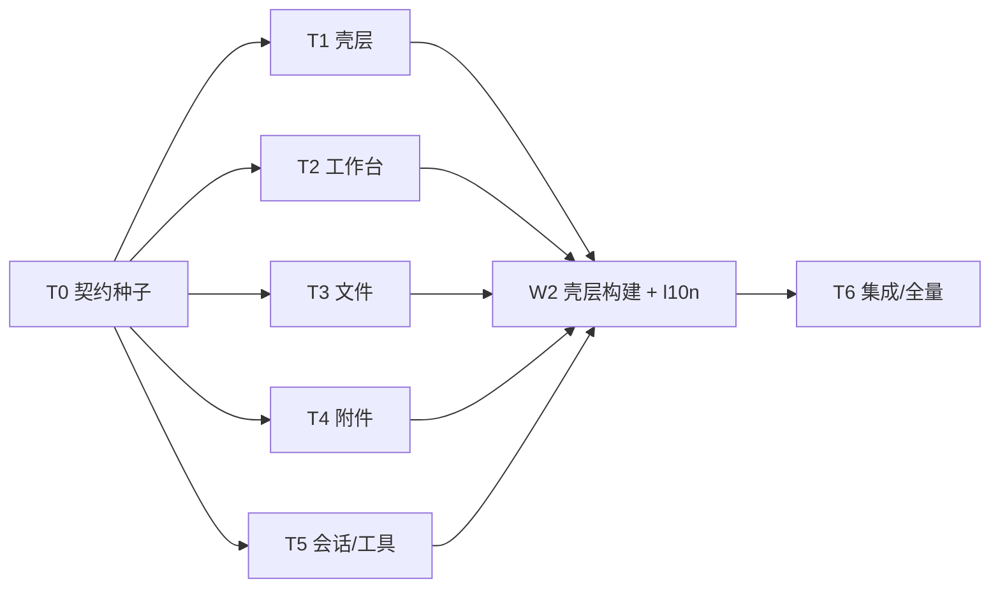

# SeRemote 终端中心化 iOS 改造实施计划

## 目标

把 SeRemote（iPhone + iPad）重做成以终端为中心的单一表面：连接后落在终端列表/上次终端；文件降级为终端上的面板与整屏预览；快捷终端控制台与工作台终端合并为一个表面；桌面入口从 6 个收到 2 个；工具跟随当前终端所在项目；Agent 对话成为终端面板，会话页只列 Agent 会话。

成功定义：

- 六个锁定问题全部按默认 YES 执行（文件不是目的地、连接落到终端、合并终端表面、桌面 2 入口、工具按项目、Agent 面板）。
- 不变量 I1–I5 全部保留，并有对应测试/检查（见需求映射 R7–R11）。
- iPhone 与 iPad 都是终端中心：iPhone 为 T1 列表 + T2 全屏终端；iPad 为侧栏终端 + 中栏终端 + 右侧检查器。
- 零 Swift 警告；`SeRemoteTests` 从 492 基线继续通过（新增测试后总数 ≥ 492）。
- 所有新文案走 `Localizable.xcstrings`，zh-Hans 只由 L5 一个 lane 通过既有 catalog 工具写入。
- 不编辑 `ios/SeRemote/SeRemote.xcodeproj/project.pbxproj`；新文件由 synchronized groups 自动收录。

## 非目标

- 不改主机协议、PTY 保活结构、`TerminalSocket` 的 spawn/attach/detach/watch 语义。
- 不改 Rust 主机、`se-server`、浏览器客户端（本计划只改 iOS；跨端 parity 不在本次范围）。
- 不给项目终端增加真正的 kill/close/rename 主机路由（现有 `TerminalSocket` 只有 spawn/attach/detach/watch/write，见 `Networking/TerminalSocket.swift:146-233`）。工作台的“关闭”对项目终端只做断开显示；只有快捷终端有真正的 `quick-terminals/close-terminal`。
- 不支持非图片附件：主机 `POST /remote/attachments/stage` 只接受 PNG/JPEG、≤ 8 MiB、≤ 4096 px（`src-tauri/src/web/remote_attachments_api.rs:1-9,36-49`；`Networking/HostHTTP+Attachments.swift:14-29`）。Files 选择器限定 `UTType.image`；PDF/任意文件暂存留待主机新路由。
- 不做 Quick Look/`QLPreviewController` 替换、拖拽关闭、终端分屏、RTL、App Store 截图。
- 不重写 Git/定时任务/搜索/屏幕文本四个工具页面，只改入口与作用域。
- 不重新设计配对/主页/设置/桌面串流。
- 不把 `Localizable.xcstrings` 的 zh-Hans 由多个 lane 并行写；不修改 `project.pbxproj` 的 `INFOPLIST_KEY_*`。

## 任务

### 证据（Evidence）

**已验证的现状（file:line）**

- 根身份：`Views/RootView.swift:20-33` 用 `.id(link.id)` 重建整棵树；连接页 `Views/WorkspaceView.swift:22-34` 在 `hasConnected` 后常驻 `ConnectedShellScreen`。
- 壳层：`Features/Shell/ConnectedShellScreen.swift:16-23` 的 `SidebarDestination`；`:51` 的 `workbenchVisible`；`:62-84` 的页面与 `SessionScreen` 是 opacity 兄弟；`:132-135` 的 Dashboard `fullScreenCover`；`:191-198` 的三项底栏；`:226-259` 主机选择 sheet；`:265-269` 的 `closeWorkbench` 会 `leaveWorkspace()`。
- 侧栏：`Features/Shell/AdaptiveSidebarShell.swift:5-33` 的四个目的地，`:14` 的 `primary` 顺序是会话/终端/工具；`:73-88` 的 Primary/Hosts 分组；`:269+` 的 footer。
- 旧工作台：`Views/SessionScreen.swift:36-44` 的 header + `SessionModeSwitch`；`:103-107` 的 tab 切换；`:113-135` 的 iPad 文件列；`:156-162` 的 `TerminalTabStrip` + `TerminalWorkspaceView`；`:398-423` 的 `setWorkspaceTab` 租约顺序。
- Dashboard：`Views/HostHomeView.swift:50-135` 的 Sessions/Projects 列表与两个工具瓷砖；`:105-124` 的 `Open terminal`/`Browse files`；`:220-228` 的行点击在遮罩后生效。
- 两套终端表面：`Features/Terminals/TerminalsHubScreen.swift:57-77` 的全屏 `QuickTerminalConsoleView`；`:207-214` 行点击进控制台；`:253-271` 的 Viewfinder 胶囊点/长按；`:175` 的快捷终端分组。工作台侧是 `Views/SessionScreen.swift:156-162` 的 `TerminalWorkspaceView`。
- 终端租约：`Terminal/TerminalPTYViewer.swift:4-13` 的独立 viewer 说明；`:108-119` 的独立 phone fit；`:156-178` 的 close 只 detach。`Terminal/TerminalStore.swift:146-191` 的 `attachViewer`/`releaseViewer`；`:343-351` 的 `resize` gate；`:373-432` 的 `commitRefit`；`:434-474` 的 `setDisplayMode`/`releaseDisplayMode`。
- 会话状态：`Session/WorkspaceSession.swift:328-338` 的 `selectConversation`（设 `.chat`）；`:340-349` 的 `selectProject`（设 `.terminal`）；`:351-364` 的 `leaveWorkspace`；`:370-373` 的 `revealTerminal`（设 `.terminal`）；`:398-423` 的 `setWorkspaceTab`；`:459-468` 的 `workspaceRoot`；`:470-485` 的 `spawnTerminal`（`.home` 静默返回）。
- 终端 chrome：`Terminal/TerminalWorkspaceView.swift:28-51` 的 `TerminalAgentChatContainer` + `TerminalInputDock`；`:94-156` 的 PTY meta；`:204-249` 的 `TerminalScreen` 画布（`.id(id)`）；`:64-75` 的 activeId 变化/onDisappear 清理。
- 键盘：`Terminal/TerminalScreen.swift:30` 与 `:64-66` 明确把 `inputAccessoryView` 置 nil；`:67-74` 的 focusToken/blurToken；`:146-351` 的 `PhoneTerminalView`（含下滑收键盘 `:312-350`）。`Terminal/TerminalInputDock.swift:45-51` 的键行 + 命令行；`:122-143` 的键盘开关；`:223-275` 的命令输入框。
- 文件：`Files/FileStore.swift:28-32` 的 `openRoot`；`:40-49` 的 `openReturningSuccess`；`:101-108` 的预览身份先发布；`:140-147` 的清理。`Files/WorkspaceFilePreviewView.swift:195-215` 只有 Copy/Share；`:113-191` 的 Markdown/HTML/图片渲染。`Files/FileBrowserView.swift:110-148` 的面包屑；`:163-223` 的列表与内联预览卡。
- 附件：`Networking/HostHTTP+Attachments.swift:96-114` 的 `stageAttachment`；`:14-29` 的错误枚举；`:49-66` 的“screenshot”文案。主机路由 `src-tauri/src/web/remote_attachments_api.rs:36-49` 只收 PNG/JPEG；`src-tauri/src/remote_attachments.rs:108-120` 的 8 MiB/4096 px 错误码；`src-tauri/src/web/auth.rs:291` 的路由分类。
- 桌面目标：`Features/Desktop/DesktopShot.swift:21-57` 的 `DesktopShotTargetResolver`；`:73-112` 的 `DesktopShotSender`；`:196-208` 的 `DesktopShellPath.stagedArgument`。`Features/Desktop/DesktopQuickSheet.swift:116-226` 的 sheet。
- 通知/深链：`App/SeNotifications.swift:31-46` 的 `post` 没有 userInfo；`Models/ConnectionStore.swift:182-185` 的 `openIncomingURL` 把所有 `se://` 都当配对链接；`SeRemoteApp.swift:16` 的 `onOpenURL`。
- 工具/命令面板：`Features/Tools/ToolsView.swift:78-88` 的 4 格 + `ToolDestination` 的 6 个 case；`:57-76` 的 `WorkspaceToolDestinationView`。`Features/Command/CommandPaletteMapping.swift:19-66` 的文件/快捷终端/工具目标；`Features/Command/ConnectedCommandPalette.swift:96-141` 的 `setWorkspaceTab(.files)`。`Features/Workspace/WorkspaceHubScreen.swift:110-120` 的最近项目打开工作台。
- 底栏：`App/DesignSystem/SeNocturneKit.swift:846-890` 的 `SeBottomBar` 顺序是会话/终端/工具。
- 权限：`ios/SeRemote/SeRemote/Info.plist:4-23` 没有相机键；`project.pbxproj:406,442` 有 `INFOPLIST_KEY_NSCameraUsageDescription`（文案只提扫码）；`InfoPlist.xcstrings:33-49` 有中英文本。`PhotosPicker`/`PHPicker` 不需要 `NSPhotoLibraryUsageDescription`；只有主动请求相册权限才需要。
- 关闭/重命名：`Networking/TerminalSocket.swift` 没有 close/rename；快捷终端有 `QuickTerminalStore.closeTerminal`（`:78-81`）与主机 `close-terminal`（`crates/se-quick-terminal/src/service.rs:319-340`）。
- 本地化：`ios/SeRemote/SeRemote/Localizable.xcstrings`；`.qin-code/scratch/seremote-l10n/catalog_tools.py:7` 固定 catalog 路径，`:23-37` 校验 Xcode 字节级 round-trip 并列出缺 zh-Hans 的 key。

**假设（未复测）**

- 当前 `SeRemoteTests` 基线为 492 个通过（用户提供；只读计划未运行测试）。
- 模拟器与 Mac “Designed for iPad” 测试目的地可用；真机/模拟器可用于键盘、相机、iPad 硬件键盘的冒烟。
- 原型 `index.html` + README v2/v3 是视觉与交互的唯一来源；截图 `shots/*.png` 用于比对。
- 当前工作区已有 `project.pbxproj` 修改（会话上下文列出）；本计划不新增其 diff。

### 范围与约束（Scope）

**范围内**

- iPhone/iPad 壳层、底栏、抽屉、iPad 侧栏、工作台、终端列表、文件面板/预览、附件、会话页、工具页入口、命令面板、深链、通知落地、本地化、测试。
- 只改 `ios/SeRemote/SeRemote/**` 与 `ios/SeRemote/SeRemoteTests/**`；`.qin-code/scratch/seremote-l10n/**` 只放一次性脚本。
- 新增文件自动被 synchronized groups 收录；不编辑 `project.pbxproj`。

**范围外**

见“非目标”。另外：不改 `ios/landing/`；不改 `src/renderer/`、`src-tauri/`；不改配对二维码协议；不改 `RemoteLink.parse` 的既有 `se://open?url=` 形式。

**兼容/迁移**

- 既有 `AppStorage` key `agent-chat.presentation.<origin>.<terminalID>` 变为未使用；保留在 UserDefaults 中不迁移（无行为影响）。
- 新增 `terminal.last.<origin>` 保存上次终端（`workspace:<projectID>:<terminalID>` 或 `quick:<recordID>:<terminalID>`）；解析失败或终端已不存在时回到 T1。
- `WorkspaceTab` 删除后，旧快捷键 `.focusChat`/`.toggleFiles` 的语义改为面板开关；不保留旧 enum case。

### 需求映射（Requirements）

| ID | 需求/来源 | 计划结果 | 验收证据 |
|---|---|---|---|
| R1 | 文件不再是目的地（Q1；`WorkspaceFilePreviewView.swift:195-215` 只有 Copy/Share） | 文件只存在于 T2 的文件面板 + 整屏预览；删除文件模式、Dashboard “Browse files”、⌘ 面板文件段 | `FilePanelPresentationTests`；grep `SessionFilesView|FileBrowserView` 为 0；文件动作含 插入路径/发给 Agent/Copy/Share |
| R2 | 连接落在终端列表/上次终端（Q2） | `ShellNavigationState.connected(last:)`；T1 继续 hero；无终端时 T1 空态 | `ShellNavigationStateTests`、`TerminalLandingModelTests`；冒烟：连接后是 T1 或 T2 |
| R3 | 快捷终端控制台与工作台终端合并（Q3） | 单一 `TerminalWorkbenchScreen` + `TerminalSurfaceBackend`（workspace/standalone）；租约仍分离 | `TerminalWorkbenchModelTests`；grep `QuickTerminalConsoleView` 为 0；I4 测试 |
| R4 | 桌面入口 6→2（Q4） | 只保留 T2 面板“桌面”（`DesktopQuickSheet`）与屏幕页“桌面”段（`DesktopFeatureView`） | grep `DesktopQuickSheet(` = 1；grep `DesktopFeatureView` 调用 = 1（`ScreenFeatureView`）；`IAShellNavigationTests` |
| R5 | 工具作用域=当前终端项目（Q5） | `WorkspaceSession.activeToolRoot`/`currentTerminalProjectID`；无终端时工具禁用 + tooltip | `ToolScopePresentationTests`；工具页冒烟 |
| R6 | Agent 对话是终端面板；会话页只列 Agent 会话（Q6） | `AgentChatSurfaceResolver`（ACP `.acp` / hook `.hook` / `.none`）；`ConversationsScreen` 数据仍只来自 `LivePresentation.conversations` | `TerminalAgentSurfaceTests`、`IAShellNavigationTests.conversationListIsACPOnly` |
| R7 | I1 终端子树常驻（opacity） | `TerminalWorkbenchChrome` 用 ZStack/opacity；`ConnectedShellScreen` 在目的地切换时只改 opacity | `TerminalWorkbenchMountTests`（面板开关 mounts==1）；`ShellNavigationStateTests.backKeepsRequest` |
| R8 | I2 模式/面板只 park/re-assert，不结束 PTY；面板不改 PTY 尺寸 | 面板是 overlay；固定 44pt 顶部留白；`presentPanel` 不调用 `resize`；`park/resume` 保持 `setWorkspaceTab` 顺序 | `TerminalWorkbenchModelTests.panelNeverResizes`；`TerminalSurfaceLeaseTests`；冒烟看 dims 不变 |
| R9 | I3 RootView 按 `link.id` | 不改 `RootView.swift:20-33` 的 `.id(link.id)` | grep `.id(link.id)` = 1 |
| R10 | I4 快捷终端租约隔离 | 快捷终端不进 `TerminalStore.terminals`；standalone 用 `TerminalPTYViewer`；切换先 park/release | `TerminalWorkbenchModelTests.switchParksBeforeAttach`；grep `TerminalStore.terminals` in quick paths = 0 |
| R11 | I5 离开工作台不销毁主机 PTY | `back` 只 `park`/`releaseViewer`；项目终端无 kill 路由；快捷终端只有显式“关闭”才 kill | `TerminalWorkbenchModelTests.backNeverCloses`；`TerminalPTYViewer.close` 只 detach |
| R12 | 本地化单写者 | 只有 L5 编辑 `Localizable.xcstrings`；并行 lane 构建加 `SWIFT_EMIT_LOC_STRINGS=NO` | `catalog_tools.py` 输出 `lacking zh-Hans: 0`；catalog 无 live stale key |
| R13 | 零 Swift 警告、不改 pbxproj | 每 lane 独立 derivedData；最终 grep 无 `.swift:N:N: warning`；`git diff` 不含 pbxproj | 见验收命令 |
| R14 | 极简文案、可访问名 | 去掉解释性脚注；用 `SeInfoTip`/`.help`；所有图标按钮有 `accessibilityLabel` | 代码审查 + 冒烟 VoiceOver |

### 设计（Design）

#### 最终屏幕树与导航（a）

**iPhone**

```
RootView
├─ HomeView（无 active link）：主机列表、配对
└─ WorkspaceView(link).id(link.id)                         [I3]
   └─ ConnectedShellScreen
      ├─ 终端 tab
      │   ├─ TerminalLandingScreen（T1，未打开终端时）
      │   │   ├─ 主机 chip / 刷新 / 抽屉
      │   │   ├─ 继续 hero（上次终端）
      │   │   ├─ 项目分组 + 终端行（点 → T2）
      │   │   ├─ 快捷终端分组（打开 / ⋯ 重命名·删除·关闭）
      │   │   └─ ＋ 新建终端（项目选择）
      │   └─ TerminalWorkbenchScreen（T2，常驻挂载，opacity 切换）  [I1]
      │       ├─ 固定 44pt 顶部留白 + 终端画布（SwiftTerm）
      │       ├─ 左上 TitlePill：‹ 返回 / 标题 + n/N / ▾ 面板
      │       ├─ 右上 AgentChip：状态点 + 名称 + 许可数
      │       ├─ 展开面板：标签行 / PTY 行 / Agent 行 / 文件·桌面·更多
      │       ├─ 右下 [+][⌨]
      │       └─ 键盘配件行：Esc Tab Ctrl ↑ ↓ ← → ⌘V 收起 + ＋
      ├─ 会话 tab：ConversationsScreen（ACP 会话 + 待你处理）
      │   └─ 行：有终端 → T2 + Agent 面板；无终端 → 全屏 ChatView
      ├─ 工具 tab：WorkspaceHubScreen（4 格 + 最近项目 + 设置）
      └─ 设置：抽屉（手机）/ 侧栏页脚（iPad）
```

T2 上的 sheet/cover：

```
T2
├─ 文件面板（sheet） → 文件预览（fullScreenCover）
├─ Agent 面板（sheet；iPad 为检查器“对话”）
├─ 桌面（sheet）
├─ 更多（sheet） → 关闭/断开确认
└─ 附件（sheet：照片 / 拍照 / 文件）
```

**iPad**

```
ConnectedShellScreen
├─ Rail 250pt / 76pt（竖屏）
│   ├─ 主机 chip
│   ├─ 按项目分组的终端行（点 → 中栏）
│   └─ 会话 / 工具 / 设置
├─ Center：TerminalWorkbenchScreen（T2）或空态
└─ Inspector 320pt（横屏）/ 右侧滑入（竖屏）
    ├─ 文件：TerminalFileInspector
    └─ 对话：AgentChatSurfaceView
```

- iPad 没有 T1；侧栏就是终端列表。文件预览 cover 盖住整台 iPad（`pad-preview`）。
- iPad 面板省略标签行（侧栏已列终端），保留 PTY 行 / Agent 行 / 文件·桌面·更多。
- iPhone 不显示检查器；文件/对话走 sheet。

**导航模型**

`ShellNavigationState`（纯值，L1）：

```swift
struct ShellNavigationState: Equatable {
    var destination: SidebarDestination = .terminals
    var landing = true
    var workbench = false
    var openRequest: TerminalOpenRequest?
    var panel: TerminalPanelAction?
    mutating func connected(last: TerminalOpenRequest?)
    mutating func open(_ request: TerminalOpenRequest)
    mutating func back()
    mutating func select(_ destination: SidebarDestination)
    mutating func present(_ action: TerminalPanelAction?)
}
```

规则：

- `open`：`openRequest=request`、`workbench=true`、`landing=false`；不重建终端子树。
- `back`：`workbench=false`、`landing=true`、`panel=nil`，**保留** `openRequest`（I1/I5）；调用 `model.back()` 只 park。
- `select(.conversations/.tools)`：`destination` 变，`workbench` 保留；视图只改 opacity。
- `connected(last:)`：有上次终端 → `open(last)`；否则 `landing=true`。
- `present` 不改变 `workbench`，不触发布局。

**深链/通知落点**

- URL：`se://terminal?host=<hostUUID>&terminal=<terminalID>`；既有 `se://open?url=...` 配对链接保持原行为。
- `HostDeepLink.parse(_:) -> .pairing(URL) | .terminal(TerminalRoute) | .unknown`（纯函数）。
- `ConnectionStore.openIncomingURL`：terminal → 若当前/已保存主机匹配则 `pendingTerminalRoute`；否则先连接保存的主机；未知主机保留 pending 并回主机列表。配对 → 原 `connect(to:)`。
- `ConnectedShellScreen` 在 `phase == .connected` 消费 `pendingTerminalRoute`：`TerminalsHubStore.refresh` → 按 terminal id 找 project → `TerminalOpenRequest` → `navigation.open` + `model.open`；找不到/attach 失败 → T1 + “终端不在运行” notice。
- 通知：`SeNotifications.post(title:body:hostID:terminalID:)` 写 userInfo；`SeAppDelegate`（`UNUserNotificationCenterDelegate`）把点击转成 `.seOpenTerminal`；`RootView` 交给 `ConnectionStore.openTerminalDestination`。只有终端退出通知带 terminalID；Agent 通知带 hostID，落到会话页。通知权限被拒不影响深链。

#### 删除/合并清单（b）

| 文件 | 类型/符号 | 动作 | 理由 / 测试 |
|---|---|---|---|
| `Views/HostHomeView.swift` | `HostHomeView`、`HostHomeSection` | 删除 | 原型无 Dashboard；遮罩后生效（`ConnectedShellScreen.swift:132-135`）。Host 切换保留为 T1 主机 chip → `hostPicker`。 |
| `Views/SessionScreen.swift` | `SessionScreen`、`ShellTabVisibility` | 删除 | 三模式工作台被 T2 取代；`SessionModeSwitch`/文件列/header 全删。opacity 语义移入 `TerminalWorkbenchChrome`。 |
| `Features/QuickTerminals/QuickTerminalConsoleView.swift` | `QuickTerminalConsoleView`、`QuickTerminalConsoleRequest` | 删除 | 合并为 T2 `.standalone` 后端；租约仍由 `TerminalPTYViewer` 持有（I4）。 |
| `Features/QuickTerminals/QuickTerminalsFeatureView.swift` | `QuickTerminalsFeatureView` | 删除 | 快捷终端列表并入 T1；create/rename/delete/close 留在 `QuickTerminalStore`。 |
| `Features/Terminals/TerminalsHubQuickSection.swift` | `TerminalsHubQuickSection` | 删除 | 并入 T1 快捷终端分组。 |
| `Features/AgentChat/TerminalAgentChatContainer.swift` | `TerminalAgentChatContainer` | 删除 | 终端内 Picker（`:47`）与 AppStorage（`:33`）删除；改为 `AgentChatPanel` + `AgentChatSurfaceResolver`。 |
| `Features/Session/SessionFilesView.swift` | `SessionFilesView` | 删除；`SessionFilesPresentation` 移到 `Files/FilePanelPresentation.swift` | 文件不再是模式；纯映射保留（`NocturneSessionFilesTests`）。 |
| `Files/FileBrowserView.swift` | `FileBrowserView` | 删除；重写为 `TerminalFilePanel` + `TerminalFileInspector` | 列表 + 内联预览卡改为 sheet 列表 + 整屏 cover。 |
| `Files/WorkspaceFilePreviewView.swift` | `WorkspaceFilePreviewView`、`PreviewModeToggle` | 重写为 `FilePreviewBody` + `TerminalFilePreviewCover` | 保留 Markdown/HTML/图片渲染；动作扩展为 插入路径/发给 Agent/Copy/Share。 |
| `Terminal/TerminalInputDock.swift` | `TerminalInputDock`、`TerminalKeyButton`、`TerminalKeyButtonStyle` | 删除 dock；按钮/样式移入 `TerminalKeyboardAccessoryBar.swift` | 原型无命令行、无常驻键行；键盘配件行走 `inputAccessoryView`。 |
| `Terminal/TerminalTabStrip.swift` | `TerminalTabStrip` | 重写为 `TerminalPanelTabRow` | 标签只在展开面板出现，不再占终端高度。 |
| `Terminal/TerminalWorkspaceView.swift` | `TerminalWorkspaceView` | 重写为 `WorkspaceTerminalCanvas` | 去掉 meta/agent container/dock；画布身份不变。 |
| `Features/Session/SessionChatView.swift` | `SessionModeSwitch`、`NocturneSessionPresentation.modeAvailable` | 删除 | 不再有三模式。 |
| `App/Theme.swift` | `WorkspaceTab` | 删除 | 由 `isTerminalSurfaceActive` + `TerminalPanelAction` 取代。 |
| `Features/Session/SessionTerminalView.swift` | `SessionTerminalView` | 删除 | 原仅 `SessionScreen` 使用。 |
| 桌面入口 4 处 | `SessionScreen` header、`TerminalWorkspaceView` meta、`TerminalAgentChatContainer`、`TerminalsHubScreen` viewfinder 胶囊/长按 | 删除 | Q4 只留 T2 面板桌面 + 屏幕页桌面。 |
| `Features/Command/CommandPaletteMapping.swift` | `.file`、`.quickTerminal`、`.tool(.desktop/.quickTerminals)` | 删除 | 文件/快捷/桌面不走 ⌘ 面板；桌面只 2 入口。 |
| `Features/Tools/ToolsView.swift` | `ToolDestination.quickTerminals`、`.desktop` | 删除 case | 工具页只 4 格；`.desktop` 由 `ScreenFeatureView` 可达；`.quickTerminals` 并入 T1。 |
| `Features/Terminals/TerminalsHubScreen.swift` | `TerminalsHubConsoleRequest`、`QuickTerminalConsoleRequest`、viewfinder | 重写 | 变为 T1；行点 → T2；无长按/胶囊。 |

#### 锁定的技术决策

1. **一个表面，两种后端。** `TerminalWorkbenchScreen` 只渲染一个 `TerminalScreen`；后端为 `WorkspaceTerminalBackend`（`TerminalStore` + `WorkspaceSession`）或 `StandaloneTerminalBackend`（`TerminalPTYViewer`）。快捷终端不进 `TerminalStore.terminals`，租约不混（I4）。切换顺序：standalone→workspace 先 `releaseViewer`；workspace→standalone 先 `parkTerminalSurface`；反向不 kill（I5）。
2. **面板是 overlay。** 展开面板、scrim、TitlePill、AgentChip、[+][⌨] 都在 `ZStack(alignment: .top)` 里；画布高度 = 容器 − 固定 44pt 顶部留白，面板出现/消失不改变画布 frame，不触发 `sizeChanged`（I2）。不使用 `safeAreaInset` 放面板。
3. **没有输入框。** 系统键盘只属于 `PhoneTerminalView`；键行通过 `inputAccessoryView` 挂在键盘上，`⌨` 用 `focusToken` 调 `becomeFirstResponder`；`+` 在键盘弹起时移到配件行左端。删除 `TerminalInputDock` 的 `TextField`。`TerminalScreen.updateUIView` 不再清空 `inputAccessoryView`。
4. **Agent 面板解析。** `AgentChatSurfaceResolver.resolve(workspace:conversationID:hookReady:absence:)`：
   - 当前是 conversation 且有 active conversation → `.acp(conversationID)`，面板用 `ChatView(session:)`（有许可卡）。
   - 否则 hook ready → `.hook(terminalID)`，面板用 `AgentChatView(store:)`。
   - 否则 `.none(absence)`：AgentChip 隐藏；面板 Agent 行隐藏；⋯ 菜单“对话”置灰 + `SeInfoTip`。
   `WorkspaceSession` 持有 `agentDrafts: [String: String]`；`offerAgentDraft`/`takeAgentDraft` 替代一次性 `AgentChatDraftInbox` 通知（面板未挂载也不丢）。
5. **文件根 = 当前终端 cwd。** 面板 `rootPath = session.currentTerminalCwd ?? session.activeToolRoot`；`FileStore.openRootIfNeeded` 只在根不同时请求。预览动作：主操作“插入路径”写 `DesktopShellPath.stagedArgument(path)` 到 PTY（workspace `terminals.write` / standalone `viewer.send`）；“发给 Agent”写 `offerAgentDraft`；“复制”文本或图片；“分享”`ShareLink`。点内容切 chrome（沉浸态）；下滑只从 grabber/顶栏开始，避免与滚动/选字冲突。
6. **附件目标。** `DesktopShotTargetResolver.attachment(terminalID:agentReady:)`：Agent 就绪 → `.agentChat(id:)`，否则 `.terminal(id:)`。照片用 `PhotosPicker`，拍照用 `UIImagePickerController`（相机不可用则隐藏/禁用），文件用 `fileImporter(allowedContentTypes: [.image])`。预检：`AttachmentImagePolicy.prepared` 把图片缩到 ≤ 4096 px、JPEG ≤ 8 MiB；上传走现有 `HostHTTP.stageAttachment`。非图片不支持（见非目标）。
7. **关闭语义。** 快捷终端（standalone 且有 `quickTerminalRecord`）的“关闭终端”真正调用 `quickTerminals.closeTerminal`，确认文案“关闭后该 shell 会结束”。项目终端的“断开”只 `park`/detach，文案“shell 会继续在主机上运行”。离开工作台/返回 T1 永远只 park（I5）。
8. **桌面 2 入口。** `DesktopQuickSheet` 只在 `TerminalWorkbenchScreen` 的“桌面”动作出现；`DesktopFeatureView` 只在 `ScreenFeatureView` 的“桌面”段出现。`ToolDestination` 删除 `.desktop`/`.quickTerminals`，⌘ 面板不再有桌面/文件/快捷终端目标。
9. **本地化。** 只有 L5 写 `Localizable.xcstrings`；并行 lane 构建加 `SWIFT_EMIT_LOC_STRINGS=NO`，L5 最终构建不加以提取新 key，然后用 `catalog_tools.py` + 一次性 zh 映射脚本写入并校验。`InfoPlist.xcstrings` 已有相机文案；`PhotosPicker` 不需要相册权限键。

**被拒绝的替代方案**

- 把快捷终端塞进 `TerminalStore.terminals`：catalog 刷新会驱逐、单 `activeId` 会抢租约（I4），拒绝。
- 把工作台终端改成 `TerminalPTYViewer`：会丢掉 conversation/project 绑定、ACP 聊天和现有 `setWorkspaceTab` 租约，风险过大，拒绝。
- 用 `safeAreaInset` 放面板/键行：会让 PTY 重排（I2），拒绝。
- 新增主机 kill/rename 路由：跨端（Rust + web + server），本次只改 iOS，拒绝；项目终端用断开语义。
- 用 `QLPreviewController` 替换现有渲染：会丢掉 Markdown/HTML/图片的既有 token 与测试，拒绝。
- 多 lane 并行写 catalog：Xcode 构建会写回，冲突不可控，拒绝。

#### 共享契约（c）

W0 先落 `ios/SeRemote/SeRemote/Terminal/TerminalWorkbenchContract.swift` 与 `TerminalSurfaceBackend.swift`（L2 维护；其他 lane 只读引用）：

```swift
nonisolated enum TerminalAttach: Hashable, Sendable {
    case workspace(terminalID: String)
    case standalone(terminalID: String, claim: String?)
}

nonisolated struct TerminalOpenRequest: Identifiable, Hashable, Sendable {
    let attach: TerminalAttach
    let title: String
    let cwd: String?
    let projectID: String?
    let projectName: String?
    var terminalID: String { /* workspace/standalone 的 id */ }
    var id: String { /* "workspace:<id>" / "standalone:<id>" */ }
}

nonisolated struct TerminalSurfaceItem: Identifiable, Hashable, Sendable {
    let id: String
    let title: String
    let cwd: String?
    let projectID: String?
    let hasAgent: Bool
}

nonisolated enum TerminalPanelAction: Hashable, Sendable {
    case files, desktop, agent, more, attach
}

nonisolated struct FilePreviewRequest: Identifiable, Hashable, Sendable {
    let path: String
    let terminalID: String?
    var id: String { path }
}

nonisolated struct TerminalRoute: Equatable, Sendable {
    let hostID: String?
    let terminalID: String
}

@MainActor
protocol TerminalSurfaceBackend: AnyObject {
    var items: [TerminalSurfaceItem] { get }
    var activeID: String? { get }
    var activeTitle: String { get }
    var activeCwd: String? { get }
    var activeProjectID: String? { get }
    var agentReady: Bool { get }
    func select(_ id: String) async
    func write(_ text: String) async
    func resize(cols: Int, rows: Int)
    func park() async
    func resume() async
}
```

L2 的模型 API（L1/L3/L4 只读调用）：

```swift
@MainActor @Observable final class TerminalWorkbenchModel {
    init(session: WorkspaceSession)
    private(set) var request: TerminalOpenRequest?
    var panelExpanded: Bool
    private(set) var errorMessage: String?
    private(set) var agentSurface: TerminalAgentSurface
    var agentReady: Bool { get }
    var activeTitle: String { get }
    var activeCwd: String? { get }
    func open(_ request: TerminalOpenRequest) async
    func select(_ terminalID: String) async
    func back() async
    func insertPath(_ path: String)
    func sendToAgent(_ path: String)
    func present(_ action: TerminalPanelAction)
    @ViewBuilder var agentPanel: some View
}
```

L2 的 `WorkspaceSession` 增量（L1/L5 只读调用）：

```swift
init(accessURL: URL, bearer: String? = nil, settings: AppSettings? = nil, hostID: String? = nil)
func parkTerminalSurface() async
func resumeTerminalSurface() async
var currentTerminalProjectID: String? { get }
var currentTerminalProjectName: String? { get }
var currentTerminalCwd: String? { get }
var activeToolRoot: String? { get }
func offerAgentDraft(_ text: String, terminalID: String)
func takeAgentDraft(terminalID: String) -> String?
```

L3 的文件视图（L1 组合）：

```swift
struct TerminalFilePanel: View {
    init(session: WorkspaceSession, rootPath: String, terminalTitle: String,
         agentAvailable: Bool, onOpenFile: @escaping (String) -> Void,
         onClose: @escaping () -> Void)
}

struct TerminalFilePreviewCover: View {
    init(session: WorkspaceSession, request: FilePreviewRequest, agentAvailable: Bool,
         onInsertPath: @escaping (String) -> Void,
         onSendToAgent: @escaping (String) -> Void,
         onClose: @escaping () -> Void)
}

struct TerminalInspector: View {
    init(session: WorkspaceSession, rootPath: String, terminalTitle: String,
         agentAvailable: Bool, segment: Binding<TerminalInspectorSegment>,
         onOpenFile: @escaping (String) -> Void, agentContent: AnyView)
}
```

L4 的附件视图（L1 组合）：

```swift
struct AttachmentSheet: View {
    init(session: WorkspaceSession, terminalID: String, terminalTitle: String,
         agentReady: Bool, onWriteTerminal: @escaping (String) async -> Void,
         onDraftAgent: @escaping (String, String) -> Void,
         onClose: @escaping () -> Void)
}

nonisolated enum AttachmentImagePolicy {
    static let maxDimension: CGFloat = 4096
    static let maxBytes = 8 * 1024 * 1024
    static func prepared(data: Data, name: String) -> ShotAttachment?
}
```

L1 的壳层组合：

```swift
TerminalWorkbenchScreen(
    session: session,
    model: terminalModel,
    isActive: workbenchVisible,
    onBack: { navigation.back(); Task { await terminalModel.back() } },
    onExternalAction: { action in
        switch action {
        case .files: pendingFiles = true
        case .attach: showsAttachment = true
        default: break
        }
    }
)
```

- `.desktop/.agent/.more` 由 L2 在 workbench 内部弹 sheet（或 iPad 检查器）。
- `.files/.attach` 由 L1 弹 L3/L4 的 sheet；`.files` 在 iPad 改为检查器“文件”段。
- 文件预览 cover 由 L1 呈现，`onInsertPath` 调 `terminalModel.insertPath`，`onSendToAgent` 调 `terminalModel.sendToAgent`。
- 共享文件只有 `Localizable.xcstrings`（L5 独占）与 `project.pbxproj`（禁止编辑）；其余文件按 lane 独占。

### 执行计划（Execution Plan）

#### 文件所有权

| Lane | 创建 | 修改 | 删除 |
|---|---|---|---|
| L1 壳层/导航 | `Features/Shell/ShellNavigationState.swift`、`Features/Shell/TerminalLandingScreen.swift`、`Features/Shell/TerminalLandingModel.swift`、`Features/Shell/HostDeepLink.swift`、`App/SeAppDelegate.swift` | `Features/Shell/ConnectedShellScreen.swift`、`Features/Shell/AdaptiveSidebarShell.swift`、`Features/Shell/ShellPresentation.swift`、`Views/RootView.swift`、`Views/WorkspaceView.swift`、`Models/ConnectionStore.swift`、`Features/Live/ConversationsScreen.swift`、`Features/Terminals/TerminalsHubScreen.swift`、`Features/Terminals/TerminalsHubStore.swift`、`App/SeNotifications.swift`、`SeRemoteApp.swift`、`App/DesignSystem/SeNocturneKit.swift` | `Views/SessionScreen.swift`、`Views/HostHomeView.swift`、`Features/Terminals/TerminalsHubQuickSection.swift` |
| L2 终端工作台 | `Terminal/TerminalWorkbenchContract.swift`、`Terminal/TerminalSurfaceBackend.swift`、`Terminal/TerminalWorkbenchScreen.swift`、`Terminal/TerminalWorkbenchModel.swift`、`Terminal/TerminalPanelPresentation.swift`、`Terminal/TerminalKeyboardAccessoryBar.swift`、`Terminal/TerminalWorkbenchChrome.swift`、`Features/AgentChat/AgentChatPanel.swift` | `Terminal/TerminalWorkspaceView.swift`、`Terminal/TerminalStore.swift`、`Terminal/TerminalScreen.swift`、`Terminal/TerminalTabStrip.swift`、`Session/WorkspaceSession.swift`、`App/Theme.swift`、`App/ShortcutCenter.swift`、`Features/Session/SessionChatView.swift`、`Features/AgentChat/AgentChatStore.swift` | `Terminal/TerminalInputDock.swift`、`Features/Session/SessionTerminalView.swift`、`Features/AgentChat/TerminalAgentChatContainer.swift`、`Features/QuickTerminals/QuickTerminalConsoleView.swift` |
| L3 文件 | `Files/TerminalFilePanel.swift`、`Files/TerminalFilePreviewCover.swift`、`Files/TerminalFileInspector.swift`、`Files/FilePanelPresentation.swift` | `Files/FileStore.swift`、`Files/WorkspaceFileListView.swift`、`Files/WorkspaceFilePreviewView.swift` | `Files/FileBrowserView.swift`、`Features/Session/SessionFilesView.swift` |
| L4 附件 | `Features/Attach/AttachmentSheet.swift`、`Features/Attach/AttachmentPickerModel.swift`、`Features/Attach/AttachmentCameraPicker.swift` | `Networking/HostHTTP+Attachments.swift`、`Features/Desktop/DesktopShot.swift` | 无 |
| L5 会话/工具/桌面入口 + l10n | `Features/Tools/ToolScopePresentation.swift` | `Features/Tools/ToolsView.swift`、`Features/Workspace/WorkspaceHubScreen.swift`、`Features/ScreenText/ScreenFeatureView.swift`、`Features/Command/CommandPaletteMapping.swift`、`Features/Command/ConnectedCommandPalette.swift`、`Localizable.xcstrings` | `Features/QuickTerminals/QuickTerminalsFeatureView.swift` |
| L6 集成 | 无（只修集成） | 任意集成冲突文件、测试 | 剩余死代码 |

#### T0 — 契约种子（串行，L2 执行）

- **Outcome**：共享类型与协议落盘，所有 lane 可引用；不影响现有构建。
- **Files / symbols**：创建 `Terminal/TerminalWorkbenchContract.swift`、`Terminal/TerminalSurfaceBackend.swift`。
- **Read first**：`Terminal/TerminalStore.swift:9-22,146-191`、`Terminal/TerminalPTYViewer.swift:4-45`、`Session/WorkspaceSession.swift:328-373`、`Features/Desktop/DesktopShot.swift:21-57`、`Files/FileStore.swift:28-49`。
- **Changes**：写入上面“共享契约”的 `TerminalAttach`、`TerminalOpenRequest`、`TerminalSurfaceItem`、`TerminalPanelAction`、`FilePreviewRequest`、`TerminalRoute`、`TerminalSurfaceBackend`；不写任何实现/视图。
- **Dependencies / parallelism**：无；必须在 W1 前完成。
- **Acceptance criteria**：`rg -n "enum TerminalAttach|struct TerminalOpenRequest|protocol TerminalSurfaceBackend" ios/SeRemote/SeRemote/Terminal/TerminalWorkbenchContract.swift ios/SeRemote/SeRemote/Terminal/TerminalSurfaceBackend.swift` 命中 3 个定义；`xcodebuild build-for-testing ...` 成功。
- **Verification**：`xcodebuild build-for-testing -project ios/SeRemote/SeRemote.xcodeproj -scheme SeRemote -destination 'generic/platform=iOS Simulator' -derivedDataPath "$TMPDIR/se-t0" CODE_SIGNING_ALLOWED=NO SWIFT_EMIT_LOC_STRINGS=NO`。

#### T1 — L1 壳层/导航

- **Outcome**：连接后 T1/T2 落地；底栏 终端|会话|工具；Dashboard/SessionScreen 删除；深链/通知能落到终端；iPad 侧栏按项目列终端。
- **Files / symbols**：见上表 L1。
- **Read first**：`ConnectedShellScreen.swift`、`AdaptiveSidebarShell.swift`、`SessionScreen.swift`、`HostHomeView.swift`、`TerminalsHubScreen.swift`、`TerminalsHubStore.swift`、`RootView.swift`、`ConnectionStore.swift`、`SeNotifications.swift`、`SeRemoteApp.swift`、`SeNocturneKit.swift:846-890`、`TerminalWorkbenchContract.swift`（T0）。
- **Changes**：
  - `SidebarDestination.primary = [.terminals, .conversations, .tools]`；`SeBottomBar` 参数顺序改为 `onTerminals/onConversations/onTools`，文案“终端/会话/工具”。
  - `ConnectedShellScreen` 用 `ShellNavigationState` + `TerminalsHubStore`；工作台常驻 opacity；T1 在 `destination == .terminals && !workbench` 显示；底栏只在工作台不可见时显示。
  - 删除 Dashboard cover；`hostPicker` 只列已保存主机（去掉“View this host dashboard”）。
  - `TerminalLandingScreen`：继续 hero、项目分组、快捷终端分组、＋ 新建终端（项目选择）；15s 轮询；错误/空态；`onOpen(TerminalOpenRequest)`。
  - `HostDeepLink.parse`；`ConnectionStore.pendingTerminalRoute`/`openTerminalDestination`；`SeAppDelegate` + `RootView` 的 `.seOpenTerminal`；`SeNotifications.post` 增加 `hostID/terminalID`。
  - `WorkspaceView` 传 `hostID: link.stableHostID`（与 L2 的 init 契约）。
  - `ConversationsScreen`：保留 ACP-only 列表；`onOpenConversation` → 有终端则 T2 + Agent 面板，无终端则 `ConversationChatCover`（`ChatView(session:embedded:false)`）。
  - iPad：`AdaptiveSidebarShell` 显示主机 chip + 项目分组的终端 + 会话/工具/设置；不显示 Primary/Hosts 旧分组。
- **Dependencies / parallelism**：依赖 T0；与 L2/L3/L4/L5 并行写文件；构建门禁在 W2（需 L2/L3/L4 的类型）。
- **Acceptance criteria**：`ShellNavigationStateTests`（open/back/select/connected）、`HostDeepLinkTests`（pairing/terminal/unknown）、`TerminalLandingModelTests`（hero/分组/新建禁用）、`ConversationOpenPolicyTests`、更新后的 `NocturneR1PresentationTests` 全部通过；`rg -n "HostHomeView|SessionScreen" ios/SeRemote/SeRemote` 为 0；`rg -n "\.id\(link\.id\)" Views/RootView.swift` 为 1。
- **Verification**：`xcodebuild build-for-testing ... -derivedDataPath "$TMPDIR/se-l1" ... SWIFT_EMIT_LOC_STRINGS=NO`；Mac 定向测试 `-only-testing:SeRemoteTests/ShellNavigationStateTests` 等。

#### T2 — L2 终端工作台

- **Outcome**：一个 `TerminalWorkbenchScreen` 承载 workspace/standalone；TitlePill/AgentChip/面板/[+][⌨]/键盘配件行；面板不改 PTY 尺寸；租约顺序保留；Agent 面板解析 ACP/hook。
- **Files / symbols**：见上表 L2。
- **Read first**：`TerminalWorkspaceView.swift`、`TerminalStore.swift`、`TerminalPTYViewer.swift`、`TerminalScreen.swift`、`TerminalInputDock.swift`、`TerminalTabStrip.swift`、`WorkspaceSession.swift`、`SessionScreen.swift`、`AgentChatView.swift`、`AgentChatStore.swift`、`TerminalAgentChatContainer.swift`、`DesktopQuickSheet.swift`、`DesktopShot.swift`、`TerminalWorkbenchContract.swift`。
- **Changes**：
  - `TerminalSurfaceBackend` 两个实现：workspace（`revealTerminal`/`terminals.write`/`terminals.resize`/`parkTerminalSurface`/`resumeTerminalSurface`）与 standalone（`attachViewer`/`viewer.send`/`viewer.resize`/`releaseViewer`）。
  - `TerminalWorkbenchModel.open` 顺序：standalone→workspace 先 `releaseViewer`；workspace→standalone 先 `park`；workspace 选项目后 `revealTerminal` + `resume`；失败设 `errorMessage`。
  - `TerminalWorkbenchChrome`：ZStack + 固定 44pt 顶部留白 + overlay；TitlePill（‹ / 标题 + n/N / ▾）、AgentChip、面板（标签/PTY/Agent/文件·桌面·更多）、[+][⌨]、错误 banner。
  - `TerminalPanelPresentation`：标签、`n/N`、PTY 状态/尺寸、FIT（仅 workspace）、A+、Agent 摘要、关闭/断开策略。
  - `TerminalKeyboardAccessoryBar`：Esc/Tab/Ctrl/箭头/⌘V/收起 + ＋；`TerminalScreen` 安装 `inputAccessoryView`（retain `UIHostingController`），不再清空。
  - `WorkspaceSession`：删除 `WorkspaceTab`/`showChat`/`setWorkspaceTab`；新增 `isTerminalSurfaceActive`、`parkTerminalSurface`/`resumeTerminalSurface`（保持 dismiss → geometry=false → releaseDisplayMode → flip → refit 顺序）；`selectConversation`/`selectProject`/`revealTerminal` 不再改 tab；`noteWideLayout`/`noteTerminalKeyboard` 用新标志；`currentTerminalProjectID`/`currentTerminalCwd`/`activeToolRoot`；`agentDrafts`。
  - `TerminalStore`：`LiveTerminal` 增加 `projectId`/`conversationId`（从 `LiveTerminalSummary` 映射），抽 `liveTerminals(from:ownedById:)` 纯函数；租约逻辑不变。
  - `AgentChatPanel`：消费 `agentDrafts`；`AgentChatSurfaceResolver` 决定 `ChatView` 或 `AgentChatView`；`AgentChip` 显示 ACP agent/permission 或 hook agent。
  - `ShortcutCenter`：`.focusTerminal`、`.toggleTerminalPanel`、`.toggleFiles`、`.toggleAgent`、`.newTerminal`、`.nextTerminal`、`.previousTerminal`、zoom；`SeRemoteApp` 菜单由 L1 同步（契约）。
  - `TerminalMoreSheet`：新建终端/屏幕文本/更改/搜索/定时任务/对话（无 hook 置灰 + tip）/关闭（quick 真关闭；workspace 断开）。
- **Dependencies / parallelism**：依赖 T0；与 L1/L3/L4/L5 并行。
- **Acceptance criteria**：`TerminalWorkbenchModelTests`（open/park/resume/panelNeverResizes/switchParksBeforeAttach/backNeverCloses）、`TerminalPanelPresentationTests`、`TerminalWorkbenchMountTests`（面板开关 mounts==1）、`TerminalSurfaceLeaseTests`（park/resume flags；terminals 不清空）、更新后的 `NocturneSessionPresentationTests`/`AgentChatTests` 通过；`rg -n "WorkspaceTab|TerminalInputDock|TerminalAgentChatContainer" ios/SeRemote/SeRemote` 为 0；`rg -n "TextField" Terminal/TerminalWorkbenchScreen.swift Terminal/TerminalKeyboardAccessoryBar.swift` 为 0。
- **Verification**：`xcodebuild build-for-testing ... -derivedDataPath "$TMPDIR/se-l2" ...`；Mac 定向测试。

#### T3 — L3 文件面板/预览

- **Outcome**：文件面板 sheet（根=终端 cwd）+ 整屏预览 cover（✕/文件名+行数/⋯/插入路径/沉浸态/下滑）+ iPad 文件检查器。
- **Files / symbols**：见上表 L3。
- **Read first**：`FileStore.swift`、`WorkspaceFilePreviewView.swift`、`FileBrowserView.swift`、`WorkspaceFileListView.swift`、`FilePreviewKind.swift`、`SessionFilesView.swift`、`TerminalWorkbenchContract.swift`。
- **Changes**：
  - `TerminalFilePanel`：面包屑 + 列表吃满；目录进入/返回；文件 `openReturningSuccess` 后 `onOpenFile(path)`；错误/加载/空态；`onClose`。
  - `TerminalFilePreviewCover`：顶栏 ✕/文件名+`N 行 · 只读`/⋯；内容用 `FilePreviewBody`（Markdown/HTML/图片/文本）；底部主操作“插入路径”；⋯ = 插入路径/发给 Agent/复制/分享；点内容切 chrome；下滑只从 grabber/顶栏；`agentAvailable == false` 时“发给 Agent”置灰 + `SeInfoTip`。
  - `FilePanelPresentation`：`shouldReloadRoot`、标题、行数、副标题、`insertText = DesktopShellPath.stagedArgument(path)`、菜单可用性；`SessionFilesPresentation` 合并进来。
  - `FileStore`：暴露 `currentPreviewPath`/`currentRootPath`；`openRootIfNeeded`。
  - `TerminalFileInspector`：面包屑 + 列表；无内联预览。
- **Dependencies / parallelism**：依赖 T0；与 L1/L2/L4/L5 并行。
- **Acceptance criteria**：`FilePanelPresentationTests`（根、行数、插入路径引用、Agent 可用性）、更新后的 `NocturneSessionFilesTests`/`FilePreviewTests` 通过；`rg -n "FileBrowserView|SessionFilesView" ios/SeRemote/SeRemote` 为 0；`rg -n "Copy|Share" Files/TerminalFilePreviewCover.swift` 命中。
- **Verification**：`xcodebuild build-for-testing ... -derivedDataPath "$TMPDIR/se-l3" ...`；Mac 定向测试。

#### T4 — L4 附件

- **Outcome**：`+` → 照片/拍照/文件（仅图片）；目标规则 Agent 就绪→Agent，否则终端；上传走现有 stage；路径写入 PTY/draft。
- **Files / symbols**：见上表 L4。
- **Read first**：`HostHTTP+Attachments.swift`、`DesktopShot.swift:73-112,196-208`、`DesktopQuickSheet.swift`、`QuickTerminalStore.swift`、`TerminalWorkbenchContract.swift`。
- **Changes**：
  - `AttachmentPickerModel`：`target` 默认 `DesktopShotTargetResolver.attachment(terminalID:agentReady:)`；菜单可切 Agent/Terminal；`send(data:name:)` 预检 → `DesktopShotSender.send` → notice/error；`isUploading`。
  - `AttachmentImagePolicy`：`UIImage` 解码、最长边 ≤ 4096、JPEG ≤ 8 MiB；非图片返回 nil。
  - `AttachmentSheet`：目标行 + 照片/拍照/文件；`PhotosPicker`、`UIImagePickerController`（`isSourceTypeAvailable(.camera)` 为 false 时隐藏/禁用）、`fileImporter([.image])`；安全作用域 URL 读取。
  - `DesktopShot.swift` 增加 `attachment(terminalID:agentReady:)`；`HostHTTP+Attachments.swift` 文案从 screenshot 改为 attachment（保留错误码映射）。
- **Dependencies / parallelism**：依赖 T0（可独立先做）；与 L1/L2/L3/L5 并行。
- **Acceptance criteria**：`AttachmentPickerModelTests`（目标规则/成功/失败/尺寸）、`AttachmentImagePolicyTests`（4096/8 MiB/非图片）、更新后的 `DesktopQuickShotTests` 通过；`rg -n "allowedContentTypes" Features/Attach` 命中 `[.image]`。
- **Verification**：`xcodebuild build-for-testing ... -derivedDataPath "$TMPDIR/se-l4" ...`；Mac 定向测试。

#### T5 — L5 会话/工具/桌面入口 + l10n

- **Outcome**：工具 4 格、作用域=当前终端项目；桌面只 2 入口；⌘ 面板只会话/项目/工具；zh-Hans 全量。
- **Files / symbols**：见上表 L5。
- **Read first**：`ToolsView.swift`、`WorkspaceHubScreen.swift`、`ScreenFeatureView.swift`、`CommandPaletteMapping.swift`、`ConnectedCommandPalette.swift`、`WorkspaceSession.swift`（L2 契约）、`catalog_tools.py`。
- **Changes**：
  - `ToolDestination` 只剩 `.git/.scheduledTasks/.search/.screenText`；`WorkspaceToolDestinationView` 同步删 case；`hubCases == allCases`。
  - `ToolScopePresentation.scope(terminalProjectID:projectName:terminalCwd:)`；`WorkspaceHubScreen` 用 `session.activeToolRoot`/`currentTerminalProjectID` 刷新 Git/搜索/任务；无终端时 tile 禁用 + `SeInfoTip`；最近项目 `onOpenProject(id)` → L1 去 T1 分组。
  - `CommandPaletteMapping.entries(conversations:projects:query:)`；`CommandPaletteTarget = .conversation/.project/.tool`；`ConnectedCommandPalette` 删除文件/快捷/桌面路径与 `setWorkspaceTab`。
  - `Localizable.xcstrings`：最终构建提取 → `catalog_tools.py` → 一次性 zh 映射脚本 → 校验 `lacking zh-Hans: 0`；删除 key 标 stale。
- **Dependencies / parallelism**：依赖 L1 的 `SidebarDestination` 顺序与 L2 的 scope API；l10n 必须在 W2 所有代码落地后。
- **Acceptance criteria**：`ToolScopePresentationTests`、更新后的 `IAShellNavigationTests`（primary 顺序 `["terminals","conversations","tools"]`、4 格、无 quick/desktop）、`NocturneCommandShellTests` 通过；`catalog_tools.py` 输出 `lacking zh-Hans: 0`；`rg -n "ToolDestination.quickTerminals|ToolDestination.desktop" ios/SeRemote/SeRemote` 为 0。
- **Verification**：`xcodebuild build-for-testing ... -derivedDataPath "$TMPDIR/se-l5" ...`；catalog 命令；Mac 定向测试。

#### T6 — L6 集成与全量验证

- **Outcome**：所有 lane 合成后可构建、零警告、492+ 测试通过、l10n 完整、无 pbxproj diff、死代码清零。
- **Files / symbols**：任意集成冲突文件与测试；不新增产品能力。
- **Read first**：所有 lane 的 diff；`git status`；`git diff -- ios/SeRemote/SeRemote.xcodeproj/project.pbxproj`。
- **Changes**：
  - 修编译/测试集成问题；删除剩余死代码；确认 `Localizable.xcstrings` 从 HEAD 开始由 L5 单写。
  - 确认 `RootView` 的 `.id(link.id)` 未动；确认 `TerminalScreen` 的 `inputAccessoryView` 安装/retain；确认无 `WorkspaceTab`。
  - 更新测试基线记录（492 + 新增）。
- **Dependencies / parallelism**：依赖 T1–T5；串行。
- **Acceptance criteria**：见验收命令；`git diff --name-only` 不含 `project.pbxproj`；`rg` 死代码清单为 0；全量测试 ≥ 492。
- **Verification**：最终 build + Mac 全量测试 + grep + 冒烟。

#### 波次与依赖（d）



- **W0（串行，~20 min）**：T0。所有 lane 只读引用契约。
- **W1（并行）**：T1/L1 写代码但不跑构建门禁（依赖 L2/L3/L4 类型）；T2/L2、T3/L3、T4/L4、T5/L5 各自构建。每路独立 `-derivedDataPath "$TMPDIR/se-lN"`，并加 `SWIFT_EMIT_LOC_STRINGS=NO`，避免并行构建写 `Localizable.xcstrings`。
- **W2（串行收口）**：L1 构建；L5 从 HEAD 重置 catalog、最终构建（不关 `SWIFT_EMIT_LOC_STRINGS`）提取 key、写 zh-Hans；L2/L3/L4 修集成。
- **W3（串行）**：T6 全量验证。

**门禁命令（每 lane）**

```bash
xcodebuild build-for-testing \
  -project ios/SeRemote/SeRemote.xcodeproj \
  -scheme SeRemote \
  -destination 'generic/platform=iOS Simulator' \
  -derivedDataPath "$TMPDIR/se-lN" \
  CODE_SIGNING_ALLOWED=NO SWIFT_EMIT_LOC_STRINGS=NO \
  2>&1 | tee "$TMPDIR/se-lN-build.log"

! grep -qE '\.swift:[0-9]+:[0-9]+: warning:' "$TMPDIR/se-lN-build.log"
```

**Mac 测试（T6，最终）**

```bash
xcodebuild test \
  -project ios/SeRemote/SeRemote.xcodeproj \
  -scheme SeRemote \
  -destination 'platform=macOS,arch=arm64,variant=Designed for iPad' \
  -derivedDataPath "$TMPDIR/se-l6-mac" \
  DEVELOPMENT_TEAM=6U45UK3L2Q CODE_SIGN_STYLE=Automatic -allowProvisioningUpdates \
  -only-testing:SeRemoteTests \
  SWIFT_EMIT_LOC_STRINGS=NO \
  2>&1 | tee "$TMPDIR/se-l6-test.log"
```

**l10n（L5，W2）**

```bash
git checkout -- ios/SeRemote/SeRemote/Localizable.xcstrings
# 最终构建（不关 SWIFT_EMIT_LOC_STRINGS）让 Xcode 提取新 key
QIN_CODE_SCRATCH_DIR="$PWD/.qin-code/scratch" \
  python3 .qin-code/scratch/seremote-l10n/catalog_tools.py
# 用同一 scratch 目录的一次性脚本写入 zh-Hans 映射；脚本复用 catalog_tools.load_checked/dump_xcode
QIN_CODE_SCRATCH_DIR="$PWD/.qin-code/scratch" \
  python3 .qin-code/scratch/seremote-l10n/catalog_tools.py
# 期望最后一行：lacking zh-Hans: 0
```

### 风险与回退（Risks and Recovery）

1. **无输入框时的 first responder。** `PhoneTerminalView` 必须能 `becomeFirstResponder`；`⌨` 用 `focusToken`，配件行走 `inputAccessoryView`。风险：`UIHostingController` 被释放导致键行消失；必须由 `Coordinator` 强引用，`updateUIView` 只更新 `rootView`。回退：若 iOS 26 上配件行不稳定，改用 `.safeAreaInset(edge: .bottom)` 放键行（会缩小画布，需接受一次键盘态 PTY resize，但面板仍不改尺寸）。
2. **iPad 硬件键盘。** `keyboardHeight` 为 0 时软件键盘不出现，`⌨` 仍应聚焦；面板 PTY 行显示“硬件键盘” + `SeInfoTip`（`GCKeyboard.coalesced != nil`）。风险：模拟器检测不到；提示只是信息，不 gate 输入。回退：隐藏提示，不影响功能。
3. **overlay 与 PTY 几何。** 面板/胶囊/键行都不得进入画布布局；固定 44pt 顶部留白；`TerminalWorkbenchModel.present` 不得调用 `backend.resize`。风险：SwiftUI 键盘避让 + 面板动画叠加导致一次 `sizeChanged`；用 fake backend 测试 + 模拟器看 dims 不变。回退：面板打开时禁用动画（`transaction { $0.animation = nil }`）。
4. **相机/相册权限。** 相机键由 `INFOPLIST_KEY_NSCameraUsageDescription`（`project.pbxproj:406,442`）与 `InfoPlist.xcstrings:33-49` 提供；`PhotosPicker` 不需要相册权限键。风险：现有相机文案只提扫码，拍照用途可能被审核质疑；本计划不改 pbxproj，记录为后续一行设置修正。模拟器无相机 → 隐藏“拍照”。
5. **附件上限。** 8 MiB、PNG/JPEG、4096 px、`terminal.input` scope；`fileImporter` 只允许 `.image`；HEIC/大图先转 JPEG 并缩放。风险：12MP 照片超 8 MiB；`AttachmentImagePolicy` 失败时显示 `AttachmentStageError` 的明确文案，不静默。回退：提示“只支持图片”并保留照片/拍照两条路。
6. **租约竞态。** workspace↔standalone 切换必须先 park/release；`TerminalStore` 的 `refitEpoch`/`forceRefit` 已防 ABA（`:353-432`）。风险：两个 viewer 同时抢 phone fit；`TerminalWorkbenchModelTests` 用 fake backend 断言顺序。回退：切换时先 `viewer.close()` 再 `resume`，宁可短暂显示 host grid。
7. **catalog 并行写。** 并行构建可能写回 `Localizable.xcstrings`；W1 全部加 `SWIFT_EMIT_LOC_STRINGS=NO`，W2 L5 从 HEAD 重置后单写。回退：`git checkout -- Localizable.xcstrings` 重跑。
8. **删除面大。** `SessionScreen`/`HostHomeView` 等被多文件引用；按 lane 所有权删除，W2/W3 修编译。回退：按 lane 粒度 revert，不跨 lane 回滚。
9. **深链主机不匹配。** 未知 hostID 不自动连任意 URL；保留 pending 并回主机列表。风险：pending 永久残留；`disconnect()`/换主机会清空。
10. **通知权限被拒。** 不影响深链；`SeNotifications.requestAuthorization` 失败只记日志（`:9-29`）。
11. **iPad 双 Agent 表面。** 检查器“对话”与 sheet 不能同时挂载同一个 `AgentChatStore`；iPad 只走检查器，iPhone 只走 sheet。风险：两个 `follow()` 轮询；用 `AgentChatSurfaceHost` 单例宿主避免。
12. **fileImporter 安全作用域。** 读取前 `startAccessingSecurityScopedResource()`，读取后 `stop...`；数据在 sheet 关闭前复制。
13. **预览 cover 与 sheet 叠加。** 从文件面板 sheet 内弹 fullScreenCover 时背景必须不透明；若 iOS 26 表现异常，先 dismiss 面板再弹 cover（用 `onOpenFile` 延迟 0.15s）。回退：cover 用 `.fullScreenCover` 挂在 `ConnectedShellScreen` 根上。
14. **零警告。** 删除 `TerminalInputDock` 后 `TerminalKeyButton` 必须仍被引用；`WorkspaceTab` 删除后所有 switch 必须穷尽；每 lane 跑 grep 门禁。

## 验收

### 验证命令与期望

1. **每 lane 构建**：上面的 `xcodebuild build-for-testing`；期望 `** TEST BUILD SUCCEEDED **`，且 `grep -E '\.swift:[0-9]+:[0-9]+: warning:'` 无输出。
2. **最终 Mac 全量测试**：上面的 `xcodebuild test`；期望 `** TEST SUCCEEDED **`，测试数 ≥ 492，0 failures。记录实际数字到交付说明。
3. **定向测试**：
   - `-only-testing:SeRemoteTests/ShellNavigationStateTests`
   - `-only-testing:SeRemoteTests/HostDeepLinkTests`
   - `-only-testing:SeRemoteTests/TerminalLandingModelTests`
   - `-only-testing:SeRemoteTests/TerminalWorkbenchModelTests`
   - `-only-testing:SeRemoteTests/TerminalPanelPresentationTests`
   - `-only-testing:SeRemoteTests/TerminalWorkbenchMountTests`
   - `-only-testing:SeRemoteTests/TerminalSurfaceLeaseTests`
   - `-only-testing:SeRemoteTests/FilePanelPresentationTests`
   - `-only-testing:SeRemoteTests/AttachmentPickerModelTests`
   - `-only-testing:SeRemoteTests/AttachmentImagePolicyTests`
   - `-only-testing:SeRemoteTests/ToolScopePresentationTests`
4. **死代码 grep**（期望 0 命中）：
   ```bash
   rg -n "HostHomeView|SessionScreen|QuickTerminalConsoleView|QuickTerminalsFeatureView|TerminalAgentChatContainer|TerminalInputDock|WorkspaceTab|SessionFilesView|FileBrowserView|TerminalsHubQuickSection" ios/SeRemote/SeRemote
   ```
5. **不变量 grep**：
   ```bash
   rg -n "\.id\(link\.id\)" ios/SeRemote/SeRemote/Views/RootView.swift          # 1
   rg -n "DesktopQuickSheet\(" ios/SeRemote/SeRemote                         # 1（工作台）
   rg -n "DesktopFeatureView" ios/SeRemote/SeRemote                          # 1 调用（ScreenFeatureView）
   rg -n "TextField" ios/SeRemote/SeRemote/Terminal/TerminalWorkbenchScreen.swift \
                      ios/SeRemote/SeRemote/Terminal/TerminalKeyboardAccessoryBar.swift  # 0
   rg -n "TerminalStore\.terminals" ios/SeRemote/SeRemote/Features/QuickTerminals      # 0
   ```
6. **pbxproj 未改**：
   ```bash
   git diff --name-only | rg 'project\.pbxproj'   # 空
   ```
7. **本地化**：`catalog_tools.py` 输出 `lacking zh-Hans: 0`；catalog 中无 live key 标 stale。
8. **模拟器/真机冒烟（手动，记录设备与 iOS 版本）**：
   - 连接 → T1/上次终端；返回 T1；再进 T2，PTY 仍在（I1/I5）。
   - 打开/收起面板，PTY dims 不变（I2）。
   - `⌨` 弹键盘、配件行输入 `ls`、收起；无输入框。
   - iPad 横/竖：侧栏、中栏、检查器；Magic Keyboard 下提示。
   - 文件面板：面包屑、列表、预览、插入路径、发给 Agent、复制/分享、沉浸态、下滑关闭。
   - `+`：照片、拍照（真机）、文件（图片）；上传后路径写入 PTY/Agent draft；错误文案。
   - 更多：新建终端、工具四页、关闭（quick 真关闭/项目终端断开确认）。
   - 深链：`xcrun simctl openurl booted 'se://terminal?host=<uuid>&terminal=<id>'` → T2；不存在的 id → T1 + notice。
   - 通知：终端退出通知点击 → 对应终端/主机；Agent 通知 → 会话页。

### 需求覆盖与回归边界

- R1–R6 由上述定向测试 + grep 覆盖；R7–R11 由 `TerminalWorkbenchMountTests`、`TerminalWorkbenchModelTests`、`TerminalSurfaceLeaseTests`、`RootView` grep 覆盖；R12–R14 由 catalog 命令、警告 grep、`project.pbxproj` diff、VoiceOver 冒烟覆盖。
- 回归边界：配对/主页、`RemoteLink.parse`、`RootView` 的 `.id(link.id)`、`TerminalSocket` 协议、`TerminalPTYViewer` 的 detach、`TerminalStore` 的 refit、快捷终端 store、桌面串流、Git/任务/搜索/屏幕页、`NeedsSheetView`。
- 不把“文件预览渲染”回归算作本计划：Markdown/HTML/图片渲染沿用 `FilePreviewBody`，只搬位置不改渲染。

### 未决事项（Open Decisions）

None。六个锁定问题按默认 YES 执行；“项目终端关闭/重命名”因主机无路由，按“断开显示 + 诚实文案”处理并列入非目标；“非图片附件”因主机 stage 只收图片，列入非目标。以上均为证据驱动的决定，不需要用户再选。
