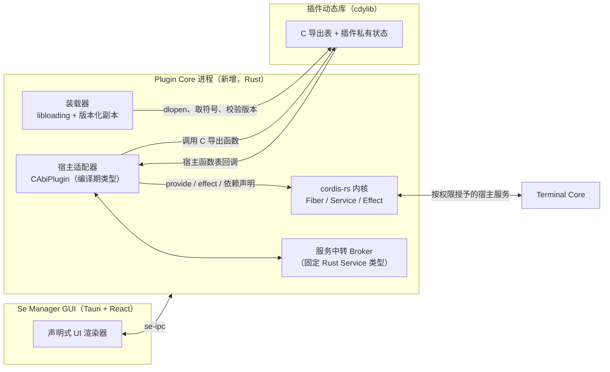

## 引用约定

本文所有源码引用都锁定到下列提交，格式为 `[代号] 路径:行号`。未在这些提交中读到的内容一律标注「待确认」。

| 代号 | 仓库 | 提交 | 许可证（已核实位置） |
|---|---|---|---|
| [R] | redoop/cordis-rust（Cordis 内核 + C-ABI 原型） | `c50d4ffd09a87c2cfea29300bfb93d60709f1241` | 工作区 `Cargo.toml:8` 写 `license = "MIT"`；仓库根目录**没有 LICENSE 文件**；`crates/plugin-contract/Cargo.toml:1-6`、`crates/dynhost/Cargo.toml:1-11` 未声明 license。原型代码的授权范围：待确认 |
| [D] | dshbox/cordis-rs（推荐内核） | `cd540033487f62c1b574bffd39befb717afb8a35` | `LICENSE:1` MIT；`Cargo.toml:21` `license = "MIT"` |
| [P] | bigfish1913/pi-rust（rpi） | `20476080231240c864181d3d928312de650e00c2` | 根目录有 LICENSE；`Cargo.toml:31` `license = "MIT"` |
| [T] | termul（本项目） | `e83cf9f3` | 不适用 |

本阶段只产出文档，不改源码，不复制 [R] 的任何代码。

## 问题

### 背景

termul 想要一个类似 VS Code 的插件系统：插件可以在运行时安装、启用、停用、升级，不必随主程序重新发版，并且插件既有后端逻辑，也能贡献界面。

termul 的宿主是 Rust（Tauri GUI 加若干常驻 Core 进程，见 [T] `src-tauri/crates/se-ipc/src/lib.rs:24-28` 的 `CoreRole { Gui, TerminalCore, AcpCore }`），没有 Node。DeepSeek Harness 和 TypeScript 版 pi 能直接加载插件，是因为它们运行在 Node 上；Rust 宿主要在运行时引入新代码，只能走动态库或内嵌运行时。

两个现成部件各解决一半问题：

- **rpi 的 C-ABI 动态库**解决「运行时把代码装进来」：插件是 `cdylib`，入口固定为 `rpi_plugin_register`（[P] `crates/rpi-plugin-sdk/src/lib.rs:1676`），宿主用 `libloading` 打开（[P] `crates/rpi-extensions/src/loader.rs:183`）。
- **cordis-rs**解决「装进来之后怎么管」：服务发布即登记撤回义务（[D] `crates/cordis-core/src/service.rs:802`），卸载按 LIFO 清理（[D] `crates/cordis-core/src/fiber/mod.rs:819`），缺依赖时停在 Pending（[D] `crates/cordis-core/src/fiber/mod.rs:921`）。但它**没有任何动态装载设施**：explorer 在 [D] 全部 `*.rs/*.toml/*.md` 中检索 `dylib|libloading|cdylib|extern "C"|abi_stable|ffi`，0 命中。

### 为什么组合比单用任一方更好

| 能力 | 仅 rpi（C-ABI） | 仅 cordis-rs | 组合 | 组合 + 独立 Plugin Core 进程 |
|---|---|---|---|---|
| 运行时装载新插件，不重新发版 | 能（[P] `loader.rs:183`） | 不能（无动态设施，见上） | 能 | 能 |
| 停用后自动撤回插件注册的服务和副作用 | 待确认：rpi 有关闭流程（[P] `loader.rs:85-128`），是否自动撤回全部注册未核实 | 能（[D] `service.rs:802`、`fiber/mod.rs:819`） | 能，由宿主侧适配器代为登记 | 能 |
| 依赖等待与级联停用 | 没有对应机制（未在 [P] 中找到，待确认） | 能（[D] `fiber/mod.rs:921`、`service.rs:310-319`） | 能 | 能 |
| 版本协商 | 有：ABI 版本 4 + `struct_size`（[P] `rpi-plugin-sdk/src/lib.rs:1673`、`1598`） | 不涉及 | 沿用 rpi 设计 | 沿用 rpi 设计 |
| 插件回调宿主能力 | 能：注册函数拿到 `*const PluginApi`（[P] `rpi-plugin-sdk/src/lib.rs:1970`） | 不涉及 | 需要自定义宿主函数表 | 同左 |
| 插件 panic 隔离 | 部分：注册时 `catch_unwind`（[P] `loader.rs:145`） | 不涉及 | 需在每个 FFI 边界补齐 | 同左 |
| 插件段错误、abort 隔离 | 不能，同进程 | 不涉及 | 不能 | **能**：只有 Plugin Core 退出，终端和界面不受影响 |
| 以后增加 WASM 等加载方式 | 要另起一套 | 可以 | 再写一个适配器，插件生命周期模型不变 | 同左 |
| 服务的类型安全 | 无（C 层只有字节） | 强：名字绑定 `TypeId`（[D] `service.rs:134`、`795`） | 宿主内强类型，跨边界只有字节 | 同左 |

结论：组合方案让「装载方式」成为可替换的一层，同时拿到 cordis 的自动撤回和依赖收敛；再放进独立进程，可以补上原生插件最大的风险（崩溃带垮宿主）。

## 方案

一句话：新增一个常驻 **Plugin Core 进程**，内部以 dshbox/cordis-rs 为生命周期内核，用一个编译期存在的适配器类型把每个 C-ABI 动态库包装成 cordis 插件；C-ABI 的版本协商、panic 防护、函数表设计参照 rpi，生命周期语义参照 redoop 原型的「宿主实现框架、插件只做计算」。

## 架构说明

### 三者职责

| 部件 | 负责 | 不负责 |
|---|---|---|
| 插件动态库 | 只做计算；持有自己的私有状态；在 `teardown` 里释放私有状态 | 不链接 cordis、不链接 tokio、不直接注册服务 |
| 宿主适配器 | 装载与版本校验；把 C 导出包装成 cordis 插件；代插件调用 `provide`、`effect`；把字节结果转成宿主侧类型；在 FFI 边界捕获 panic、做超时 | 不解释插件业务逻辑 |
| cordis-rs 内核 | 依赖等待、启动、停用级联、LIFO 清理、服务撤回 | 不知道动态库存在 |

### 为什么 `provide`、`effect`、撤回放在宿主侧

[R] 的契约在文件头写明原因（`crates/plugin-contract/src/lib.rs:1-10`）：`cdylib` 会静态链接一份自己的依赖副本，两份 tokio 的线程局部运行时句柄互不相通，插件侧任何框架调用都会触发 "no reactor running"；所以反转 API，**宿主实现框架，插件只计算**。适配器也明确所有框架语义都在宿主侧完成（[R] `crates/dynhost/src/main.rs:4-6`）。

这对 [D] 同样成立，而且 [D] 有更硬的约束：`Context` 是纯 Rust 句柄，不能跨 FFI；服务必须是实现了 `Service` 的 Rust 类型（[D] `service.rs:134`），C 侧无法直接构造。

### 数据流（启用一个插件）

1. 装载器把插件复制成版本化副本后 `dlopen`（副本策略参照 [P] `docs/extensions/authoring.md:332`、`358`），读取导出表并校验版本。
2. 一条 JSON 配置选出适配器：[D] 的 `PluginResolver::resolve` 能把 JSON 行映射成已封装的插件（[D] `crates/cordis-loader/src/resolver.rs:74-80`）。
3. 适配器的 `prepare` 完成符号解析与校验，`apply` 里调用插件的 `setup`，再由宿主代为 `provide` 和登记清理。
4. 内核按依赖收敛：依赖齐全才 `apply`，缺失则停在 Pending。

## 接口契约

### 原型 [R] 的 C 导出（已核实）

`#[repr(C)] pub struct PluginExports`（[R] `crates/plugin-contract/src/lib.rs:14-31`）：

| 字段 | 签名 | 语义 | 位置 |
|---|---|---|---|
| `abi_version` | `u32` | 不兼容变更时递增，宿主拒绝不匹配 | `:16-17` |
| `name` | `unsafe extern "C" fn(out_buf: *mut u8, cap: usize, out_len: *mut usize)` | 把显示名写入调用方缓冲区，无返回状态 | `:19-20` |
| `setup` | `unsafe extern "C" fn() -> *mut usize` | 分配插件私有状态，返回不透明句柄；返回 null 表示初始化失败 | `:22-24` |
| `produce` | `unsafe extern "C" fn(handle: *mut usize, out_buf: *mut u8, cap: usize, out_len: *mut usize) -> i32` | 生成服务值字节，返回状态码 | `:26-27` |
| `teardown` | `unsafe extern "C" fn(handle: *mut usize)` | 释放私有状态，每次成功 `setup` 恰好调用一次 | `:29-30` |

- 接口版本：`pub const ABI_VERSION: u32 = 1`（`:33`）。
- 导出符号：插件以 `#[no_mangle] pub static cordis_plugin_exports: PluginExports` 导出（[R] `crates/greeter-plugin/src/lib.rs:51-58`）。
- 版本协商：宿主取符号（[R] `dynhost/src/main.rs:63`），`assert!` 非空（`:65`），`assert_eq!` 版本严格相等（`:66-67`）。只有「完全相等」一种结果，失败直接 panic，没有范围协商，也没有 `struct_size`。
- 缓冲区约定：辅助函数 `write_out` 在超出容量时返回 `false`（[R] `plugin-contract/src/lib.rs:36-45`），示例插件此时让 `produce` 返回 `-1`（[R] `greeter-plugin/src/lib.rs:33-37`）。宿主侧缓冲区固定为名字 128 字节（[R] `dynhost/src/main.rs:69`）、服务值 512 字节（`:92`），没有「先问长度再分配」的协议。

### 本项目 ABI v1 草案（设计，未实现）

在 [R] 的最小契约上，按 [P] 的成熟做法补齐以下几点。具体字段名与布局待确认，需在 PoC 中定稿：

1. **版本加尺寸**：导出表首字段为 `struct_size`，另有 `abi_version`；宿主按尺寸判断哪些尾部槽位可用，缺少的能力当作不支持（参照 [P] `rpi-plugin-sdk/src/lib.rs:1592-1598`、`1673`）。
2. **宿主函数表**：注册函数接收宿主提供的只读函数表指针，插件通过它调用宿主能力（参照 [P] `rpi-plugin-sdk/src/lib.rs:1970`）。[R] 没有这一层，插件不能回调宿主。
3. **声明式元数据**：插件在装载阶段一次性给出名称、依赖的服务名列表、提供的服务名列表。原因是 [D] 的 `name()`、`inject()` 只在封装时取值一次（explorer 引用 [D] `plugin.rs:328-330`、`342-344`），`apply` 中不能追加依赖。
4. **可变长度结果**：结果字节由「宿主分配、插件填充」或「插件分配、宿主调用插件的释放函数」二选一，消除 [R] 的固定 512 字节上限。方案选择待确认。
5. **错误与 panic**：每个导出函数返回状态码；插件 SDK 用宏在每个 `extern "C"` 入口内部 `catch_unwind`（参照 [P] `rpi-plugin-sdk/src/lib.rs:1947-1970` 的 `export_plugin!`）；宿主侧再包一层（参照 [P] `loader.rs:145`）。
6. **超时**：每个回调设预算，超时后宿主停止等待并把插件标记为失败（参照 [P] `docs/extensions/lifecycle.md:11-15`；该文档写明超时**不会强制终止**插件代码）。

### 宿主侧服务注册与撤回

**原型 [R] 的做法**（`dynhost/src/main.rs:82-108`）：

1. `apply` 先调用 `setup`，句柄为 null 时返回错误（`:85-88`）。
2. 在 `ctx.effect("greeter greeting", …)` 里调用 `produce`，把字节转成 `String`（`:91-93`，转换见 `:41-49`，使用 `from_utf8_lossy`）。
3. `effect_ctx.provide("greeting", greeting)` 由宿主发布服务（`:94`）。
4. 返回一个调用 `teardown` 的清理器（`:96-103`）。注释写明清理器回调进库里只做纯清理，库侧不存在 cordis 或 tokio 类型（`:96-97`）。

[R] 内核里，`provide` 本身就登记一个撤回清理器：撤回时同步删除实现并通知依赖者，从而驱动级联停用（[R] `crates/cordis/src/service.rs:76-81`、`127-143`）。

**迁移到 [D] 时的差异**：

| 点 | [R] 内核 | [D] 内核 |
|---|---|---|
| 插件 trait | `pub trait Plugin: Send + Sync + 'static`，`inject() -> Vec<Injection>`，`resolve_config(&Value)`（[R] `crates/cordis/src/plugin.rs:57-75`），可以 `Arc<dyn Plugin>` | 非对象安全：关联类型加 `impl Future` 返回（[D] `plugin.rs:114`、`158-162`）；唯一公开构造器 `PreparedPlugin::from_input<P: Plugin>`（[D] `plugin.rs:341`），封装 trait 为 `pub(crate)`（[D] `plugin.rs:192`） |
| 服务值 | `Arc<dyn Any + Send + Sync>`，按字符串名存放（[R] `service.rs:85`） | `Service` 带 `const NAME: &'static str`（[D] `service.rs:134`），名字永久绑定一个 `TypeId`（[D] `service.rs:190-194`、`795`） |
| 撤回 | `provide` 登记撤回清理器（[R] `service.rs:127-143`） | 同样是 `provide` 时压入的清理义务（[D] `service.rs:802-813`） |

由此得出 [D] 下的两条设计约束（推论，PoC 中验证）：

- **适配器必须是一个编译期类型**（例如 `CAbiPlugin`），它的 `Input` 携带运行时句柄；动态库在 `prepare`（[D] `plugin.rs:139`，同步、准入之前）中完成解析。
- **插件不能各自定义新的服务类型**。服务名是类型上的常量，运行时无法为每个插件生成新名字。插件之间的服务需要经过一个固定类型的**服务中转 Broker**（宿主提供的一个 `Service`，内部按字符串名登记插件提供的能力），或改走事件。Broker 的具体设计待确认。

## 生命周期

| 阶段 | 原型 [R] 的行为（已核实） | 本项目方案 |
|---|---|---|
| 装载 | `Library::new` 后包装成 `ForeignPlugin`（[R] `dynhost/src/main.rs:123-124`）；`Exports` 持有 `Arc<Library>` 保证代码映射存活（`:26-32`） | 版本化副本后 `dlopen`；`struct_size` 加版本校验失败时拒绝装载而不是 panic |
| 依赖等待 | 消费者声明 `Injection::from("greeting")`（`:136`），在插件提供前停在 Pending（注释 `:131-132`）；示例中消费者先于插件启动（`:133` 早于 `:149`），随后两者都 `join` 成功（`:150-151`）并断言插件为 Active（`:152`） | 由插件元数据生成 `inject` 列表（[D] `plugin.rs:78`、`130`）；Pending 判定见 [D] `fiber/mod.rs:921-927` |
| 启动 | `apply` 内 `setup`、`produce`、`provide`（`:85-94`）；[R] 内核在插件进入 Active 后重新广播其服务，让等待中的依赖者复查（[R] `crates/cordis/src/fiber.rs:516-533`） | 同左，`apply` 只做宿主侧登记 |
| 停用与级联 | 示例先 `fiber.dispose()` 再 `consumer.dispose()`（`:155-156`）；内核侧撤回清理器同步通知依赖者（[R] `service.rs:139-141`），依赖者卸载后若缺依赖则收敛为 Pending（[R] `fiber.rs:463-470`）。**示例没有断言插件停用后消费者的状态**，级联行为只在内核代码中可见，原型未演示，未运行验证 | [D] 的级联：撤回产生漂移并重查依赖者（[D] `service.rs:310-319`、`334-335`），依赖者清理后回到 Pending，服务重新出现时自动重新 `apply`（explorer 引用 [D] `fiber/inertia.rs:305-311`） |
| 卸载清理 | 清理器 LIFO 执行（[R] `fiber.rs:346-365`）；启动失败时回滚已登记的清理器（[R] `fiber.rs:536-539`） | LIFO（[D] `fiber/mod.rs:819`），单个清理失败不影响后续（explorer 引用 [D] `fiber/mod.rs:810-814`、`826-833`）；插件 `teardown` 用 `effect_sync`（[D] `effect.rs:450`）登记进同一清理日志 |
| 动态库释放 | 从不 `dlclose`：`std::mem::forget(lib)`（[R] `dynhost/src/main.rs:161-163`） | 同样不真正卸载；升级 = 停用旧版加装载新副本（rpi 在关闭失败时也保留库到进程结束，[P] `loader.rs:96-107`） |

## 风险与未决问题

### 原型 [R] 未覆盖或有缺陷的部分

1. **类型与所有权**：跨边界只有调用方缓冲区里的字节（[R] `plugin-contract/src/lib.rs:2-3`、`36-45`）；插件私有状态是不透明句柄，归插件所有（`:22-23`）；宿主把字节按 UTF-8 宽松解码成 `String` 再发布（[R] `dynhost/src/main.rs:48`、`94`），消费者按 `String` 取用（`:138`）。结构化数据（JSON 或其他编码）的约定：待确认。
2. **`setup` 成功但 `produce` 失败会泄漏**：`produce` 出错时 `?` 在清理器创建之前返回（[R] `dynhost/src/main.rs:93`、`98-103`），`teardown` 不会被调用，违反契约「每次成功 `setup` 恰好调用一次 `teardown`」（[R] `plugin-contract/src/lib.rs:29`）。这是读代码得出的结论，未运行验证。
3. **没有 panic 防护**：[R] 的 `dynhost` 和 `plugin-contract` 中没有任何 `catch_unwind`（检索结果为空）；装载失败用 `assert!` 直接 panic（[R] `dynhost/src/main.rs:65`、`67`）。
4. **线程安全靠约定**：`unsafe impl Send/Sync for Exports`、`unsafe impl Send for Handle`（[R] `dynhost/src/main.rs:21-24`、`56-59`），正确性取决于插件自身线程安全，宿主没有强制。
5. **配置未传入插件**：`apply` 忽略 `_config`（[R] `dynhost/src/main.rs:82`）；`ForeignPlugin` 没有重写 `inject`，插件无法声明依赖。
6. **插件撤回与 `teardown` 的先后顺序**：外层 effect 与内层 `provide` 各自登记清理器，二者在清理日志中的先后待确认（取决于外层 effect 何时入日志，未核实）。示例中服务值是复制出来的 `String`，顺序不影响正确性；若服务值引用插件内存则必须先撤回再 `teardown`。

### 方案层面的风险

7. **同进程原生代码没有沙箱**：插件拥有 Plugin Core 进程的全部权限。缓解：独立进程加按能力授权的宿主函数表；但能力授权只能约束「通过宿主函数表」的调用，插件自己发起的系统调用无法拦截。
8. **段错误、abort 会带走 Plugin Core**：需要 Core 级重启与插件状态恢复，参照 termul 现有 Core 的复用与替换决策（[T] `src-tauri/src/core/launcher.rs:303`）。具体恢复语义待确认。
9. **超时不能强制终止插件代码**（[P] `docs/extensions/lifecycle.md:15`），一个卡死的回调会占住线程直到进程退出。
10. **内存随升级次数增长**：动态库从不释放（[R] `dynhost/src/main.rs:161-163`；[P] `loader.rs:132-146` 每次装载还会有意保留一份函数表）。
11. **cordis-rs 处于 1.0 之前**：[D] 自述公开 API 在 1.0 前仍可能变化（[D] `README.md:391-401`，explorer 引用），`cordis-core` 已发布 53 个版本。需锁定版本并在 termul 内包一层自己的接口。
12. **[D] 的静态类型约束**：服务名绑定类型，插件间服务必须走 Broker（见「接口契约」），Broker 设计待确认。
13. **macOS 签名与库验证**：termul 仓库中只有 `src-tauri/Info.plist`，没有 entitlements 文件；发布流水线用 `APPLE_CERTIFICATE` 签名（[T] `.github/workflows/release.yml:209-215`、`255-260`）。正式版是否启用 Hardened Runtime 的库验证、会不会拒绝加载未签名或他人签名的动态库：待确认。若会拒绝，第三方原生插件不可行，只能走后续的 WASM 适配器。
14. **[R] 原型代码许可证**：只有工作区 `Cargo.toml:8` 的 MIT 声明，无 LICENSE 文件，`plugin-contract`、`dynhost` 未声明 license。若要引用其代码，先由维护者决定；本方案只借鉴思路。
15. **工具链**：[D] 为 edition 2024、MSRV 1.88（[D] `Cargo.toml:19-20`）；termul 为 edition 2021、`rust-version = "1.89"`（[T] `src-tauri/Cargo.toml:6`、`8`）。edition 不同的 crate 可以互相依赖，MSRV 满足；实际编译未验证。
16. **Windows**：已装载的 DLL 不能被覆盖，必须用版本化副本（[P] `docs/extensions/authoring.md:358`）。

## 落地改造点与分阶段计划

### termul 中的改造点（均为计划，本阶段不改）

| 改造点 | 当前位置（已核实） | 计划改动 |
|---|---|---|
| Core 角色 | [T] `src-tauri/crates/se-ipc/src/lib.rs:24-37`（`CoreRole`、`endpoint_name`） | 增加 `PluginCore` 与对应 endpoint 名；新旧 GUI 与 Core 之间的兼容性待确认 |
| Core 启动与参数 | [T] `src-tauri/src/core/launcher.rs:845-847`（角色到命令行参数）、`927-929`（角色到组件） | 增加 `--plugin-core` 等映射 |
| Core 脱离 GUI 会话、版本替换决策 | [T] `launcher.rs:95-112`、`118`、`303` | Plugin Core 复用同一套启动、接管与替换逻辑 |
| 发布组件清单 | [T] `scripts/release/component-build-inputs.json:17-19`、`25`、`41`、`73`、`81` | 增加 `pluginCore` 组件，使其参与组件身份与按需替换 |
| 新 crate | 不存在 | `se-plugin-abi`（零依赖 C 契约与 SDK 宏）、`se-plugin-host`（装载器、`CAbiPlugin` 适配器、Broker）；命名待确认 |
| 界面 | 不存在 | GUI 侧声明式 UI 渲染与 IPC 命令；具体组件位置待确认 |

### 分阶段计划

| 阶段 | 内容 | 验收 | 粗估 |
|---|---|---|---|
| P0 技术验证 | 仓库外或独立实验 crate：[D] `cordis-core` + `libloading` + ABI v1 草案；一个示例插件 | 自动化测试覆盖：依赖等待、停用级联、重新启用、`setup` 失败回滚、插件 panic 不跨边界、版本不匹配被拒 | 2 到 3 天 |
| P1 Plugin Core | 新 Core 角色、装载器、适配器、Broker、宿主函数表 v1、一个内置示例插件 | Core 可被 GUI 启动和接管；插件启停不重启 Core；Core 崩溃后自动恢复 | 2 到 3 周 |
| P2 能力与界面 | 命令、设置、声明式 UI（面板、状态栏）、终端事件订阅（异步、限流） | 示例插件贡献一个面板并响应终端事件；颜色跟随主题 | 2 到 3 周 |
| P3 分发 | 安装、更新、版本化副本、签名与库验证策略 | macOS、Windows 各装一个第三方插件（取决于风险 13 的结论） | 持续 |
| P4 可选 | WASM 适配器，复用同一生命周期模型 | 同一插件接口下 WASM 插件可启停 | 待定 |

工期为一人全职的粗估，误差可能在 ±50%。

## 备选

1. **只用 cordis-rs，插件全部编译进程序**：最简单、最安全，但新增插件必须发版，不满足需求。
2. **只用 rpi 式 C-ABI，不引入 cordis**：装载能力有了，但依赖收敛和自动撤回要自己写。
3. **WASM 插件**：有沙箱、跨平台、可安全卸载，但插件能力受限于宿主开放的接口，插件作者基本只能用 Rust。可作为 P4 的第二种装载方式。
4. **内嵌 JS 引擎**（如 pi_agent_rust 的 QuickJS 方案）：生态大，但沙箱需自建，且与「不做 TS/JS 插件」的决定冲突。
5. **用 [R] 的内核替代 [D]**：[R] 的插件 trait 对象安全、服务按字符串名存放，更适合动态插件；但仓库只有 9 星、2026-08-25 之后无提交、无 LICENSE 文件。

## 不做

- 本阶段不修改任何源码，不复制 [R] 或 [P] 的代码。
- 不做 TypeScript、JavaScript 插件。
- 不承诺真正卸载动态库；升级通过装载新副本实现。
- 不在 P0 到 P2 做第三方插件市场、付费分发或远程安装。
- 不把插件放进 Terminal Core 或 GUI 进程。
